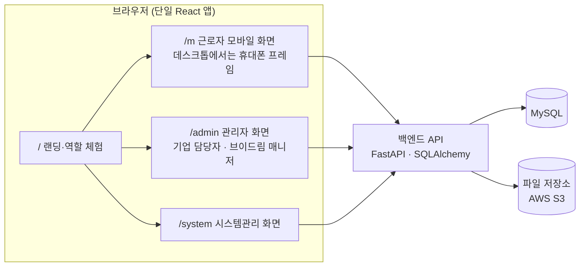

# my-vdream 프로젝트 개요

| 항목 | 내용 |
|---|---|
| 프로젝트명 | my-vdream (가칭) |
| 문서 버전 | v2.0 (포트폴리오 2주 범위, 2026-11-19 작성) |
| 작성일 | 2026-11-19 |
| 문서 성격 | 프로젝트의 목적, 사용자, 필요 기능, 핵심 업무 규칙을 정의하는 최상위 문서 |
| 프로젝트 성격 | 브이드림 개발자 채용 지원용 포트폴리오. 2주 안에 개발하고 AWS에 배포한 뒤 이력서에 링크로 첨부한다 |
| 기반 문서 | v1.0 전체 설계(`archive/my-vdream-v1-full-scope/`)에서 이력서 어필에 필요한 기능만 남겨 재작성. 제외 내역은 12장. 2026-11-19 CI/CD·브랜치 전략 추가 |
| 관련 문서 | [요구기능정의서](02-functional-requirements.md) · [DB 테이블 정의서](03-database-schema.md) · [기술스펙정의서](04-tech-spec.md) · [개발 계획](05-development-plan.md) |

---

## 1. 배경

### 1.1 장애인 재택근무란

상시근로자 50명 이상인 기업은 장애인 의무고용률을 지켜야 하고, 미달하면 장애인고용부담금을 낸다. 그러나 사무실 출근이 어려운 장애인이 많고, 기업도 장애인이 수행할 직무를 설계하고 관리해 본 경험이 부족해 채용이 쉽지 않다. 재택근무는 이동 제약을 없애 다양한 장애 유형의 근로자가 집에서 일할 수 있게 하고, 기업은 의무고용을 이행하면서 실제 업무 성과를 얻는다.

브이드림은 이런 장애인 재택근무를 전문으로 운영하는 회사다. 구직자를 모집해 기업과 연결하고, 채용 뒤에도 근태, 업무, 상담을 플랫폼으로 관리한다. 이 프로젝트는 브이드림의 운영 방식을 벤치마킹하여 근로자, 기업, 운영사(브이드림)가 함께 쓰는 재택근무 관리 시스템을 작은 규모로 구현한다.

### 1.2 이 프로젝트의 목표 (포트폴리오 관점)

| 보는 사람 | 확인하고 싶은 것 | 이 프로젝트가 보여줄 것 |
|---|---|---|
| 브이드림 인사·개발 담당자 | 브이드림의 도메인을 이해하는가 | 채용 → 근태 → 업무 → 업무일지 → 상담의 재택근무 생애주기를 역할별 화면으로 구현. 브이드림·브이매치·브이워크의 실제 브랜드 컬러(민트 `#2EB6AA`, 바이올렛 `#584C9D`)를 그대로 써서 한눈에 "브이드림 서비스처럼" 보이게 함. 기업이 한국장애인고용공단에 고용 사실을 증빙하는 **월간 장애인 고용 리포트**를 근태·업무일지에서 자동으로 만들어 재택 장애인 고용의 실제 업무 흐름을 이해하고 있음을 보여줌 |
| | 백엔드와 프론트엔드를 끝까지 만들 수 있는가 | FastAPI + MySQL + React를 AWS에 배포하고 HTTPS 링크로 바로 열어 볼 수 있음 |
| | 사용자(장애인 근로자)를 고려하는가 | 접근성 기본(스크린리더 레이블, 키보드, 대비, 큰 버튼, 다크모드)을 지킨 모바일 화면 |
| | 코드 품질 | 타입 힌트, 테스트, OpenAPI에서 생성한 클라이언트 타입, 정리된 README |
| | 협업 도구를 실제로 쓰는가 (채용 공고 명시) | `main` 보호 + feature 브랜치 + PR 기반 작업, GitHub Actions CI(PR마다)와 CD(머지 시 자동 배포), 이슈·릴리스 이력 |

링크를 클릭한 사람이 **설치 없이, 로그인 정보를 외우지 않고, 1분 안에** 세 역할의 화면을 둘러볼 수 있어야 한다. 이것이 모든 범위 판단의 기준이다.

### 1.3 현재의 문제 (도메인)

| 영역 | 현재 방식 | 문제 |
|---|---|---|
| 채용 | 기업 → 운영사 → 근로자 순으로 조건, 이력서, 면접 일시, 합격 여부를 사람이 전달 | 전달 지연, 누락, 기록 부재 |
| 근태 | 재택 근로자가 메신저나 전화로 출퇴근을 보고 | 기록이 남지 않음 |
| 업무 배정 | 기업 담당자가 메일, 메신저로 업무를 전달 | 기한과 진행 상황 추적이 어려움 |
| 업무일지 | 수기, 엑셀, 메신저 보고 | 기업과 운영사가 같은 기록을 보기 어려움 |
| 상담 기록 | 운영사 매니저가 개별 기록 | 이력 추적이 어려움 |

---

## 2. 목적

1. 근로자, 기업, 브이드림 세 당사자가 **하나의 시스템에서 같은 정보를 공유**하는 흐름을 구현한다.
2. 근로자용 화면은 **모바일 크기의 웹 화면**으로 만들고, 데스크톱 브라우저에서는 휴대폰 프레임 안에 보여준다. 접근성 기본 원칙(레이블, 키보드, 대비, 큰 버튼, 다크모드)을 지킨다.
3. 채용부터 근태, 업무, 퇴사까지 **생애주기를 끝까지 동작**하게 만든다. 깊이보다 흐름의 완결성을 우선한다.
4. **2주 안에 AWS에 배포**한다. 2주를 넘기는 기능은 넣지 않는다.
5. 화면의 색은 **브이드림 사이트에서 실제로 쓰는 브랜드 컬러**를 가져온다. 근로자 화면은 브이워크·브이매치의 민트, 관리자 화면은 본사의 바이올렛을 주색으로 하여 보는 사람이 브이드림의 서비스 군으로 느끼게 한다. 로고와 워드마크는 쓰지 않는다.

---

## 3. 용어 정의

| 용어 | 정의 |
|---|---|
| 근로자 (WK) | 브이드림을 통해 기업에 채용되어 재택으로 근무하는 장애인 근로자. 모바일 화면 사용자 |
| 기업 | 근로자를 고용하는 회사. 모든 기업은 브이드림과 협력한다 |
| 기업 담당자 (CM) | 기업 안에서 채용, 근태, 업무 배정, 업무일지 확인을 담당하는 직원. 관리자 화면 사용자 |
| 브이드림 (운영사) | 장애인 재택근무 서비스를 운영하는 회사. 시스템에 하나만 존재한다 |
| 브이드림 매니저 (VM) | 브이드림에서 기업과 근로자를 담당하는 직원. 관리자 화면 사용자 |
| 담당 매니저 | 특정 기업을 전담하도록 지정된 브이드림 매니저. 해당 기업 관련 알림을 받는다 |
| 시스템관리자 (SA) | 기업, 계정, 공지사항, 데모 데이터를 관리하는 운영자. 시스템관리 화면 사용자 |
| 구직 등록 | 근로자가 공고에 지원할 수 있는 상태(구직중)로 바꾸는 것 |
| 채용 공고 (공고) | 기업이 작성하고 브이드림이 승인하여 게시하는 모집 공고 |
| 입사지원 (지원) | 근로자가 공고에 지원하는 행위와 서류심사, 면접, 합격, 출근일 확정까지의 기록 |
| 재직 | 근로자가 특정 기업에 입사하여 근무 중인 상태 또는 그 기록 |
| 근로계약 | 재직에 대해 체결한 계약. 재직당 1건이며 수정으로 관리한다 |
| 업무 | 기업 담당자가 근로자에게 배정하는 일의 단위. 제목, 내용, 우선순위, 기한 |
| 업무일지 | 근로자가 근무일마다 작성하는 하루 업무 기록. 업무 항목, 수행 내용, 소요 시간, 산출물 파일, 특이사항 |
| 업무일지 확인 | 기업 담당자가 제출된 업무일지를 검토하여 확인하거나 보완을 요청하는 것 |
| 상담보고서 | 브이드림 매니저가 근로자와 상담한 뒤 고정 양식으로 작성하는 보고서. 브이드림만 열람 |
| 쪽지 | 사용자 간 비실시간 메시지. 역할과 소속에 따라 보낼 수 있는 상대가 정해져 있다 |
| 월간 장애인 고용 리포트 | 기업 담당자가 선택한 기간 동안 자기 기업 장애인 근로자의 월별 근태·업무 실적과 고용 인정 참고 판정을 정리한 문서. 한국장애인고용공단 제출 증빙용 |
| 월 소정근로시간 | 주 소정근로시간 × 365 ÷ 7 ÷ 12. 장애인 고용 인정 기준(월 60시간)의 비교 대상 |
| 중증 2배수 인정 | 월 소정근로시간 60시간 이상인 중증장애인 1명을 고용 인원 2명으로 인정하는 제도 |
| 데모 계정 | 역할별로 미리 만들어 둔 체험용 계정. 랜딩 페이지의 버튼 한 번으로 로그인된다 |
| 휴대폰 프레임 | 데스크톱 브라우저에서 근로자 화면을 휴대폰 모양 테두리 안에 모바일 크기로 보여주는 레이아웃 |

---

## 4. 사용자 종류 및 역할

| 사용자 | 약어 | 소속 | 사용 화면 | 주요 역할 |
|---|---|---|---|---|
| 장애인 근로자 | WK | 개인 (재직은 한 기업만) | 모바일 화면 (`/m`) | 이력서 작성, 구직 등록, 공고 조회 및 지원, 출퇴근 체크, 휴가 신청, 업무 상태 변경, 업무일지 작성·제출, 퇴사 신청, 재직 기업 담당자·담당 매니저에게 쪽지 |
| 기업 담당자 | CM | 기업 (1개) | 관리자 화면 (`/admin`) | 공고 작성, 지원자 심사, 면접 및 합격 처리, 근로계약 수정, 업무 배정, 업무일지 확인, 근태 확인 및 정정, 휴가 승인, 통계 및 엑셀, 자기 기업 근로자·담당 매니저에게 쪽지, 월간 장애인 고용 리포트 |
| 브이드림 매니저 | VM | 브이드림 | 관리자 화면 (`/admin`) | 구직자 관리, 이력서 대리 작성, 공고 작성·승인·마감, 채용 진행 입력, 퇴사 승인, 근태·업무·업무일지 조회, 상담보고서 작성, 모든 사용자에게 쪽지(단체 발송 포함) |
| 시스템관리자 | SA | 브이드림 | 시스템관리 화면 (`/system`) | 기업 등록, 담당 매니저 지정, 계정 관리, 공지사항, 데모 데이터 초기화 |

### 4.1 권한 요약

| 영역 | WK | CM | VM | SA |
|---|---|---|---|---|
| 이력서 | 본인 작성·수정 | 지원자·재직 근로자 열람 | 전체 열람·대리 작성 | - |
| 구직 등록 | 등록·해제 | - | 조회·대리 등록·해제 | - |
| 채용 공고 | 전체 조회·지원 | 작성·마감 | 작성·승인·반려·마감 | - |
| 채용 진행 | 본인 현황 조회·지원 취소 | 입력 | 입력 | - |
| 근로계약 | 본인 조회 | 수정 | 수정·조회 | - |
| 근태 | 출퇴근 체크·본인 조회 | 전체 조회·정정·엑셀 | 전체 조회·엑셀 | - |
| 휴가 | 신청·본인 조회 | 연차 부여·승인·반려·조회 | 조회 | - |
| 업무 | 본인 업무 조회·시작·완료 | 배정·수정·취소·재오픈 | 조회 | - |
| 업무일지 | 작성·제출·본인 조회 | 확인·보완 요청·조회·엑셀 | 조회·엑셀 | - |
| 상담보고서 | 불가 | 불가 | 작성·수정·조회 | - |
| 퇴사 | 신청 | 통보 조회 | 승인·반려 | - |
| 쪽지 | 재직 기업 담당자·담당 매니저에게 발신, 수신 | 자기 기업 근로자·담당 매니저에게 발신, 수신 | 전체에게 발신(단체 포함), 수신 | 수신만 |
| 월간 장애인 고용 리포트 | - | 자기 기업 생성·엑셀·인쇄 | - | - |
| 공지사항 | 조회 | 조회 | 조회 | 작성·수정·삭제 |
| 기업·계정 | - | - | 기업 조회 | 전체 |
| 데모 운영 | - | - | - | 데이터 초기화 |

---

## 5. 시스템 구성

| 구성 요소 | 사용자 | 설명 |
|---|---|---|
| 백엔드 API | 전체 | 단일 FastAPI 서버. 인증, 비즈니스 로직, 엑셀 생성, 파일 업로드. 스케줄러나 배치 없음 |
| 프론트엔드 | 전체 | 단일 React 앱. 경로에 따라 랜딩, 근로자 모바일 화면, 관리자 화면, 시스템관리 화면을 제공 |
| 데이터베이스 | - | MySQL (EC2의 Docker 컨테이너) |
| 파일 저장소 | - | AWS S3. 증명사진, 업무일지 산출물 |
| 배포 | - | AWS EC2 1대에 Docker Compose(Caddy, api, web, mysql). Caddy가 HTTPS 자동 발급 |

백엔드는 Python(FastAPI), 프론트엔드는 TypeScript(React)로 작성한다. 모바일 앱(Flutter)은 만들지 않고 근로자 화면을 모바일 크기 웹으로 대체한다. 상세 기술 구성은 [기술스펙정의서](04-tech-spec.md) 참고.

---

## 6. 조직 구조와 핵심 업무 규칙

### 6.1 조직 관계

1. 브이드림은 시스템에 **하나만 존재하는 운영 조직**이며, 기업은 여러 곳이 시스템을 사용한다.
2. 기업마다 **담당 매니저**를 지정할 수 있으며(선택), 담당 매니저는 해당 기업 관련 알림을 받는다. 담당 매니저가 없는 기업의 알림은 모든 브이드림 매니저에게 간다.
3. 브이드림 매니저의 조회 범위는 **브이드림 전체**다. 목록 화면은 "내 담당 기업" 필터를 제공한다.
4. 근로자는 **한 번에 하나의 기업에서만 재직**할 수 있다.
5. 한 기업에는 담당자 계정이 여러 개 있을 수 있다.

### 6.2 계정 규칙

1. 모든 계정은 **시스템관리자가 만든다**. 자가 회원가입은 없다.
2. 데모 계정(역할별 1개 이상)은 시드 데이터로 만들어지며 랜딩 페이지에서 버튼 한 번으로 로그인된다. 데모 계정의 비밀번호는 변경할 수 없다.
3. 로그인은 아이디와 비밀번호다. 최초 비밀번호 변경 강제, 생체인증, 로그인 잠금은 두지 않는다.
4. 근로자 계정을 만들면 비어 있는 이력서 프로필이 함께 생성된다.

### 6.3 구직 등록 규칙

1. 근로자가 모바일 화면에서 구직 등록을 켜면 즉시 **구직중** 상태가 되고 브이드림 매니저에게 알림이 간다.
2. 브이드림 매니저가 대리로 구직 등록할 수 있다. 근로자에게 알림이 간다.
3. 공고에 지원하려면 구직중 상태여야 한다. 구직 안 함 상태로 지원을 시도하면 안내 후 등록과 지원을 한 흐름으로 처리한다.
4. 출근 시작일이 입력되어 재직 기록이 만들어지는 시점에 구직 등록은 해제된다.
5. **재직 중에는 지원할 수 없다.** 재직 중 조기 이직 지원과 조건부 퇴사 승인(v1.0 6.5)은 범위에서 제외한다.

### 6.4 채용 규칙

1. 공고는 기업 담당자 또는 브이드림 매니저가 작성한다. 기업 담당자가 작성한 공고는 브이드림 매니저가 승인해야 게시되고, 반려 시 사유와 함께 돌아간다. 브이드림 매니저가 작성한 공고는 즉시 게시된다.
2. 공고 마감, 서류심사, 면접 일시, 합격 여부, 출근 시작일은 기업 담당자와 브이드림 매니저 **모두** 입력할 수 있다.
3. 공고의 채용 조건은 직무 분야, 주요 업무 내용, 근무 형태(재택, 혼합), 근무 요일과 시간, 주 소정근로시간, 급여, 복리후생, 지원 장비, 필요 역량, 근무 시작 예정일, 계약 기간, 모집 인원으로 구성한다.
4. 지원 시 근로자의 이력서가 기업에 공개된다. 기업은 자기 공고의 지원자 이력서만 볼 수 있다.
5. 면접은 화상 또는 방문으로 기록만 한다. 화상 링크는 안내 사항에 문자로 적으며 실제 화상 연결 기능은 만들지 않는다.
6. 최종 합격 후 출근 시작일이 입력되면 입사 예정 상태의 재직 기록과 공고 조건을 복사한 근로계약 1건이 생성된다. 재직 상태는 저장하지 않고 오늘 날짜와 출근 시작일·퇴사일로 계산한다. 출근 시작일이 오늘 이후면 입사 예정, 그렇지 않으면 재직중이며, 재직중이 되면 근태와 업무일지 기능이 열린다.
7. 근로자는 최종 결과 입력 전까지 지원을 취소할 수 있다. 입사 포기 처리는 범위에서 제외한다.

### 6.5 근태 규칙

1. 근태는 기업 담당자가 관리한다. 브이드림 매니저는 **동일한 정보를 조회**하고 엑셀로 내려받을 수 있지만 정정이나 승인은 할 수 없다.
2. 출퇴근은 근로자가 모바일 화면의 버튼으로 기록한다. 시각은 서버 시각을 사용한다. 위치와 IP는 저장하지 않는다.
3. 지각은 근로계약의 소정 근로 시작 시각 이후 출근, 조퇴는 소정 근로 종료 시각 이전 퇴근으로 자동 판정한다. 근로자는 사유를 적을 수 있고, 기업 담당자는 기록을 정정할 수 있다.
4. 근무일은 근로계약의 근무 요일이다. 공휴일과 기업 휴무일 관리는 범위에서 제외한다.
5. 결근은 저장하지 않고 조회 시점에 계산한다. 오늘 이전의 근무일 중 출근 기록과 승인된 휴가가 없는 날이 결근이다. 기업 담당자가 정정으로 결근 기록을 직접 남길 수도 있다.
6. 휴가는 근로자가 신청하고 기업 담당자가 승인 또는 반려한다. 연차 부여일수는 기업 담당자가 입력하며 시스템이 사용분을 차감한다. 반차는 0.5일로 계산하며 출퇴근 판정 기준은 조정하지 않는다.
7. 퇴근 체크 시 그날 업무일지가 제출되지 않았으면 작성을 안내한다. 퇴근 자체는 막지 않는다.

### 6.6 업무 규칙

1. 업무는 기업 담당자가 근로자 한 명에게 건별로 배정한다. 제목, 내용, 우선순위(낮음, 보통, 높음), 기한(선택)으로 구성한다. 배정 시 근로자에게 알림이 간다.
2. 업무 상태는 배정됨, 진행중, 완료, 취소 네 가지다. 진행중과 완료는 근로자가, 취소와 완료된 업무의 재오픈은 기업 담당자가 처리한다.
3. 기한이 지난 미완료 업무는 목록에서 "기한 초과"로 표시한다. 별도 알림은 두지 않는다.
4. 업무 댓글, 첨부파일, 보류 상태는 범위에서 제외한다.

### 6.7 업무일지 규칙

1. 근로자는 출근한 근무일마다 업무일지를 1건 작성한다. 업무일지는 여러 항목으로 구성되며 각 항목은 배정된 업무를 선택하거나 업무명을 직접 입력하고, 수행 내용과 소요 시간(분)을 적는다. 하루 요약, 특이사항, 산출물 파일을 함께 넣을 수 있다.
2. 작성 중에는 임시저장 상태이며, 제출하면 기업 담당자에게 알림이 간다. 제출 후 기업 담당자가 확인하기 전까지는 수정하여 다시 제출할 수 있다.
3. 기업 담당자는 제출된 업무일지를 **확인**하거나 사유를 적어 **보완 요청**한다. 보완 요청된 업무일지는 근로자가 수정하여 다시 제출한다.
4. 브이드림 매니저는 업무일지를 조회하고 엑셀로 내려받을 수 있지만 확인이나 보완 요청은 할 수 없다.
5. 업무일지가 제출되면 항목에 연결된 업무의 누적 소요 시간이 갱신된다.

### 6.8 상담 규칙

1. 상담보고서는 **고정 양식**이다. 상담 일시, 상담 방식(전화, 화상, 방문, 메신저), 상담 주제, 상담 내용, 근로자 상태 점수(1~5), 후속 조치로 구성한다. 설문 양식 빌더와 버전 관리는 범위에서 제외한다.
2. 상담보고서는 브이드림 매니저만 볼 수 있다. 근로자와 기업 담당자는 볼 수 없다.

### 6.9 퇴사 규칙

1. 근로자가 모바일 화면에서 퇴사 예정일과 사유를 넣어 신청하면 담당 매니저에게 알림이 간다. 승인 전에는 철회할 수 있다.
2. 브이드림 매니저가 승인하면 재직 기록에 퇴사일이 설정되고 기업 담당자에게 알림이 간다. 반려하면 근로자에게 알림이 간다.
3. 퇴사일이 지나면 재직 상태는 계산상 퇴사가 되어 근태, 업무, 업무일지는 조회만 가능하다. 남은 미완료 업무는 "재직 종료"로 표시되고 기업 담당자가 필요하면 취소한다.

### 6.10 알림 규칙

1. 알림은 **앱 내 알림 목록**으로만 제공한다. 푸시 알림은 두지 않는다.
2. 화면 상단에 미읽음 개수를 표시하고 10초마다 갱신한다.

### 6.11 공지사항 규칙

1. 공지사항은 시스템관리자만 작성, 수정, 삭제한다.
2. 공개 범위는 모두 공개, 브이드림 매니저 대상, 기업 대상, 근로자 대상 네 가지다.

### 6.12 데모 운영 규칙

1. 랜딩 페이지(`/`)는 프로젝트 소개, 역할별 체험 버튼, 기술 스택, GitHub 링크를 보여준다. 체험 버튼을 누르면 해당 역할의 데모 계정으로 바로 로그인된다.
2. 근로자 화면은 데스크톱 브라우저(가로 600px 이상)에서 휴대폰 프레임 안에 모바일 크기로 표시되고, 실제 모바일 기기에서는 화면을 가득 채운다. 프레임 옆에 "새 창으로 열기" 버튼을 두어 휴대폰 크기의 팝업 창으로도 볼 수 있게 한다.
3. 시드 데이터는 기업 3곳, 매니저 2명, 근로자 8명, 다양한 상태의 공고와 지원, 최근 3개월의 근태·업무·업무일지, 상담보고서, 쪽지를 포함한다. 링크를 연 사람이 빈 화면을 보지 않게 한다.
4. 시스템관리자는 "데모 데이터 초기화" 버튼으로 시드 상태로 되돌릴 수 있다. 자동 초기화는 두지 않는다.
5. 매일 실행되는 배치(스케줄러)는 이 프로젝트 범위 밖이다. 날짜에 따라 달라지는 상태(재직 상태, 결근, 공고 마감 예정일 경과)는 모두 조회 시점에 계산한다.

### 6.13 쪽지 규칙

1. 쪽지는 사용자 간 비실시간 메시지다. 실시간 채팅은 두지 않는다.
2. 보낼 수 있는 상대는 역할과 소속으로 정해진다 (요구기능정의서 부록 A.13).
   - 근로자 → 재직 기업의 기업 담당자, 재직 기업의 담당 매니저
   - 기업 담당자 → 자기 기업의 재직 근로자, 자기 기업의 담당 매니저
   - 브이드림 매니저 → 모든 사용자 (특정 기업 전체, 전체 근로자, 전체 기업 담당자, 전체 사용자 단체 발송 포함)
3. 근로자와 기업 담당자가 매니저에게 보낼 때는 **자기 기업을 담당하는 매니저 한 명만** 대상이 된다. 쪽지 쓰기 화면의 대상 목록에도 그 매니저만 보이며, 다른 매니저는 검색으로도 나오지 않는다.
4. 대상 목록은 서버가 계산해서 내려주고, 발송 API도 같은 규칙으로 다시 검사한다. 화면을 우회한 요청은 거부된다.
5. 재직 기록이 없는 근로자(구직자)와 시스템관리자는 받기만 한다. 답장도 같은 규칙을 따른다.
6. 읽음은 수신자별로 기록되고 발신자는 보낸 쪽지함에서 읽은 사람 수를 본다. 삭제는 각자의 함에서만 숨긴다.
7. 미읽음 쪽지 수는 알림 미읽음 수와 함께 10초마다 갱신된다. 쪽지는 알림 목록에 쌓지 않는다.

### 6.14 월간 장애인 고용 리포트 규칙

1. 기업이 장애인 고용을 한국장애인고용공단에 인정받으려면 고용 사실과 근로 실적을 증빙해야 한다. 재택 근로자는 사업장에서 근무 모습을 확인할 수 없으므로 출퇴근 기록과 업무 기록이 핵심 증빙이 된다. 이 리포트는 그 증빙을 시스템 데이터로 만든다.
2. 기업 담당자가 시작 월과 종료 월(최대 12개월)을 고르면, 그 기간 각 월에 자기 기업에 재직한 장애인 근로자 전원(퇴사자 포함)의 월별 리포트를 만든다.
3. 내용은 기업 요약, 근로자 × 월 리포트(인적사항, 근로조건, 근태 실적, 업무 실적, 고용 인정 참고, 확인란), 일자별 근로 기록 부록이다 (요구기능정의서 부록 A.14).
4. 고용 인정 참고 판정은 공단 기준을 따른다. 월 소정근로시간 60시간 이상이면 인정 대상이고, 중증장애인은 60시간 이상이면 2명으로 인정(2배수), 60시간 미만이어도 월 유급 근로일수 16일 이상이면 1명으로 인정한다. 이 판정은 참고 값이며 최종 인정은 공단 심사로 정해진다는 문구를 모든 출력물에 넣는다.
5. 증빙이 약한 데이터(장애정보 미입력, 퇴근 미기록, 업무일지 미제출·미확인)는 리포트를 만들기 전에 경고로 보여주고 해당 화면으로 바로 이동해 고치게 한다.
6. 리포트는 요청할 때마다 계산하며 저장하지 않는다. 생성 일시를 출력물에 찍어 어느 시점의 데이터인지 알 수 있게 한다.
7. 출력은 화면 미리보기, 엑셀, A4 인쇄(브라우저의 PDF 저장)다. 공단 e신고 시스템 자동 제출은 하지 않는다.
8. 기업 담당자만 자기 기업 리포트를 만든다. 근로자, 매니저, 시스템관리자는 접근할 수 없다.

---

## 7. 필요 기능 요약

| 카테고리 | 주요 기능 | 상세 |
|---|---|---|
| 공통 | 로그인, 데모 로그인, 알림 목록, 공지사항 조회, 테마 전환 | [요구기능정의서 1~3장](02-functional-requirements.md) |
| 시스템관리 | 기업 등록, 담당 매니저 지정, 계정 관리, 공지사항, 데모 데이터 초기화 | 4장 |
| 근로자 이력 관리 및 입사지원 | 이력서(기본정보, 장애정보, 재택근무 환경, 희망 직무, 학력, 경력), 구직 등록, 공고 작성·승인·게시·마감, 지원, 서류심사, 면접, 합격, 출근일 확정, 근로계약, 퇴사 | 5~10장 |
| 근태관리 (휴가 포함) | 출퇴근 체크, 지각·조퇴·결근 판정, 근태 정정, 연차 부여, 휴가 신청·승인, 월별 현황, 엑셀 | 11~12장 |
| 업무 관리 | 업무 배정·수정·취소·재오픈, 시작·완료, 목록·상세 | 13장 |
| 업무일지 | 일지 작성·제출, 확인·보완 요청, 산출물 첨부, 미제출 현황, 월별 통계, 엑셀 | 14장 |
| 브이드림 상담 | 고정 양식 상담보고서 작성·조회 | 15장 |
| 쪽지 | 역할·소속별 수신 대상 제한, 받은·보낸 쪽지함, 읽음 확인, 답장, 매니저 단체 발송 | 16장 |
| 월간 장애인 고용 리포트 | 기간 선택, 기업 요약, 근로자 × 월 리포트, 일자별 부록, 고용 인정 참고 판정, 데이터 경고, 엑셀, 인쇄·PDF | 17장 |
| 대시보드 및 데모 | 역할별 대시보드, 랜딩 페이지, 휴대폰 프레임 | 18~19장 |
| 접근성 및 UI | 테마, 큰 글씨, 스크린리더 레이블, 키보드, 큰 버튼 | 20장 |

---

## 8. 핵심 업무 흐름

### 8.1 채용 흐름

1. 시스템관리자가 기업, 기업 담당자, 브이드림 매니저, 근로자 계정을 만들고 기업에 담당 매니저를 지정한다 (시드로 제공).
2. 근로자가 이력서를 작성하고(또는 매니저가 대리 작성) 구직 등록을 켠다.
3. 기업 담당자가 공고를 작성하고 승인을 요청한다. 브이드림 매니저가 승인하면 게시된다. 매니저가 직접 작성한 공고는 즉시 게시된다.
4. 근로자가 공고를 보고 지원한다. 구직 안 함 상태면 등록 후 지원된다.
5. 기업 담당자(또는 매니저)가 서류심사 결과를 입력하고, 면접 일시와 방식을 입력하고, 면접 결과를 입력한다. 각 단계마다 근로자에게 알림이 간다.
6. 출근 시작일을 입력하면 입사 예정 재직 기록과 근로계약이 생성된다. 실제 계약 내용으로 수정한다.
7. 출근 시작일이 되면 재직 상태가 계산상 재직중이 된다. 구직 등록은 6단계에서 이미 해제되어 있다.
8. 공고를 마감한다.

### 8.2 일일 근무 흐름

1. 기업 담당자가 업무를 배정한다. 근로자에게 알림이 간다.
2. 근로자가 모바일 화면에서 출근 버튼을 누른다. 늦으면 지각으로 기록되고 사유를 적을 수 있다.
3. 홈에서 오늘 업무를 확인하고 시작한 업무를 진행중으로 바꾼다.
4. 업무일지에 항목을 추가하며 수행 내용과 소요 시간을 적고 산출물을 첨부한다.
5. 끝낸 업무는 완료로 표시한다. 기업 담당자에게 알림이 간다.
6. 업무일지를 제출하고 퇴근 버튼을 누른다. 이르면 조퇴로 기록된다.
7. 기업 담당자가 업무일지를 확인하거나 보완을 요청한다. 브이드림 매니저는 동일하게 조회한다.

### 8.3 휴가 흐름

1. 근로자가 휴가 종류, 기간, 사유를 넣어 신청한다.
2. 기업 담당자에게 알림이 가고, 승인 또는 반려한다.
3. 승인된 날짜의 근태는 휴가로 기록되고 연차는 차감된다.

### 8.4 상담 흐름

1. 브이드림 매니저가 근로자와 상담한 뒤 고정 양식의 상담보고서를 작성한다.
2. 근로자 상세 화면에서 상담 이력과 상태 점수 추이를 본다.

### 8.5 퇴사 흐름

1. 근로자가 퇴사 예정일과 사유를 넣어 신청한다.
2. 담당 매니저가 승인하면 기업 담당자에게 알림이 간다.
3. 퇴사일이 지나면 재직 상태가 계산상 퇴사가 된다.

### 8.6 쪽지 흐름

1. 근로자가 더보기 → 쪽지 → 쓰기를 누른다. 대상 목록에는 재직 기업의 기업 담당자들과 그 기업의 담당 매니저 한 명만 보인다.
2. 기업 담당자를 골라 보낸다. 담당자의 관리자 화면 상단 봉투 배지가 10초 안에 늘어난다.
3. 기업 담당자가 쪽지를 열면 읽음 처리되고, 근로자의 보낸 쪽지함에 "1명 중 1명 읽음"이 표시된다. 담당자가 답장한다.
4. 매니저는 "특정 기업 전체"로 공지성 쪽지를 보내고, 보낸 쪽지함에서 읽은 사람 수를 확인한다.

### 8.7 월간 장애인 고용 리포트 흐름

1. 기업 담당자가 관리자 화면 → 고용 리포트에서 시작 월과 종료 월을 고른다.
2. 데이터 경고가 있으면 먼저 보여준다 (예: "김OO, 11월 14일 퇴근 미기록"). 필요하면 근태 정정이나 업무일지 확인을 마친다.
3. 리포트를 생성해 기업 요약과 근로자 × 월 리포트를 화면에서 확인한다.
4. 엑셀로 내려받거나 인쇄 화면에서 PDF로 저장해 공단 제출 자료에 첨부한다.

---

## 9. 범위 제외

2주 포트폴리오 범위에서 다루지 않는다. v1.0 전체 설계에 있던 항목은 "확장 계획"으로 이력서와 README에 적는다.

| 항목 | 이유 |
|---|---|
| Flutter 모바일 앱 | 빌드·스토어 변수가 크고 설치 없이 볼 수 없음. 모바일 크기 웹으로 대체 |
| 푸시 알림(FCM), 기기 토큰 | 보는 사람이 확인할 수 없음. 앱 내 알림 목록으로 대체 |
| 생체인증, 리프레시 토큰 회전, 로그인 잠금, 최초 비밀번호 변경 강제, 플랫폼 헤더 검사 | 데모 체험을 방해하고 눈에 보이지 않음 |
| 매일 실행되는 배치·스케줄러 전체 (재직 전환, 결근 생성, 공고 자동 마감, 자동 데모 초기화, 리마인더) | 프로젝트 범위 밖. 날짜 의존 상태는 조회 시점 계산으로 대체 |
| 근무 확인(임의 시각 자기 확인), 휴게 기록, 위치·IP 저장 | 분 단위 처리가 필요하고 체험 중 확인이 어려움 |
| 재직 중 지원, 조기 이직 조건부 승인, 입사 포기 | 가장 복잡한 상태 전이이나 화면에서 드러나지 않음 |
| 근로계약 갱신·이력, 유효 계약 조회, 계약서 파일 첨부 | 재직당 계약 1건으로 단순화 |
| 공휴일, 기업 휴무일 관리 | 근무일 = 계약 근무 요일로 단순화 |
| 상담 설문 양식 빌더, 양식 버전 관리 | 고정 양식으로 대체 |
| 업무 댓글, 업무 첨부파일, 업무 보류, 상태 변경 이력 테이블 | 핵심 흐름 밖 |
| 자격증, 채용 진행 메모, 재직 직접 등록 | 시드 데이터로 대체 |
| 시스템 설정 키-값과 변경 이력 | 설정할 항목이 없음 |
| 계약 만료 알림, 업무 기한 알림, 새 공고 알림, 공지 알림 | 화면 표시로 대체 |
| 휴가·상담 엑셀 | 근태와 업무일지 엑셀만 제공 |
| 실제 화상 상담·면접 연결 | 링크 문자 기록만 |
| 급여 계산, HRM 연동, 전자서명, 실시간 채팅, 다국어, 교육 콘텐츠, 성과 평가 | v1.0부터 제외. 사용자 간 소통은 쪽지로 제공 |
| 쪽지 첨부파일, 쪽지 실시간 전송(웹소켓) | 10초 폴링과 본문 텍스트로 충분 |
| 한국장애인고용공단 e신고 자동 제출, 공단 공식 서식 그대로 출력, 급여대장·원천징수 자료 연동, 서버 PDF 생성 | 리포트는 근태·업무 실적 증빙 자료까지. 임금 자료는 기업 급여 시스템이 담당. PDF는 브라우저 인쇄로 저장 |
| Nginx + 인증서 수동 발급, 다중 인스턴스, RDS, ECS·CodePipeline | Caddy 자동 HTTPS와 EC2 1대, GitHub Actions 배포로 단순화 |

---

## 10. 비기능 요구사항 요약

| 영역 | 요구사항 |
|---|---|
| 접근성 | 근로자 화면은 시맨틱 HTML과 ARIA 레이블, 키보드 조작, 명도 대비 4.5:1 이상, 주요 버튼 높이 56px 이상, 본문 18px 이상. 테마는 OS 설정을 따르고 다크·라이트 전환 가능. 색상 외에 텍스트로 상태 구분. 자동 닫힘 알림 금지 |
| 브랜드 | 브이드림 본사·브이매치·브이워크 사이트에서 수집한 실제 색(민트 `#2EB6AA`·`#0B7A71`, 바이올렛 `#584C9D`, 다크 `#0C0918`, 상태색)을 토큰으로 두고 전 화면에서 사용. 흰 글자가 미달하는 민트 위에는 진한 글자를 써서 브랜드 색과 대비 기준을 동시에 만족 (기술스펙 6.2.1) |
| 보안 | 비밀번호 bcrypt 해시, JWT 인증, 역할과 소속 범위에 따른 접근 제어, HTTPS. 상담보고서와 이력서는 권한 검사 |
| 데모 안정성 | 시드 데이터로 빈 화면 방지. 시스템관리자 버튼으로 데모 데이터 초기화. 데모 계정 비밀번호 변경 불가 |
| 운영 | AWS EC2 1대, Docker Compose, Caddy 자동 HTTPS, S3 파일 저장. `main` 머지 시 GitHub Actions가 이미지를 빌드해 GHCR에 올리고 EC2에 자동 배포 |
| 유지보수 | 백엔드 Python 타입 힌트, 프론트 TypeScript strict. OpenAPI에서 프론트 타입 생성. README에 아키텍처, 실행 방법, 데모 계정, 확장 계획 |

---

## 11. 설계 과정에서 결정한 사항 (검수 포인트)

아래는 요구사항에서 직접 확인되지 않아 작성자가 결정한 사항이다.

| 번호 | 결정 사항 | 근거 |
|---|---|---|
| 1 | 프론트엔드를 하나의 React 앱으로 만들고 경로(`/`, `/m`, `/admin`, `/system`)로 역할 화면을 나눈다 | 앱 세 개를 따로 빌드·배포할 시간이 없음. 배포 단위 1개 |
| 2 | 근로자 화면은 데스크톱에서 CSS 휴대폰 프레임(390×844) 안에 렌더링하고, 가로 600px 미만에서는 전체 화면으로 렌더링한다 | 브라우저는 열려 있는 탭의 크기를 스크립트로 바꿀 수 없음(기술스펙 7.1). 프레임이 가장 확실한 방법 |
| 3 | 휴대폰 프레임 옆에 "새 창으로 열기" 버튼을 두고 `window.open`으로 390×844 팝업을 연다 | 클릭으로 연 팝업은 크기 지정이 가능. 보조 수단 |
| 4 | 랜딩 페이지에 역할별 데모 로그인 버튼을 두고 비밀번호 입력 없이 로그인한다 | 보는 사람이 1분 안에 체험 |
| 5 | 데모 데이터 초기화는 시스템관리자 버튼으로만 한다 | 매일 실행 배치는 범위 밖. 제출 기간 중 하루 한 번 직접 누른다 |
| 6 | 인증은 액세스 토큰 1개(24시간)로 단순화하고 리프레시 토큰을 두지 않는다 | 데모 체험에 충분. 토큰 회전 구현 생략 |
| 7 | 재직 중 지원을 막는다 | 조기 이직 조건부 승인 흐름 제거 |
| 8 | 근로계약은 재직당 1건이며 수정으로 관리한다 | 갱신·이력·유효 계약 조회 제거 |
| 9 | 업무 상태는 배정됨, 진행중, 완료, 취소 네 가지로 줄인다 | 보류 제거 |
| 10 | 상담보고서를 고정 양식(일시, 방식, 주제, 내용, 상태 점수 1~5, 후속 조치)으로 만든다 | 설문 빌더는 2주 안에 만들 가치가 낮음. 점수 추이 그래프는 보여줄 수 있음 |
| 11 | 스케줄러를 두지 않는다. 재직 상태(입사 예정·재직중·퇴사), 결근, 공고 마감 예정일 경과는 저장하지 않고 오늘 날짜로 계산한 파생 값으로 응답한다 | 매일 실행 배치는 범위 밖. 계산 방식은 배치 없이도 항상 정확하고 테스트가 쉬움 |
| 12 | 알림은 앱 내 목록과 10초 폴링으로만 제공한다 | 푸시 인프라 제거 |
| 13 | 파일 업로드는 서버가 받아 S3에 올리는 단순 방식으로 한다 (사전 서명 URL 없음) | 구현 단순. S3 사용은 유지해 AWS 경험을 보여줌 |
| 14 | 엑셀은 근태와 업무일지 두 종류만 제공한다 | 다운로드 기능 시연에는 충분 |
| 15 | 테마는 OS 설정을 따르고 다크·라이트 전환만 둔다. 고대비 전용 테마는 제외 | 시간 |
| 16 | 공지 공개 범위를 네 가지(모두, 브이드림, 기업, 근로자)로 줄인다 | 조합 범위 제거 |
| 17 | 백엔드 SQLAlchemy는 동기 세션 + PyMySQL을 사용한다 | 비동기 드라이버 이슈를 피하고 구현 속도 우선. FastAPI가 스레드풀에서 처리 |
| 18 | 배포는 EC2 1대에 Docker Compose(Caddy, api, web, mysql)로 하고 도메인을 하나 구입해 Caddy로 HTTPS를 자동 발급한다 | 인증서 수동 관리 제거. IP 주소 링크는 인상이 나쁨 |
| 19 | 브이드림 단일 운영 조직, 담당 매니저, 구직 상태 토글, 재직 생성 시 구직 해제 등 v1.0의 조직·채용 규칙은 유지한다 | 변경 요구 없음 |
| 20 | v1.0 전체 설계 문서를 `archive/`에 보존하고 README의 확장 계획에서 참조한다 | 설계 역량도 함께 보여줌 |
| 21 | 브랜치는 GitHub Flow(`main` + 짧은 feature 브랜치, PR 필수, squash merge)로 운영하고, CI/CD는 GitHub Actions 두 개(PR마다 CI, 머지 시 GHCR 푸시 후 SSH 배포)로 구성한다 | 채용 공고가 CI/CD와 브랜치 활용을 평가. 설정 파일 2개로 가장 적게 세팅하면서 Actions·Deployments 이력이 남음 |
| 22 | 브랜드 컬러는 브이드림 세 사이트의 CSS 토큰과 계산된 스타일에서 직접 수집한 값(민트 `#2EB6AA`, 딥민트 `#0B7A71`, 바이올렛 `#584C9D`, 다크 `#0C0918`, 상태색 4종)을 그대로 쓴다. 근로자 화면은 민트, 관리자 화면은 바이올렛 주색. 로고·심볼은 쓰지 않는다 | 벤치마킹 대상의 색을 쓰면 도메인 이해를 즉시 전달. 브이워크식 흰 글자 민트 버튼은 대비 2.0~2.5:1로 AA 미달이라 버튼 배경만 딥민트로 조정 |
| 23 | 쪽지 대상 규칙은 부록 A.13 표 하나로 정의하고, 화면의 대상 목록 API와 발송 API가 같은 함수를 쓴다 | 사용자 요구: 근로자·기업 담당자는 자기 기업 담당 매니저에게만, 목록에도 그 매니저만. 화면과 서버 규칙이 어긋나지 않게 |
| 24 | 재직 기록이 없는 근로자(구직자)와 시스템관리자는 쪽지를 받기만 한다. 답장에도 같은 규칙을 적용한다 | 요구된 발신 경로에 없는 조합. 답장 예외를 두면 "담당 매니저에게만" 규칙이 깨짐 |
| 25 | 매니저 단체 발송은 발송 시점 대상자로 수신 행을 만든다(fan-out) | 수신자별 읽음·삭제 관리가 단순. 데모 규모에서 성능 문제 없음 |
| 26 | 쪽지는 알림 목록에 넣지 않고 별도 봉투 배지로 표시하며, 미읽음 수는 알림과 한 요청으로 10초마다 받는다 | 배지 중복 방지, 폴링 요청 1개 |
| 27 | 월간 장애인 고용 리포트는 저장하지 않고 요청 시 계산한다. 출력물에 생성 일시를 넣는다 | 배치 없음 원칙. 근태 정정 후 다시 만들면 최신 데이터 반영 |
| 28 | 고용 인정 판정은 월 60시간, 중증 2배수, 중증 60시간 미만 월 16일 기준을 참고 값으로 표시하고 공단 심사가 최종이라는 문구를 넣는다 | 공단 기준을 반영하되 법적 판정으로 오해되지 않게 |
| 29 | 유급 근로일수는 출근일 + 승인 연차(전일)로 추정하고 "급여대장으로 확정" 안내를 붙인다 | 급여 데이터가 없어 정확한 임금지급 기초일수 계산 불가 |
| 30 | 최저임금 비교는 환경 변수 `MINIMUM_WAGE_HOURLY`(기본 10,320원, 2026년)로 하고 참고 표시만 한다 | 연도별 변경. 고용장려금 요건 사전 점검용 |
| 31 | 리포트 PDF는 서버에서 만들지 않고 인쇄 전용 화면 + 브라우저 "PDF로 저장"으로 만든다 | 한글 폰트·PDF 라이브러리 세팅 시간 절약 |
| 32 | 리포트에 여러 달이 보이도록 시드 데이터를 최근 3개월로 늘리고, 주 12시간 계약 근로자와 중증·경증을 섞는다 | "제외 가능", "2배수" 판정이 데모에서 실제로 보이게 |
| 33 | 고용 리포트 표지를 위해 기업에 대표자명과 고용보험 사업장관리번호 컬럼을 추가한다 | 공단 제출 자료의 사업장 식별 정보 |

---

## 12. v1.0 대비 변경 요약

| 영역 | v1.0 (전체 설계) | v2.0 (포트폴리오 2주) |
|---|---|---|
| 근로자 클라이언트 | Flutter 앱 (iOS, Android) | React 모바일 크기 웹 + 데스크톱 휴대폰 프레임 |
| 프론트엔드 구성 | admin-web, system-web 별도 앱 + 공유 패키지 | 단일 React 앱, 경로로 분리 |
| 인증 | 액세스 + 리프레시 회전, 생체인증, 잠금, 플랫폼 헤더 | 액세스 토큰 1개, 데모 로그인 |
| 알림 | 앱 내 + FCM 푸시, 37개 이벤트 | 앱 내 목록만, 핵심 이벤트 |
| 채용 | 재직 중 지원, 조건부 퇴사 승인, 입사 포기, 메모 | 재직 중 지원 불가, 지원 취소만 |
| 계약 | 갱신·이력, 유효 계약 조회, 파일 | 재직당 1건 수정 |
| 근태 | 휴게, 위치·IP, 공휴일·휴무일, 근무 확인 | 출퇴근·지각·조퇴·결근, 정정 |
| 휴가 | 7종, 반차 판정 조정, 엑셀 | 연차·반차·병가·기타, 엑셀 없음 |
| 업무 | 보류, 댓글, 첨부, 이력, 기한 알림 | 배정·시작·완료·취소·재오픈, 기한 초과 표시 |
| 업무일지 | 동일 | 동일 (리마인더 제외) |
| 상담 | 설문 양식 빌더, 버전 | 고정 양식 |
| 배치 | 10종, 분 단위 포함 | 없음. 날짜 의존 상태는 조회 시 계산 |
| 배포 | Nginx, 다중 인스턴스 고려 | EC2 1대, Caddy, GitHub Actions CD(GHCR → SSH) |
| 테이블 수 | 36 | 23 |
| 기능 수 | 183 | 163 |
| 쪽지 | 없음 (채팅 제외) | 역할·소속 제한 쪽지, 매니저 단체 발송 |
| 고용 리포트 | 근태·시술 엑셀 | 월간 장애인 고용 리포트(공단 제출 증빙, 고용 인정 참고 판정) |
