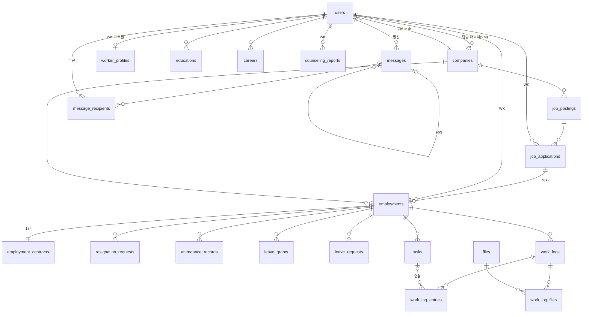

# my-vdream DB 테이블 정의서

| 항목 | 내용 |
|---|---|
| 문서 버전 | v2.0 (포트폴리오 2주 범위, 2026-11-19 작성) |
| 작성일 | 2026-11-19 |
| DBMS | MySQL 8.4 (InnoDB, utf8mb4) |
| ORM | SQLAlchemy 2.0 (동기 세션, PyMySQL), Alembic 마이그레이션 |
| 관련 문서 | [프로젝트 개요](01-project-overview.md) · [요구기능정의서](02-functional-requirements.md) · [기술스펙정의서](04-tech-spec.md) · [개발 계획](05-development-plan.md) |

## 공통 규칙

| 항목 | 규칙 |
|---|---|
| 테이블명 | snake_case 복수형. SQLAlchemy 모델은 PascalCase 단수형이며 `__tablename__`으로 연결 |
| 컬럼명 | snake_case. 모델 속성명도 동일 |
| 기본 키 | 모든 테이블 `id BIGINT UNSIGNED AUTO_INCREMENT` |
| 공통 컬럼 | 모든 테이블에 `created_at DATETIME(3) NOT NULL DEFAULT CURRENT_TIMESTAMP(3)`, `updated_at DATETIME(3) NOT NULL ON UPDATE CURRENT_TIMESTAMP(3)`. 아래 표에서는 생략. 예외는 비고에 적는다 |
| 소프트 삭제 | `deleted_at DATETIME(3) NULL`이 있는 테이블은 값만 채우고 조회에서 제외 |
| 시간 | DATETIME은 UTC로 저장. 업무 기준 날짜(`work_date` 등 DATE)는 Asia/Seoul 기준 |
| 열거형 | Python `enum.Enum`(문자열 값)으로 정의하고 `sqlalchemy.Enum(native_enum=True)`으로 MySQL ENUM 컬럼에 저장. 값 목록은 부록 A |
| 불리언 | `TINYINT(1)` |
| 금액 | `INT UNSIGNED` (원) |
| 외래 키 | 모두 실제 FK. 기본 `RESTRICT`, 종속 데이터(항목, 파일 연결)는 `CASCADE` |
| 사용자 참조 | `*_by`와 `worker_id`는 `users.id`를 참조 |
| 데모 초기화 | 데모 초기화는 모든 테이블을 TRUNCATE한 뒤 시드를 다시 넣는다. 별도 플래그 컬럼은 두지 않는다 |
| 날짜 파생 상태 | 재직 상태, 결근, 공고 마감 예정일 경과는 저장하지 않고 서비스 계층이 오늘 날짜로 계산한다. 배치가 없으므로 "어제 기준으로 갱신되어야 하는" 컬럼을 두지 않는다 |

## ERD 개요

## 테이블 목록

| 영역 | 테이블 | 설명 |
|---|---|---|
| 계정 및 공통 | users | 모든 사용자 계정 |
| | notifications | 사용자별 알림 |
| | announcements | 공지사항 |
| | files | 업로드 파일 메타데이터 |
| 조직 | companies | 기업 (담당 매니저 포함) |
| 이력서 | worker_profiles | 근로자 기본정보, 장애정보, 재택근무 환경, 희망 직무, 구직 상태 |
| | educations | 학력 |
| | careers | 경력 |
| 채용 | job_postings | 채용 공고 |
| | job_applications | 입사지원 및 채용 진행 |
| | resignation_requests | 퇴사 신청 |
| 재직 | employments | 재직 기록 |
| | employment_contracts | 근로계약 (재직당 1건) |
| 근태 및 휴가 | attendance_records | 일별 근태 |
| | leave_grants | 연도별 연차 부여 |
| | leave_requests | 휴가 신청 |
| 업무 | tasks | 배정 업무 |
| 업무일지 | work_logs | 일별 업무일지 |
| | work_log_entries | 업무일지 항목 |
| | work_log_files | 업무일지 산출물 파일 연결 |
| 상담 | counseling_reports | 상담보고서 (고정 양식) |
| 쪽지 | messages | 쪽지 본문 (발신 1건당 1행) |
| | message_recipients | 쪽지 수신자별 읽음·삭제 상태 |

총 23개 테이블. 스케줄러가 없으므로 실행 기록 테이블은 두지 않는다. 월간 장애인 고용 리포트는 기존 테이블에서 요청 시 계산하므로 별도 테이블이 없다.

---

## 1. 계정 및 공통

### 1.1 users

기업 담당자만 `company_id`가 채워진다. 데모 계정은 `is_demo = 1`이며 비밀번호 변경과 비활성화가 막힌다.

| 컬럼명 | 타입 | NULL | 키/제약 | 기본값 | 설명 |
|---|---|---|---|---|---|
| id | BIGINT UNSIGNED | N | PK, AI | | |
| login_id | VARCHAR(50) | N | UK | | 로그인 아이디 |
| password_hash | VARCHAR(255) | N | | | bcrypt 해시 |
| role | ENUM UserRole | N | IDX | | WORKER, COMPANY_MANAGER, VDREAM_MANAGER, SYSTEM_ADMIN |
| name | VARCHAR(50) | N | | | 이름 |
| phone | VARCHAR(20) | Y | | | |
| email | VARCHAR(100) | Y | | | |
| company_id | BIGINT UNSIGNED | Y | FK companies.id | | 기업 담당자의 소속 |
| status | ENUM UserStatus | N | | ACTIVE | ACTIVE, INACTIVE |
| is_demo | TINYINT(1) | N | | 0 | 데모 계정 여부 |
| last_login_at | DATETIME(3) | Y | | | |
| deleted_at | DATETIME(3) | Y | | | 소프트 삭제 |

인덱스: UK(login_id), IDX(role), IDX(company_id)

### 1.2 notifications

| 컬럼명 | 타입 | NULL | 키/제약 | 기본값 | 설명 |
|---|---|---|---|---|---|
| id | BIGINT UNSIGNED | N | PK, AI | | |
| user_id | BIGINT UNSIGNED | N | FK users.id, CASCADE | | 수신자 |
| type | VARCHAR(50) | N | | | 이벤트 코드 (요구기능정의서 부록 B) |
| title | VARCHAR(200) | N | | | |
| body | VARCHAR(1000) | N | | | |
| link_path | VARCHAR(200) | Y | | | 클릭 시 이동할 프론트 경로 (예: `/admin/work-logs/12`) |
| is_read | TINYINT(1) | N | | 0 | |
| read_at | DATETIME(3) | Y | | | |

인덱스: IDX(user_id, is_read, created_at). `updated_at` 없음.

### 1.3 announcements

| 컬럼명 | 타입 | NULL | 키/제약 | 기본값 | 설명 |
|---|---|---|---|---|---|
| id | BIGINT UNSIGNED | N | PK, AI | | |
| title | VARCHAR(200) | N | | | |
| content | TEXT | N | | | 본문 |
| audience | ENUM AnnouncementAudience | N | IDX | | ALL, VDREAM, COMPANY, WORKER |
| is_pinned | TINYINT(1) | N | | 0 | 상단 고정 |
| author_id | BIGINT UNSIGNED | N | FK users.id | | |
| deleted_at | DATETIME(3) | Y | | | 소프트 삭제 |

인덱스: IDX(audience, is_pinned, created_at)

### 1.4 files

| 컬럼명 | 타입 | NULL | 키/제약 | 기본값 | 설명 |
|---|---|---|---|---|---|
| id | BIGINT UNSIGNED | N | PK, AI | | |
| storage_key | VARCHAR(500) | N | UK | | S3 객체 키 |
| original_name | VARCHAR(255) | N | | | 원본 파일명 |
| mime_type | VARCHAR(100) | N | | | |
| size_bytes | BIGINT UNSIGNED | N | | | |
| purpose | ENUM FilePurpose | N | | | PROFILE_PHOTO, WORK_LOG_ATTACHMENT |
| uploaded_by | BIGINT UNSIGNED | N | FK users.id | | |

인덱스: UK(storage_key), IDX(uploaded_by). `updated_at` 없음.

---

## 2. 조직

### 2.1 companies

| 컬럼명 | 타입 | NULL | 키/제약 | 기본값 | 설명 |
|---|---|---|---|---|---|
| id | BIGINT UNSIGNED | N | PK, AI | | |
| name | VARCHAR(100) | N | | | 기업명 |
| business_registration_no | VARCHAR(20) | Y | | | |
| industry | VARCHAR(100) | Y | | | 업종 |
| address | VARCHAR(300) | Y | | | |
| phone | VARCHAR(20) | Y | | | |
| representative_name | VARCHAR(50) | Y | | | 대표자명 (고용 리포트 표지) |
| employment_insurance_no | VARCHAR(20) | Y | | | 고용보험 사업장관리번호 (고용 리포트 표지) |
| manager_id | BIGINT UNSIGNED | Y | FK users.id | | 담당 매니저 (VM). NULL이면 전체 매니저에게 알림. 근로자·기업 담당자의 쪽지 수신 대상 결정에도 사용 |
| status | ENUM OrgStatus | N | | ACTIVE | ACTIVE, INACTIVE |

인덱스: IDX(name), IDX(manager_id)

---

## 3. 이력서

### 3.1 worker_profiles

근로자 1명당 1행. 계정 생성 시 빈 행이 함께 생성된다. 구직 상태도 여기 둔다.

| 컬럼명 | 타입 | NULL | 키/제약 | 기본값 | 설명 |
|---|---|---|---|---|---|
| id | BIGINT UNSIGNED | N | PK, AI | | |
| user_id | BIGINT UNSIGNED | N | FK users.id, UK | | |
| birth_date | DATE | Y | | | |
| gender | ENUM Gender | Y | | | MALE, FEMALE |
| photo_file_id | BIGINT UNSIGNED | Y | FK files.id | | 증명사진 |
| address | VARCHAR(300) | Y | | | 거주지 |
| disability_type | ENUM DisabilityType | Y | | | 주 장애유형 |
| disability_type_secondary | ENUM DisabilityType | Y | | | 부 장애유형 |
| disability_degree | ENUM DisabilityDegree | Y | | | SEVERE, MILD |
| assistive_devices | VARCHAR(300) | Y | | | 사용 보조기기 |
| has_pc | TINYINT(1) | Y | | | |
| has_internet | TINYINT(1) | Y | | | |
| software_skills | VARCHAR(500) | Y | | | 사용 가능 소프트웨어 |
| work_environment_note | VARCHAR(500) | Y | | | |
| desired_job_fields | VARCHAR(200) | Y | | | JobField 코드 쉼표 구분 |
| skills | VARCHAR(1000) | Y | | | 보유 기술 |
| introduction | TEXT | Y | | | 자기소개 |
| job_seeking_status | ENUM JobSeekingStatus | N | IDX | NOT_SEEKING | NOT_SEEKING, SEEKING |
| job_seeking_changed_at | DATETIME(3) | Y | | | 마지막 상태 변경 시각 |

인덱스: UK(user_id), IDX(job_seeking_status)

### 3.2 educations

| 컬럼명 | 타입 | NULL | 키/제약 | 기본값 | 설명 |
|---|---|---|---|---|---|
| id | BIGINT UNSIGNED | N | PK, AI | | |
| worker_id | BIGINT UNSIGNED | N | FK users.id, CASCADE | | |
| start_date | DATE | N | | | |
| end_date | DATE | Y | | | 재학 중이면 NULL |
| institution | VARCHAR(100) | N | | | |
| type | ENUM EducationType | N | | | ELEMENTARY, MIDDLE, HIGH, UNIVERSITY, GRADUATE, VOCATIONAL |
| status | ENUM EducationStatus | N | | | ENROLLED, GRADUATED, DROPPED_OUT, COMPLETED |
| major | VARCHAR(100) | Y | | | |
| sort_order | INT | N | | 0 | |

인덱스: IDX(worker_id, sort_order)

### 3.3 careers

| 컬럼명 | 타입 | NULL | 키/제약 | 기본값 | 설명 |
|---|---|---|---|---|---|
| id | BIGINT UNSIGNED | N | PK, AI | | |
| worker_id | BIGINT UNSIGNED | N | FK users.id, CASCADE | | |
| start_date | DATE | N | | | |
| end_date | DATE | Y | | | |
| institution | VARCHAR(100) | N | | | |
| employment_type | ENUM CareerType | N | | | INTERN, TRAINEE, EMPLOYEE |
| duties | VARCHAR(500) | Y | | | |
| position | VARCHAR(50) | Y | | | |
| sort_order | INT | N | | 0 | |

인덱스: IDX(worker_id, sort_order)

---

## 4. 채용

### 4.1 job_postings

| 컬럼명 | 타입 | NULL | 키/제약 | 기본값 | 설명 |
|---|---|---|---|---|---|
| id | BIGINT UNSIGNED | N | PK, AI | | |
| company_id | BIGINT UNSIGNED | N | FK companies.id | | |
| title | VARCHAR(200) | N | | | |
| job_field | ENUM JobField | N | IDX | | 직무 분야 |
| main_duties | TEXT | N | | | 주요 업무 내용 |
| work_type | ENUM WorkType | N | | REMOTE | REMOTE, HYBRID |
| work_location | VARCHAR(300) | Y | | | 출근 장소 (혼합일 때) |
| work_days | VARCHAR(32) | N | | | MON,TUE,... |
| work_start_time | TIME | N | | | |
| work_end_time | TIME | N | | | |
| weekly_work_hours | DECIMAL(4,1) | N | | | 주 소정근로시간 |
| salary_type | ENUM SalaryType | N | | | MONTHLY, HOURLY |
| salary_amount | INT UNSIGNED | N | | | |
| benefits | TEXT | Y | | | |
| equipment_support | VARCHAR(500) | Y | | | 지원 장비 |
| requirements | TEXT | Y | | | 필요 역량·우대 |
| expected_start_date | DATE | N | | | 근무 시작 예정일 |
| contract_type | ENUM ContractType | N | | | FIXED_TERM, INDEFINITE |
| expected_end_date | DATE | Y | | | |
| headcount | INT | N | | 1 | |
| description | TEXT | Y | | | |
| deadline_date | DATE | Y | | | 경과 시 지원 거부 (상태는 바꾸지 않음) |
| status | ENUM JobPostingStatus | N | | DRAFT | DRAFT, PENDING_APPROVAL, REJECTED, PUBLISHED, CLOSED |
| author_type | ENUM PostingAuthorType | N | | | COMPANY, VDREAM |
| reject_reason | VARCHAR(500) | Y | | | |
| approved_by | BIGINT UNSIGNED | Y | FK users.id | | |
| approved_at | DATETIME(3) | Y | | | 게시 시각 |
| closed_at | DATETIME(3) | Y | | | |
| created_by | BIGINT UNSIGNED | N | FK users.id | | |

인덱스: IDX(company_id, status), IDX(status, job_field), IDX(status, deadline_date)

### 4.2 job_applications

| 컬럼명 | 타입 | NULL | 키/제약 | 기본값 | 설명 |
|---|---|---|---|---|---|
| id | BIGINT UNSIGNED | N | PK, AI | | |
| job_posting_id | BIGINT UNSIGNED | N | FK job_postings.id | | |
| worker_id | BIGINT UNSIGNED | N | FK users.id | | |
| status | ENUM ApplicationStatus | N | | APPLIED | 부록 A |
| applied_at | DATETIME(3) | N | | | |
| document_result_at | DATETIME(3) | Y | | | |
| interview_at | DATETIME(3) | Y | | | 면접 일시 |
| interview_method | ENUM InterviewMethod | Y | | | VIDEO, VISIT |
| interview_location | VARCHAR(500) | Y | | | 장소 또는 화상 링크(문자) |
| interview_note | VARCHAR(500) | Y | | | 안내 사항 |
| final_result_at | DATETIME(3) | Y | | | |
| start_date | DATE | Y | | | 출근 시작일 |
| employment_id | BIGINT UNSIGNED | Y | FK employments.id, UK | | 생성된 재직 기록 |
| cancelled_at | DATETIME(3) | Y | | | |
| last_updated_by | BIGINT UNSIGNED | Y | FK users.id | | 마지막 단계 입력자 |

인덱스: UK(job_posting_id, worker_id), IDX(worker_id, status), IDX(job_posting_id, status)

### 4.3 resignation_requests

| 컬럼명 | 타입 | NULL | 키/제약 | 기본값 | 설명 |
|---|---|---|---|---|---|
| id | BIGINT UNSIGNED | N | PK, AI | | |
| employment_id | BIGINT UNSIGNED | N | FK employments.id | | |
| worker_id | BIGINT UNSIGNED | N | FK users.id | | |
| planned_date | DATE | N | | | 퇴사 예정일 |
| reason | VARCHAR(1000) | N | | | |
| status | ENUM ResignationStatus | N | | PENDING | PENDING, APPROVED, REJECTED, WITHDRAWN |
| confirmed_date | DATE | Y | | | 확정 퇴사일 |
| reviewed_by | BIGINT UNSIGNED | Y | FK users.id | | |
| reviewed_at | DATETIME(3) | Y | | | |
| review_note | VARCHAR(500) | Y | | | 반려 사유 또는 메모 |

인덱스: IDX(employment_id, status), IDX(status)

---

## 5. 재직

### 5.1 employments

한 근로자에게 종료되지 않은 재직은 최대 하나 (서비스 계층 보장). 상태 컬럼은 없다. 입사 예정·재직중·퇴사는 `start_date`, `end_date`와 오늘 날짜로 계산하며 API 응답의 `status` 필드로만 존재한다 (열거형 EmploymentStatus).

| 컬럼명 | 타입 | NULL | 키/제약 | 기본값 | 설명 |
|---|---|---|---|---|---|
| id | BIGINT UNSIGNED | N | PK, AI | | |
| worker_id | BIGINT UNSIGNED | N | FK users.id | | |
| company_id | BIGINT UNSIGNED | N | FK companies.id | | |
| job_application_id | BIGINT UNSIGNED | Y | FK job_applications.id, UK | | 시드 데이터로 만든 재직은 NULL |
| start_date | DATE | N | | | 출근 시작일. 오늘 이후면 입사 예정 |
| end_date | DATE | Y | | | 확정 퇴사일. 오늘 이전이면 퇴사 |

인덱스: IDX(worker_id, end_date), IDX(company_id, end_date), IDX(start_date)

### 5.2 employment_contracts

재직당 1건. 출근 시작일 입력 시 공고 조건으로 생성되고 이후 수정으로 관리한다.

| 컬럼명 | 타입 | NULL | 키/제약 | 기본값 | 설명 |
|---|---|---|---|---|---|
| id | BIGINT UNSIGNED | N | PK, AI | | |
| employment_id | BIGINT UNSIGNED | N | FK employments.id, UK | | |
| contract_type | ENUM ContractType | N | | | FIXED_TERM, INDEFINITE |
| start_date | DATE | N | | | |
| end_date | DATE | Y | | | |
| work_type | ENUM WorkType | N | | REMOTE | |
| work_location | VARCHAR(300) | N | | | 자택 등 |
| job_description | VARCHAR(500) | N | | | |
| work_days | VARCHAR(32) | N | | | 근무 요일. 근무일 판정 기준 |
| work_start_time | TIME | N | | | 지각 판정 기준 |
| work_end_time | TIME | N | | | 조퇴 판정 기준 |
| break_minutes | INT | N | | 60 | |
| weekly_work_hours | DECIMAL(4,1) | N | | | |
| annual_leave_days | DECIMAL(4,1) | Y | | | |
| salary_type | ENUM SalaryType | N | | | |
| salary_amount | INT UNSIGNED | N | | | |
| insurance_employment | TINYINT(1) | N | | 1 | |
| insurance_accident | TINYINT(1) | N | | 1 | |
| insurance_pension | TINYINT(1) | N | | 1 | |
| insurance_health | TINYINT(1) | N | | 1 | |
| equipment_support | VARCHAR(500) | Y | | | |
| note | VARCHAR(1000) | Y | | | |
| updated_by | BIGINT UNSIGNED | Y | FK users.id | | 마지막 수정자 |

인덱스: UK(employment_id)

---

## 6. 근태 및 휴가

### 6.1 attendance_records

재직 기록과 근무일 기준 하루 1행.

| 컬럼명 | 타입 | NULL | 키/제약 | 기본값 | 설명 |
|---|---|---|---|---|---|
| id | BIGINT UNSIGNED | N | PK, AI | | |
| employment_id | BIGINT UNSIGNED | N | FK employments.id | | |
| work_date | DATE | N | | | Asia/Seoul 날짜 |
| check_in_at | DATETIME(3) | Y | | | |
| check_out_at | DATETIME(3) | Y | | | |
| status | ENUM AttendanceStatus | N | | | NORMAL, LATE, EARLY_LEAVE, LATE_EARLY_LEAVE, ABSENT, ON_LEAVE |
| half_day_type | ENUM HalfDayType | Y | | | AM, PM |
| late_minutes | INT | N | | 0 | |
| early_leave_minutes | INT | N | | 0 | |
| worker_late_reason | VARCHAR(500) | Y | | | |
| worker_early_leave_reason | VARCHAR(500) | Y | | | |
| leave_request_id | BIGINT UNSIGNED | Y | FK leave_requests.id | | |
| corrected_by | BIGINT UNSIGNED | Y | FK users.id | | 정정자. NULL이면 정정 없음 |
| corrected_at | DATETIME(3) | Y | | | |
| correction_note | VARCHAR(500) | Y | | | |

인덱스: UK(employment_id, work_date), IDX(work_date, status)

### 6.2 leave_grants

| 컬럼명 | 타입 | NULL | 키/제약 | 기본값 | 설명 |
|---|---|---|---|---|---|
| id | BIGINT UNSIGNED | N | PK, AI | | |
| employment_id | BIGINT UNSIGNED | N | FK employments.id | | |
| year | SMALLINT UNSIGNED | N | | | |
| granted_days | DECIMAL(4,1) | N | | | |
| created_by | BIGINT UNSIGNED | N | FK users.id | | |

인덱스: UK(employment_id, year). 사용일수는 `leave_requests`에서 집계.

### 6.3 leave_requests

| 컬럼명 | 타입 | NULL | 키/제약 | 기본값 | 설명 |
|---|---|---|---|---|---|
| id | BIGINT UNSIGNED | N | PK, AI | | |
| employment_id | BIGINT UNSIGNED | N | FK employments.id | | |
| leave_type | ENUM LeaveType | N | | | ANNUAL, HALF_DAY_AM, HALF_DAY_PM, SICK, OTHER |
| start_date | DATE | N | | | |
| end_date | DATE | N | | | 반차는 start_date와 동일 |
| days | DECIMAL(4,1) | N | | | 근무 요일 기준, 반차 0.5 |
| reason | VARCHAR(1000) | Y | | | |
| status | ENUM LeaveStatus | N | | PENDING | PENDING, APPROVED, REJECTED, WITHDRAWN, CANCELLED |
| reviewed_by | BIGINT UNSIGNED | Y | FK users.id | | |
| reviewed_at | DATETIME(3) | Y | | | |
| review_note | VARCHAR(500) | Y | | | 반려·취소 사유 |

인덱스: IDX(employment_id, start_date), IDX(employment_id, status)

---

## 7. 업무

### 7.1 tasks

| 컬럼명 | 타입 | NULL | 키/제약 | 기본값 | 설명 |
|---|---|---|---|---|---|
| id | BIGINT UNSIGNED | N | PK, AI | | |
| employment_id | BIGINT UNSIGNED | N | FK employments.id | | 담당 근로자의 재직 |
| company_id | BIGINT UNSIGNED | N | FK companies.id | | 조회 편의 복제 |
| title | VARCHAR(200) | N | | | |
| description | TEXT | Y | | | |
| priority | ENUM TaskPriority | N | | NORMAL | LOW, NORMAL, HIGH |
| due_date | DATE | Y | | | |
| status | ENUM TaskStatus | N | | ASSIGNED | ASSIGNED, IN_PROGRESS, COMPLETED, CANCELLED |
| started_at | DATETIME(3) | Y | | | |
| completed_at | DATETIME(3) | Y | | | |
| completion_note | VARCHAR(1000) | Y | | | |
| cancel_reason | VARCHAR(500) | Y | | | |
| total_minutes | INT | N | | 0 | 업무일지에서 누적 |
| status_changed_by | BIGINT UNSIGNED | Y | FK users.id | | |
| status_changed_at | DATETIME(3) | Y | | | |
| assigned_by | BIGINT UNSIGNED | N | FK users.id | | |

인덱스: IDX(employment_id, status), IDX(company_id, status), IDX(employment_id, due_date)

---

## 8. 업무일지

### 8.1 work_logs

| 컬럼명 | 타입 | NULL | 키/제약 | 기본값 | 설명 |
|---|---|---|---|---|---|
| id | BIGINT UNSIGNED | N | PK, AI | | |
| employment_id | BIGINT UNSIGNED | N | FK employments.id | | |
| company_id | BIGINT UNSIGNED | N | FK companies.id | | 조회 편의 복제 |
| work_date | DATE | N | | | |
| status | ENUM WorkLogStatus | N | | DRAFT | DRAFT, SUBMITTED, CONFIRMED, RETURNED |
| summary | VARCHAR(1000) | Y | | | 하루 요약 |
| issues | VARCHAR(1000) | Y | | | 특이사항 |
| total_minutes | INT | N | | 0 | 제출 시 계산 |
| submitted_at | DATETIME(3) | Y | | | 마지막 제출 |
| first_submitted_at | DATETIME(3) | Y | | | 최초 제출 (제출률 기준) |
| reviewed_by | BIGINT UNSIGNED | Y | FK users.id | | |
| reviewed_at | DATETIME(3) | Y | | | |
| review_comment | VARCHAR(1000) | Y | | | 확인 코멘트 또는 보완 사유 |

인덱스: UK(employment_id, work_date), IDX(company_id, work_date), IDX(status, work_date)

### 8.2 work_log_entries

| 컬럼명 | 타입 | NULL | 키/제약 | 기본값 | 설명 |
|---|---|---|---|---|---|
| id | BIGINT UNSIGNED | N | PK, AI | | |
| work_log_id | BIGINT UNSIGNED | N | FK work_logs.id, CASCADE | | |
| task_id | BIGINT UNSIGNED | Y | FK tasks.id | | 연결 업무. 직접 입력이면 NULL |
| title | VARCHAR(200) | N | | | 연결 시 업무 제목 복사 |
| content | TEXT | N | | | 수행 내용 |
| minutes | INT | N | | | |
| sort_order | INT | N | | 0 | |

인덱스: IDX(work_log_id, sort_order), IDX(task_id)

### 8.3 work_log_files

| 컬럼명 | 타입 | NULL | 키/제약 | 기본값 | 설명 |
|---|---|---|---|---|---|
| id | BIGINT UNSIGNED | N | PK, AI | | |
| work_log_id | BIGINT UNSIGNED | N | FK work_logs.id, CASCADE | | |
| file_id | BIGINT UNSIGNED | N | FK files.id | | |

인덱스: UK(work_log_id, file_id). `updated_at` 없음.

---

## 9. 상담

### 9.1 counseling_reports

고정 양식. 설문 템플릿 테이블은 없다.

| 컬럼명 | 타입 | NULL | 키/제약 | 기본값 | 설명 |
|---|---|---|---|---|---|
| id | BIGINT UNSIGNED | N | PK, AI | | |
| worker_id | BIGINT UNSIGNED | N | FK users.id | | 상담 대상 |
| employment_id | BIGINT UNSIGNED | Y | FK employments.id | | 상담 당시 재직 (구직 중이면 NULL) |
| company_id | BIGINT UNSIGNED | Y | FK companies.id | | 조회 편의 |
| method | ENUM CounselingMethod | N | | | PHONE, VIDEO, VISIT, CHAT |
| counseled_at | DATETIME(3) | N | | | |
| topic | VARCHAR(200) | N | | | 상담 주제 |
| content | TEXT | N | | | 상담 내용 |
| condition_score | TINYINT UNSIGNED | N | | | 근로자 상태 점수 1~5 |
| follow_up | VARCHAR(1000) | Y | | | 후속 조치 |
| author_id | BIGINT UNSIGNED | N | FK users.id | | |
| updated_by | BIGINT UNSIGNED | Y | FK users.id | | |
| deleted_at | DATETIME(3) | Y | | | 소프트 삭제 |

인덱스: IDX(worker_id, counseled_at), IDX(company_id, counseled_at)

---

## 10. 쪽지

### 10.1 messages

발신 1건당 1행. 수신자가 여러 명이어도 본문은 한 번만 저장한다. 단체 발송은 발송 시점의 대상자로 `message_recipients`를 만든다.

| 컬럼명 | 타입 | NULL | 키/제약 | 기본값 | 설명 |
|---|---|---|---|---|---|
| id | BIGINT UNSIGNED | N | PK, AI | | |
| sender_id | BIGINT UNSIGNED | N | FK users.id | | 발신자 |
| title | VARCHAR(100) | N | | | 제목 |
| body | TEXT | N | | | 본문 (서비스에서 2,000자 제한) |
| audience | ENUM MessageAudience | N | | INDIVIDUAL | INDIVIDUAL(개별 선택), COMPANY_MEMBERS(특정 기업 전체), ALL_WORKERS, ALL_COMPANY_MANAGERS, ALL_USERS. 단체 값은 VM만 |
| audience_company_id | BIGINT UNSIGNED | Y | FK companies.id | | audience가 COMPANY_MEMBERS일 때 대상 기업 |
| parent_message_id | BIGINT UNSIGNED | Y | FK messages.id | | 답장이면 원래 쪽지 |
| recipient_count | INT | N | | | 수신자 수 (보낸 쪽지함 표시용) |
| sender_deleted_at | DATETIME(3) | Y | | | 보낸 쪽지함에서 삭제한 시각 |

인덱스: IDX(sender_id, created_at), IDX(parent_message_id). `updated_at` 없음 (쪽지는 수정하지 않는다).

### 10.2 message_recipients

수신자 1명당 1행. 읽음과 삭제는 수신자별로 관리한다.

| 컬럼명 | 타입 | NULL | 키/제약 | 기본값 | 설명 |
|---|---|---|---|---|---|
| id | BIGINT UNSIGNED | N | PK, AI | | |
| message_id | BIGINT UNSIGNED | N | FK messages.id, CASCADE | | |
| recipient_id | BIGINT UNSIGNED | N | FK users.id | | 수신자 |
| read_at | DATETIME(3) | Y | | | 읽은 시각. NULL이면 미읽음 |
| deleted_at | DATETIME(3) | Y | | | 받은 쪽지함에서 삭제한 시각 |

인덱스: UK(message_id, recipient_id), IDX(recipient_id, deleted_at, created_at), IDX(recipient_id, read_at). `updated_at` 없음.

---

## 부록 A. 열거형 정의

| 열거형 | 값 | 사용 테이블 |
|---|---|---|
| UserRole | WORKER, COMPANY_MANAGER, VDREAM_MANAGER, SYSTEM_ADMIN | users |
| UserStatus | ACTIVE, INACTIVE | users |
| OrgStatus | ACTIVE, INACTIVE | companies |
| AnnouncementAudience | ALL, VDREAM, COMPANY, WORKER | announcements |
| FilePurpose | PROFILE_PHOTO, WORK_LOG_ATTACHMENT | files |
| Gender | MALE, FEMALE | worker_profiles |
| DisabilityType | PHYSICAL, BRAIN_LESION, VISUAL, HEARING, SPEECH, FACIAL, KIDNEY, HEART, LIVER, RESPIRATORY, OSTOMY, EPILEPSY, INTELLECTUAL, AUTISM, MENTAL | worker_profiles |
| DisabilityDegree | SEVERE, MILD | worker_profiles |
| JobSeekingStatus | NOT_SEEKING, SEEKING | worker_profiles |
| EducationType | ELEMENTARY, MIDDLE, HIGH, UNIVERSITY, GRADUATE, VOCATIONAL | educations |
| EducationStatus | ENROLLED, GRADUATED, DROPPED_OUT, COMPLETED | educations |
| CareerType | INTERN, TRAINEE, EMPLOYEE | careers |
| JobField | DATA_LABELING, DOCUMENT_ENTRY, CONTENT_MONITORING, DESIGN, VIDEO_EDITING, CONTENT_WRITING, CUSTOMER_SUPPORT, RESEARCH, OTHER | job_postings, worker_profiles(문자열) |
| WorkType | REMOTE, HYBRID | job_postings, employment_contracts |
| SalaryType | MONTHLY, HOURLY | job_postings, employment_contracts |
| ContractType | FIXED_TERM, INDEFINITE | job_postings, employment_contracts |
| JobPostingStatus | DRAFT, PENDING_APPROVAL, REJECTED, PUBLISHED, CLOSED | job_postings |
| PostingAuthorType | COMPANY, VDREAM | job_postings |
| ApplicationStatus | APPLIED, DOCUMENT_PASSED, DOCUMENT_FAILED, INTERVIEW_SCHEDULED, PASSED, FAILED, HIRED, CANCELLED | job_applications |
| InterviewMethod | VIDEO, VISIT | job_applications |
| ResignationStatus | PENDING, APPROVED, REJECTED, WITHDRAWN | resignation_requests |
| EmploymentStatus | PENDING, ACTIVE, RESIGNED | (API 응답 전용 계산 값, 컬럼 없음) |
| AttendanceStatus | NORMAL, LATE, EARLY_LEAVE, LATE_EARLY_LEAVE, ABSENT, ON_LEAVE | attendance_records |
| HalfDayType | AM, PM | attendance_records |
| LeaveType | ANNUAL, HALF_DAY_AM, HALF_DAY_PM, SICK, OTHER | leave_requests |
| LeaveStatus | PENDING, APPROVED, REJECTED, WITHDRAWN, CANCELLED | leave_requests |
| TaskPriority | LOW, NORMAL, HIGH | tasks |
| TaskStatus | ASSIGNED, IN_PROGRESS, COMPLETED, CANCELLED | tasks |
| WorkLogStatus | DRAFT, SUBMITTED, CONFIRMED, RETURNED | work_logs |
| CounselingMethod | PHONE, VIDEO, VISIT, CHAT | counseling_reports |
| MessageAudience | INDIVIDUAL, COMPANY_MEMBERS, ALL_WORKERS, ALL_COMPANY_MANAGERS, ALL_USERS | messages |
| RecognitionResult | DOUBLE(인정 2배수), SINGLE(인정 1배수), EXCLUDED(제외 가능), NEEDS_REVIEW(확인 필요) | (고용 리포트 응답 전용 계산 값, 컬럼 없음) |

## 부록 B. 주요 비즈니스 제약 (서비스 계층 보장)

| 번호 | 규칙 | 관련 테이블 |
|---|---|---|
| 1 | 근로자 1명당 종료되지 않은 재직(`end_date`가 NULL 또는 오늘 이후)은 최대 1개 | employments |
| 2 | `users.role`이 COMPANY_MANAGER이면 `company_id` 필수, 그 외 NULL | users |
| 3 | `companies.manager_id`는 활성 VDREAM_MANAGER만 | companies, users |
| 4 | 지원 시 `job_seeking_status = SEEKING`이고 종료되지 않은 재직이 없어야 한다. 출근 시작일 입력으로 재직이 생성되면 즉시 NOT_SEEKING으로 바꾼다 | worker_profiles, job_applications, employments |
| 5 | 구직 등록 해제는 종료 상태가 아닌 지원이 없을 때만 | worker_profiles, job_applications |
| 6 | 입사 예정 재직의 업무 `due_date`는 재직 start_date 이상. 재직 상태가 RESIGNED(계산)이면 근로자는 업무 상태를 바꿀 수 없다 | tasks, employments |
| 7 | 업무와 업무일지 상태 전이는 요구기능정의서 부록 A.6, A.7만 허용 | tasks, work_logs |
| 8 | 업무일지는 `work_date`가 오늘이거나 그 날짜에 attendance_records가 있을 때만 생성. 재직당 날짜별 1건 | work_logs, attendance_records |
| 9 | 제출 시 항목 1개 이상. `task_id`는 같은 재직의 CANCELLED가 아닌 업무만. 제출 시 `total_minutes`와 `tasks.total_minutes` 재계산 | work_logs, work_log_entries, tasks |
| 10 | CONFIRMED 업무일지는 근로자가 수정할 수 없다 | work_logs |
| 11 | 연차 신청은 (부여 - 사용) 잔여일수 이내 | leave_requests, leave_grants |
| 12 | 근무일은 계약 `work_days`에 해당하는 요일. 결근 생성과 휴가 일수 계산에 사용 | employment_contracts |
| 13 | `counseling_reports`는 VDREAM_MANAGER만 접근 | counseling_reports |
| 14 | `is_demo = 1` 계정은 비밀번호 변경, 비활성화, 삭제 불가 | users |
| 15 | 데모 초기화는 모든 테이블을 비우고 시드를 다시 넣는다 | 전체 |
| 16 | 재직 상태는 `start_date > 오늘`이면 PENDING, `end_date < 오늘`이면 RESIGNED, 그 외 ACTIVE로 계산한다. 공통 함수 `employment_status(e, today)` 하나로 일원화 | employments |
| 17 | 결근은 `attendance_records`에 행이 없는 과거 근무일(재직 기간 안, 계약 `work_days` 요일, 승인 휴가 없음)로 계산한다. 담당자 정정으로 ABSENT 행이 저장되면 그것을 우선한다 | attendance_records, leave_requests |
| 18 | 지원 시 공고 `deadline_date < 오늘`이면 거부한다 | job_postings, job_applications |
| 19 | 쪽지 발송은 수신자 하나하나를 요구기능정의서 부록 A.13 규칙으로 검사한다. 근로자의 "재직 기업"과 기업 담당자의 "자기 기업 근로자"는 재직 상태(계산)가 PENDING 또는 ACTIVE인 재직 기록으로 판단하고, "담당 매니저"는 `companies.manager_id`로 판단한다. 하나라도 어긋나면 전체 거부 | messages, message_recipients, employments, companies |
| 20 | `messages.audience`가 INDIVIDUAL이 아니면 발신자는 VDREAM_MANAGER여야 하며, COMPANY_MEMBERS면 `audience_company_id` 필수 | messages |
| 21 | 쪽지 조회는 발신자(보낸 쪽지함) 또는 `message_recipients`에 행이 있는 수신자만 가능. 삭제는 각자의 함에서만 숨김 | messages, message_recipients |
| 22 | 월간 장애인 고용 리포트는 요청자 역할이 COMPANY_MANAGER이고 `company_id`가 같은 기업에 대해서만 계산한다 | employments, attendance_records, work_logs |
