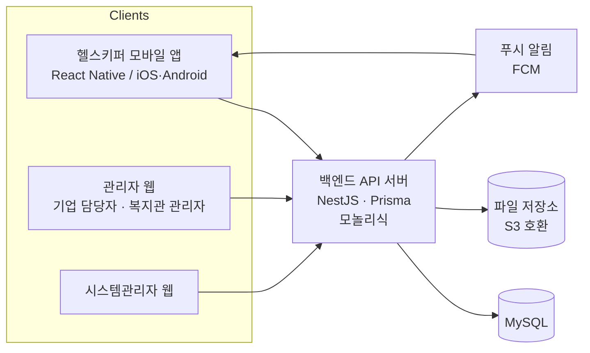

# healkee 프로젝트 개요

| 항목 | 내용 |
|---|---|
| 프로젝트명 | healkee (가칭, 추후 변경 가능하도록 설정) |
| 문서 버전 | v1.0 (검수 완료, 2026-11-09 변경사항 반영) |
| 작성일 | 2026-11-09 |
| 문서 성격 | 프로젝트의 목적, 사용자, 필요 기능, 핵심 업무 규칙을 정의하는 최상위 문서 |
| 관련 문서 | [요구기능정의서](02-functional-requirements.md) · [DB 테이블 정의서](03-database-schema.md) · [기술스펙정의서](04-tech-spec.md) |

---

## 1. 배경

### 1.1 헬스키퍼란

헬스키퍼는 기업에 상주하면서 직원들에게 안마 서비스를 제공하는 직업이다. 기업은 장애인고용부담금을 내지 않기 위해 안마 기술을 가진 시각장애인을 고용하며, 이 과정에서 헬스키퍼라는 직군이 자리 잡았다.

헬스키퍼는 장애인복지관(이하 복지관)을 통해 기업에 채용된다. 복지관은 구직자인 헬스키퍼와 채용을 원하는 기업을 연결하고, 채용 이후에도 헬스키퍼의 근무 환경과 근무 상태를 지속적으로 점검한다.

### 1.2 현재의 문제

| 영역 | 현재 방식 | 문제 |
|---|---|---|
| 채용 | 기업 → 복지관 → 헬스키퍼 순으로 채용 조건, 이력서, 면접 일시, 합격 여부를 사람이 일일이 전달 | 전달 지연, 누락, 기록 부재 |
| 근태 | 헬스키퍼가 출퇴근, 지각, 조퇴, 휴가를 기업 담당자에게 구두로 보고 | 기록이 남지 않고, 복지관은 결과만 뒤늦게 전달받음 |
| 시술 일정 | 기업 담당자가 별도 방식으로 일정을 작성해 헬스키퍼에게 전달 | 변경 사항 공유가 어렵고 노쇼 기록이 체계적이지 않음 |
| 시술 일지 | 수기 또는 개별 파일 | 기업과 복지관이 같은 데이터를 보기 어려움 |
| 면담 기록 | 복지관 담당자가 방문, 전화 면담 후 개별 기록 | 복지관별 양식이 다르고 누적 관리가 어려움 |
| 접근성 | 헬스키퍼는 시각장애인이지만 기업의 기존 HRM 시스템은 접근성이 낮음 | 헬스키퍼가 시스템을 직접 쓰지 못하고 담당자에게 의존 |

---

## 2. 목적

1. 헬스키퍼, 기업, 복지관 세 당사자가 **하나의 시스템에서 같은 정보를 실시간으로 공유**한다.
2. 헬스키퍼가 **스스로 사용할 수 있는 접근성 높은 모바일 앱**을 제공한다. 다크모드 기본, 크고 선명한 글씨, 스크린리더 대응을 기본 원칙으로 한다.
3. 채용부터 근태, 시술, 퇴사까지 **헬스키퍼 고용의 전체 생애주기를 기록**하여 기업과 복지관이 각자의 시스템에 옮겨 적을 수 있는 근거 자료(엑셀)를 제공한다.
4. 기업마다 다른 운영 방식을 모두 수용하기보다 **가장 단순한 공통 흐름**을 정확하게 구현한다.

---

## 3. 용어 정의

| 용어 | 정의 |
|---|---|
| 헬스키퍼 (HK) | 기업에 상주하며 안마 시술을 제공하는 시각장애인 근로자. 이 시스템의 모바일 앱 사용자 |
| 기업 | 헬스키퍼를 고용하는 회사. 반드시 하나의 복지관과만 협력한다 |
| 기업 담당자 (CM) | 기업 안에서 헬스키퍼의 근태, 시술 일정, 채용을 관리하는 직원. 관리자 웹 사용자 |
| 복지관 | 헬스키퍼의 구직 등록을 받고 기업과 연결하며 재직 중 면담을 담당하는 장애인복지관 |
| 복지관 관리자 (WM) | 복지관에서 헬스키퍼를 담당하는 직원. 관리자 웹 사용자 |
| 시스템관리자 (SA) | 복지관, 기업, 모든 계정, 공지사항, 시스템 설정을 관리하는 운영자. 시스템관리자 웹 사용자 |
| 구직 등록 | 헬스키퍼가 특정 복지관의 구직자 명단에 올라가는 것. 여러 복지관에 등록할 수 있다 |
| 채용 공고 (공고) | 기업이 작성하고 복지관이 승인하여 게시하는 헬스키퍼 모집 공고 |
| 입사지원 (지원) | 헬스키퍼가 공고에 지원하는 행위와 그 이후의 서류심사, 면접, 합격, 출근일 확정까지의 기록 |
| 재직 | 헬스키퍼가 특정 기업에 입사하여 근무 중인 상태 또는 그 기록 |
| 근로계약 | 재직에 대해 체결한 계약. 갱신 시 새 계약이 추가되어 이력이 남는다 |
| 피술자 | 안마 시술을 받는 기업 직원 |
| 시술 장소 | 기업 안에서 시술이 이루어지는 공간(헬스키퍼실 등). 기업이 여러 공간을 둘 수 있으며 기업별 목록으로 관리한다 |
| 시술 | 헬스키퍼가 피술자에게 제공하는 1회의 안마. 기본 30분 |
| 세트 | 시술 시간 + 휴식 시간. 기본 30분 시술 + 30분 휴식 = 1시간 |
| 시술 일정 | 기업 담당자가 등록하는 시술 예약. 시술자(헬스키퍼), 피술자, 시술 장소, 시작일시로 구성 |
| 시술 일지 | 시술 일정에 결과(시술완료, 미시술, 예약취소)가 기록된 것. 일정과 일지는 같은 데이터다 |
| 피술자 노트 | 헬스키퍼 본인만 볼 수 있는 피술자별 메모. 이전 시술 때의 통증, 증상 등을 기록 |
| 면담보고서 | 복지관 관리자가 헬스키퍼를 방문 또는 전화 면담한 뒤 작성하는 설문 형식의 보고서. 복지관만 열람 |
| 노쇼 (미시술) | 예약된 피술자가 시술 시간에 오지 않은 경우 |

---

## 4. 사용자 종류 및 역할

| 사용자 | 약어 | 소속 | 사용 플랫폼 | 주요 역할 |
|---|---|---|---|---|
| 헬스키퍼 근로자 | HK | 개인 (여러 복지관에 구직 등록 가능, 재직은 한 기업만) | 모바일 앱 (iOS, Android) | 이력서 작성, 구직 등록, 공고 조회 및 지원, 출퇴근 체크, 휴가 신청, 시술 상태 기록, 피술자 노트 작성, 퇴사 신청 |
| 기업 헬스키퍼 관리 담당자 | CM | 기업 (1개) | 관리자 웹 | 공고 작성, 지원자 심사, 면접 및 합격 처리, 근로계약 등록, 피술자 관리, 시술 일정 작성, 근태 확인 및 정정, 휴가 승인, 통계 및 엑셀 |
| 장애인복지관 헬스키퍼 관리자 | WM | 복지관 (1개) | 관리자 웹 | 구직 등록자 관리, 이력서 대리 작성, 공고 승인 및 마감, 채용 진행 입력, 재직 중 지원 승인, 퇴사 승인, 근태 및 시술 조회, 면담보고서 양식 설정 및 작성 |
| 시스템관리자 | SA | 운영 조직 | 시스템관리자 웹 | 복지관 및 기업 등록, 모든 계정 생성·수정·삭제, 공지사항, 시스템 설정 |

### 4.1 권한 요약

| 영역 | HK | CM | WM | SA |
|---|---|---|---|---|
| 이력서 | 본인 작성·수정 | 지원자·재직 헬스키퍼 열람 | 등록·재직 헬스키퍼 열람·대리 작성 | - |
| 구직 등록 | 등록·승인 | - | 추가·조회 | - |
| 채용 공고 | 전체 조회·지원 | 작성·마감 | 승인·반려·마감 | - |
| 채용 진행 | 본인 현황 조회 | 입력 | 입력 | - |
| 근로계약 | 본인 조회 | 등록 | 등록·조회 | - |
| 근태 | 출퇴근 체크·본인 조회 | 전체 조회·정정·엑셀 | 전체 조회·엑셀 | - |
| 휴가 | 신청·본인 조회 | 승인·반려·조회·엑셀 | 조회·엑셀 | - |
| 피술자·시술 장소 | 재직 기업 조회 | 등록·수정 | 조회 | - |
| 시술 일정·일지 | 본인 조회·상태 변경 | 등록·수정·취소·조회·엑셀 | 조회·엑셀 | - |
| 피술자 노트 | 본인만 | 불가 | 불가 | 불가 |
| 면담보고서 | 불가 | 불가 | 양식 설정·작성·조회 | - |
| 퇴사 | 신청·입사 포기 | 통보 조회 | 승인·반려·직접 처리 | - |
| 공지사항 | 조회 | 조회 | 조회 | 작성·수정·삭제 |
| 조직·계정 | - | - | - | 전체 |
| 시스템 설정 | - | - | - | 전체 |
| 공휴일·휴무일 | - | 기업 휴무일 관리 | 조회 | 전국 공휴일 관리 |
| 재직 직접 등록 | - | - | 등록 | - |

---

## 5. 시스템 구성

| 구성 요소 | 사용자 | 설명 |
|---|---|---|
| 백엔드 API 서버 | 전체 | 단일 모놀리식 서버. 인증, 비즈니스 로직, 배치 작업, 푸시 발송, 엑셀 생성 |
| 헬스키퍼 모바일 앱 | HK | iOS, Android 동시 제공. 접근성 최우선 |
| 관리자 웹 | CM, WM | 같은 웹 앱을 역할에 따라 메뉴와 권한만 다르게 제공 |
| 시스템관리자 웹 | SA | 별도 웹 앱 |
| 데이터베이스 | - | MySQL |
| 파일 저장소 | - | 증명사진, 근로계약서 파일 |
| 개발·배포 환경 | - | Docker, Docker Compose |

모든 코드는 TypeScript로 작성한다. 상세 기술 구성은 [기술스펙정의서](04-tech-spec.md) 참고.

---

## 6. 조직 구조와 핵심 업무 규칙

### 6.1 조직 관계

1. 복지관과 기업은 각각 여러 곳이 시스템을 사용한다.
2. 기업은 **반드시 하나의 복지관**과만 협력한다. 기업 등록 시 소속 복지관을 지정한다.
3. 헬스키퍼는 **여러 복지관에 구직 등록**할 수 있다.
4. 헬스키퍼는 **한 번에 하나의 기업에서만 재직**할 수 있다.
5. 한 복지관과 한 기업에는 담당자 계정이 여러 개 있을 수 있다.

### 6.2 계정 규칙

1. 헬스키퍼, 기업 담당자, 복지관 관리자 계정은 **시스템관리자가 시스템관리자 웹에서 직접 생성**한다. 자가 회원가입은 없다.
2. 시스템관리자는 모든 계정을 수정, 비활성화, 삭제할 수 있고 비밀번호를 초기화할 수 있다.
3. 최초 로그인 시 비밀번호 변경을 강제한다.

### 6.3 구직 등록 규칙

1. 헬스키퍼가 앱에서 복지관을 골라 직접 구직 등록하면 즉시 등록된다.
2. 복지관 관리자가 헬스키퍼를 구직 등록자로 추가하면 헬스키퍼가 앱에서 승인해야 정식 등록된다.
3. 헬스키퍼는 모든 복지관의 공고를 볼 수 있다. 등록되지 않은 복지관의 공고에 지원하려면 구직 등록을 먼저 진행한 뒤 지원이 이어지도록 한 흐름으로 묶는다.

### 6.4 채용 규칙

1. 공고는 기업 담당자 또는 복지관 관리자가 작성한다. 기업 담당자가 작성한 공고는 복지관 관리자가 승인해야 게시되고, 반려 시 사유와 함께 기업 담당자에게 돌아간다. 복지관 관리자가 소속 기업을 지정해 작성한 공고는 승인 절차 없이 즉시 게시된다.
2. 공고 마감, 면접 일시, 합격 여부, 실제 출근 시작일은 기업 담당자와 복지관 관리자 **모두** 입력할 수 있다.
3. 지원 시 헬스키퍼의 이력서가 기업에 공개된다. 기업은 자기 공고의 지원자 이력서만 볼 수 있다.
4. 최종 합격 후 출근 시작일이 입력되면 입사 예정 상태의 재직 기록과 공고 조건을 복사한 초기 근로계약이 생성된다. 출근 시작일이 되면 재직중으로 전환되어 근태 기능이 열리고, 시술 일정은 출근 시작일 이후 날짜로 미리 등록할 수 있다.
5. 최종 합격자가 입사를 포기하면 지원은 입사 포기 상태가 되고, 이미 만들어진 입사 예정 재직 기록은 취소된다.
6. 시스템 도입 전부터 재직 중인 헬스키퍼는 복지관 관리자가 재직 기록과 근로계약을 직접 등록한다. 이때 해당 복지관 구직 등록이 없으면 자동으로 등록된다.

### 6.5 재직 중 입사지원 규칙

1. 재직 중에도 다른 공고에 지원할 수 있다.
2. 지원하려는 공고의 근무 시작 예정일이 **현재 재직 종료일 이후**이면 아무 절차 없이 지원된다. 재직 종료일은 승인된 퇴사일이 있으면 그 날짜, 없으면 현재 유효한 근로계약의 종료일이다.
3. 근무 시작 예정일이 **현재 재직 종료일 이전**이거나 **종료일이 없으면**, 경고 팝업을 띄우고 퇴사 예정일과 퇴사 사유를 입력받는다. 이 내용은 현재 재직 기업의 소속 복지관 관리자에게 자동으로 알려지고, 복지관 관리자가 승인해야 지원이 정상 접수된다. 반려되면 지원은 취소된다.
4. 이때 입력한 퇴사 예정일과 사유는 퇴사 신청으로 저장되며, 복지관 관리자의 승인은 **조건부 승인**이다. 지원이 최종 합격을 거쳐 출근 시작일이 확정되는 시점에 퇴사가 확정되어 현재 재직의 종료일이 설정되고 기업 담당자에게 통보된다. 지원이 불합격이나 취소로 끝나면 퇴사 신청은 자동 철회되고 현재 재직은 그대로 유지된다.
5. 새 출근 시작일은 기존 재직 종료일 이후여야 한다. 퇴사 신청 없이 지원된 경우 입사 시점에 기존 재직 종료일이 현재 계약 종료일로 설정된다.

### 6.6 근태 규칙

1. 근태는 기업 담당자가 전적으로 관리한다. 복지관 관리자는 기업 담당자와 **동일한 정보를 조회**하고 엑셀로 내려받을 수 있지만 정정이나 승인은 할 수 없다.
2. 출퇴근은 헬스키퍼가 앱에서 버튼으로 기록한다. 시각은 서버 시각을 사용하고, 위치는 참고용으로만 저장하며 출퇴근을 막는 조건으로 쓰지 않는다.
3. 지각은 근로계약의 소정 근로 시작 시각 이후 출근, 조퇴는 그날 마지막 시술 예약의 세트 종료 시각 이전 퇴근으로 자동 판정한다. 헬스키퍼는 사유를 적을 수 있고, 기업 담당자는 기록을 정정할 수 있다.
4. 휴가는 헬스키퍼가 신청하고 기업 담당자가 승인 또는 반려한다. 연차 부여일수는 기업 담당자가 입력하며 시스템이 사용분을 차감한다.
5. 근무일은 근로계약의 근무 요일에서 전국 공휴일과 기업 휴무일을 뺀 날이다. 공휴일은 시스템관리자가, 기업 휴무일은 기업 담당자가 관리한다. 결근 생성과 휴가 일수 계산은 근무일만 센다.
6. 근태 판정에 쓰는 계약 조건은 그 날짜에 유효한 근로계약의 것이다. 갱신 계약을 미리 등록해도 시작일 전까지는 기존 계약 조건이 적용된다.

### 6.7 시술 규칙

1. 시술 일정은 기업 담당자가 건별로 직접 지정한다. 직원 셀프 예약, 반복 배정은 다루지 않는다. 일정에는 시술 장소를 지정한다. 시술 장소는 기업 담당자가 기업별 목록으로 관리하며, 헬스키퍼 여러 명이 여러 공간에서 동시에 근무하는 기업을 위해 같은 장소에 시간이 겹치는 일정이 있으면 경고한다.
2. 시술 시간, 휴식 시간, 하루 최대 시술 횟수 기본값은 그 날짜에 유효한 근로계약 조건에서 가져온다. 입사 시 공고 조건으로 초기 계약이 자동 생성되므로 계약이 없는 재직은 없다. 하루 최대 시술 횟수를 넘기면 경고한다.
3. 시술 상태는 시술전, 미시술, 예약취소, 시술완료 네 가지다. 시술완료와 미시술은 헬스키퍼가, 예약취소는 기업 담당자가 처리한다.
4. 피술자 정보는 기업별 피술자 목록으로 관리하고 일정 등록 시 목록에서 선택한다. 피술자 주의사항을 변경하면 아직 시술전인 미래 일정에도 반영된다.

### 6.8 피술자 노트 규칙

1. 피술자 노트는 작성한 헬스키퍼 **본인만** 볼 수 있다. 기업 담당자, 복지관 관리자, 시스템관리자 모두 볼 수 없다.
2. 퇴사 처리 후 일정 기간이 지나면 해당 기업에서 작성한 노트는 폐기되어 본인도 볼 수 없다. 기본값은 **퇴사 후 7일**이며 시스템관리자가 설정에서 변경할 수 있다.

### 6.9 면담보고서 규칙

1. 면담보고서는 설문지 형식이며, 문항 구성, 척도 점수 수, 점수별 레이블, 객관식과 주관식 구성을 **복지관마다 관리자가 직접 설정**한다.
2. 면담보고서는 복지관 관리자만 볼 수 있다. 헬스키퍼와 기업 담당자는 볼 수 없다.

### 6.10 퇴사 규칙

1. 헬스키퍼는 복지관 관리자에게 먼저 퇴사 의사를 알린다. 앱에서 퇴사 예정일과 사유를 넣어 신청하면 복지관 관리자에게 알림이 간다.
2. 복지관 관리자가 충분히 소통한 뒤 승인하면 기업 담당자에게 알림이 간다.
3. 퇴사일이 지나면 재직 상태가 종료되고 피술자 노트 폐기 기한이 시작된다.
4. 헬스키퍼가 구두로 퇴사 의사를 전한 경우 복지관 관리자가 퇴사일과 사유를 직접 입력해 처리할 수 있다.
5. 기업 담당자는 승인된 퇴사 내역을 조회할 수 있다.

### 6.11 공지사항 규칙

1. 공지사항은 시스템관리자만 작성, 수정, 삭제한다.
2. 공개 범위는 모두 공개, 복지관 대상 공개, 기업 대상 공개, 복지관과 기업에게만 공개, 헬스키퍼에게만 공개 다섯 가지다.

---

## 7. 필요 기능 요약

| 카테고리 | 주요 기능 | 상세 |
|---|---|---|
| 공통 | 로그인, 비밀번호 관리, 생체인증 재로그인(앱), 푸시 알림, 알림 목록, 공지사항 조회 | [요구기능정의서 1~3장](02-functional-requirements.md) |
| 시스템관리 | 복지관·기업 등록, 계정 생성·수정·삭제, 비밀번호 초기화, 공지사항 관리, 시스템 설정 | 4장 |
| 헬스키퍼 이력 관리 및 입사지원 | 이력서(기본정보, 장애정보, 학력, 경력), 구직 등록, 공고 작성·승인·게시·마감, 지원, 서류심사, 면접, 합격, 출근일 확정, 근로계약, 퇴사 | 5~10장 |
| 근태관리 (휴가 포함) | 출퇴근 체크, 지각·조퇴·결근 판정, 근태 정정, 연차 부여, 휴가 신청·승인, 월별 현황, 엑셀 | 11~12장 |
| 시술 일정 관리 | 피술자 관리, 시술 장소 관리, 시술 일정 등록·수정·취소, 최대 횟수 경고, 장소 중복 경고, 헬스키퍼 일정 조회 | 13~14장 |
| 안마 시술 일지 | 시술 상태 기록, 건별 주의사항, 일지 조회, 월별 통계, 엑셀, 피술자 노트 | 14~15장 |
| 복지관 면담 | 설문 양식 설정, 면담보고서 작성·조회 | 16장 |
| 대시보드 및 접근성 | 역할별 대시보드, 다크모드 기본, 큰 글씨, 스크린리더 대응 | 17~18장 |

---

## 8. 핵심 업무 흐름

### 8.1 채용 흐름

1. 시스템관리자가 복지관, 기업, 각 담당자 계정, 헬스키퍼 계정을 생성한다.
2. 헬스키퍼가 앱에서 이력서를 작성하고(또는 복지관 관리자가 대리 작성) 복지관에 구직 등록한다.
3. 기업 담당자가 채용 조건(근무지, 근무시간, 하루 최대 시술 횟수, 1건당 시술 시간과 휴식 시간, 희망 성별, 급여, 복리후생, 근무 시작 예정일)을 담아 공고를 작성하고 승인을 요청한다. 복지관 관리자가 기업을 대신해 직접 작성할 수도 있다.
4. 기업 담당자가 작성한 공고는 복지관 관리자가 승인하면 게시된다. 반려 시 수정 후 다시 요청한다. 복지관 관리자가 작성한 공고는 즉시 게시된다.
5. 헬스키퍼가 앱에서 공고를 보고 지원한다. 해당 복지관에 미등록 상태면 구직 등록 후 지원된다. 재직 중이면 6.5 규칙이 적용된다.
6. 기업 담당자(또는 복지관 관리자)가 지원자 이력서를 보고 서류심사 결과를 입력한다.
7. 면접 일시를 입력하면 헬스키퍼와 복지관 관리자에게 알림이 간다. 면접은 기업 현장에서 구술 면접과 안마 시연으로 진행하며 복지관 담당자가 동행한다.
8. 면접 결과(최종 합격, 불합격)를 입력한다.
9. 출근 시작일을 입력하면 입사 예정 상태의 재직 기록과 공고 조건을 복사한 초기 근로계약이 생성된다.
10. 실제 계약 내용으로 근로계약을 수정하고 서명된 계약서 파일을 첨부한다.
11. 출근 시작일이 되면 재직중으로 전환된다.
12. 기업 담당자 또는 복지관 관리자가 공고를 마감한다.

### 8.2 일일 근무 흐름

1. 기업 담당자가 피술자 목록에서 피술자를, 시술 장소 목록에서 장소를 골라 시술 일정을 등록한다. 헬스키퍼에게 푸시 알림이 간다.
2. 헬스키퍼가 출근하여 앱에서 출근 버튼을 누른다. 소정 근로 시작 시각보다 늦으면 지각으로 기록되고 사유를 적을 수 있다.
3. 앱 홈에서 오늘 일정(세트 수, 예상 퇴근 시각)을 확인한다.
4. 시술 전 피술자 노트에서 이전 메모(통증, 증상 등)와 주의사항을 확인한다.
5. 30분 시술 후 시술완료로 표시하고 필요하면 노트에 메모를 남긴다. 피술자가 오지 않으면 미시술로 표시하고 그 시간은 휴식한다.
6. 30분 휴식 후 다음 세트를 진행한다.
7. 마지막 세트가 끝나면 퇴근 버튼을 누른다. 마지막 세트 종료 시각보다 이르면 조퇴로 기록된다.
8. 기업 담당자와 복지관 관리자는 근태와 시술 일지를 실시간으로 동일하게 조회한다.

### 8.3 휴가 흐름

1. 헬스키퍼가 앱에서 휴가 종류, 기간, 사유를 넣어 신청한다.
2. 기업 담당자에게 알림이 가고, 담당자가 승인 또는 반려한다.
3. 승인된 날짜의 근태는 휴가로 기록되고, 연차에 해당하면 잔여일수가 차감된다.

### 8.4 복지관 면담 흐름

1. 복지관 관리자가 자기 복지관의 면담 설문 양식을 설정한다.
2. 헬스키퍼를 방문하거나 전화 면담한 뒤 양식에 따라 면담보고서를 작성한다.
3. 보고서는 복지관 관리자만 열람한다.

### 8.5 퇴사 흐름

1. 헬스키퍼가 앱에서 퇴사 예정일과 사유를 넣어 퇴사를 신청한다. 재직 중 다른 공고에 조기 이직 지원을 하면서 입력한 퇴사 예정일과 사유도 같은 기록으로 저장되며, 이 경우 복지관 승인은 조건부이고 출근 시작일 확정 시 퇴사가 확정된다.
2. 복지관 관리자에게 알림이 가고, 관리자가 헬스키퍼와 소통한 뒤 승인한다.
3. 승인되면 기업 담당자에게 알림이 간다.
4. 퇴사일이 지나면 재직 상태가 종료된다. 퇴사 후 설정된 기간(기본 7일)이 지나면 해당 기업의 피술자 노트가 폐기된다.

---

## 9. 범위 제외

다음은 이번 개발에서 다루지 않는다.

| 항목 | 이유 |
|---|---|
| 급여 계산, 급여 명세서 | 근로계약의 급여 조건은 기록하지만 계산은 기업 급여 시스템이 담당 |
| 기업 HRM 시스템과의 자동 연동 | 엑셀 내려받기로 대체 |
| 피술자(기업 직원)의 셀프 예약, 직원용 계정 | 기업 담당자가 건별로 직접 배정하는 방식만 지원 |
| 반복 일정 자동 생성 | 기업마다 배정 방식이 달라 단순화를 위해 제외 |
| 자가 회원가입, 소셜 로그인 | 모든 계정은 시스템관리자가 생성 |
| 전자서명 | 근로계약서는 서명된 파일을 업로드하여 보관 |
| 사용자 간 1:1 메시지, 채팅 | 알림과 공지사항으로 대체 |
| 다국어 | 한국어만 지원 |
| 위치 기반 출퇴근 제한 | 위치는 참고용 저장만 |
| 기존 데이터 엑셀 일괄 이관 도구 | 도입 전 재직자는 복지관 관리자가 화면에서 직접 등록 |
| 연차 자동 산정 | 연차 부여일수는 기업 담당자가 입력 |

---

## 10. 비기능 요구사항 요약

| 영역 | 요구사항 |
|---|---|
| 접근성 | 관리자 웹과 모바일 앱 모두 다크모드 기본. 크고 선명한 글씨(모바일 본문 최소 18pt, 웹 본문 최소 16px, 고대비). 모바일 앱은 VoiceOver, TalkBack 등 스크린리더 완전 대응, 시스템 글꼴 크기 설정 반영, 큰 터치 영역 |
| 보안 | 비밀번호 해시 저장, JWT 기반 인증, 역할과 소속 범위에 따른 접근 제어, HTTPS, 개인정보(이력서, 장애정보, 면담보고서, 피술자 노트) 접근 권한 엄격 통제 |
| 데이터 보존 | 주요 데이터는 소프트 삭제. 피술자 노트는 정책에 따라 물리 삭제 |
| 운영 | Docker Compose로 로컬 개발 환경과 서버 배포 환경을 동일하게 구성. 매일 자동 배치(노트 폐기, 결근 생성, 재직 종료) |
| 유지보수 | 전 구성요소 TypeScript. 모노레포로 타입과 상수 공유. 프로젝트명을 한 곳에서 바꿀 수 있는 구조 |

---

## 11. 설계 과정에서 결정한 사항 (검수 포인트)

아래는 대화에서 직접 확인되지 않아 작성자가 결정한 사항이다. 검수 시 특히 확인이 필요하다.

| 번호 | 결정 사항 | 근거 |
|---|---|---|
| 1 | 시술 일정과 시술 일지는 같은 데이터이며 상태로 구분한다 | 일정 등록 = 시술전 상태의 일지 생성 |
| 2 | 피술자 정보는 기업별 피술자 목록으로 관리하고 일정 등록 시 선택한다 | 매번 재입력 방지 |
| 3 | 조퇴 판정 기준은 그날 마지막 시술 예약의 세트 종료 시각 | 예약 세트 수에 따라 하루 근무시간이 달라지므로 계약 종료 시각 기준은 부적절 |
| 4 | 결근은 근무일에 출근 기록과 승인된 휴가가 모두 없을 때 배치가 자동 생성한다 | 월별 근태 집계를 위해 필요 |
| 5 | 재직 중 지원 시 승인 주체는 현재 재직 기업의 소속 복지관 | 퇴사 관련 소통을 담당하는 복지관이기 때문 |
| 6 | 근로계약 종료일이 없는 계약(기간의 정함 없음)은 재직 중 지원 시 항상 경고 절차를 거친다 | 종료일 비교가 불가능 |
| 7 | 복지관 관리자도 근로계약을 등록, 조회할 수 있다 | 면접, 합격, 출근일 입력 권한과 동일하게 적용 |
| 8 | 복지관 관리자가 헬스키퍼의 앱 신청 없이도 퇴사 처리를 할 수 있다 | 구두로 퇴사 의사를 전달한 경우 대응 |
| 9 | 설문 양식은 수정 시 새 버전으로 저장하여 기존 보고서의 문항을 보존한다 | 과거 보고서 무결성 |
| 10 | 학력 구분을 초등학교, 중학교, 고등학교, 대학교, 대학원, 직업교육 여섯 가지로 세분화한다 | "초/중/고등학교"를 분리 |
| 11 | 새 공고 게시 알림은 해당 복지관에 구직 등록된 헬스키퍼에게만 보낸다 | 전체 발송 시 알림 과다 |
| 12 | 다크모드가 기본이되 라이트모드 전환 옵션을 둔다 | 저시력 사용자 중 밝은 배경을 선호하는 경우 대비 |
| 13 | 휴가 종류는 연차, 반차(오전/오후), 병가, 경조사, 공가, 무급휴가로 둔다 | 일반적인 국내 기업 기준 |
| 14 | 지원 취소는 최종 결과 입력 전까지 헬스키퍼가 할 수 있다 | 일반적인 채용 관행 |
| 15 | 생체인증 재로그인은 앱에서만 제공하고 웹은 아이디·비밀번호만 사용한다 | 헬스키퍼 사용 편의 |
| 16 | 재직 상태에 입사 예정과 입사 취소를 추가하여 재직중 기록은 항상 하나만 존재하게 한다 | 재직 중 입사 시 두 재직이 겹치는 기간을 표현 |
| 17 | 입사 시 공고 조건을 복사한 초기 근로계약을 자동 생성한다 | 계약 없는 재직 기간을 없애 근태·시술 기준값 확보 |
| 18 | 근태·시술 판정은 해당 날짜에 유효한 계약을 사용하고, 없으면 최신 계약을 사용한다 | 갱신 계약을 미리 등록해도 기존 조건 유지 |
| 19 | 최종 합격 이후 입사 포기 상태를 두고, 입사 예정 재직은 취소할 수 있다 | 채용 변동 대응 |
| 20 | 피술자 주의사항 변경 시 아직 시술전인 미래 일정의 주의사항 사본도 갱신한다 | 임신 등 안전 정보 |
| 21 | 반차는 근태 상태와 별도 컬럼으로 기록하여 반차이면서 지각인 경우를 표현한다 | 월별 집계 정확성 |
| 22 | 척도형 응답은 점수 숫자로 저장하고 점수별 레이블은 선택 사항이다 | 레이블 없는 점수도 응답 가능 |
| 23 | 학력 상태에 재학중을 추가한다 | 종료일 없는 학력 표현 |
| 24 | 기업 담당자도 자기 기업의 퇴사 통보 내역을 조회한다 | 알림만으로는 이력 확인 불가 |
| 25 | 이력서 열람 범위를 지원자뿐 아니라 재직 중이거나 재직했던 헬스키퍼까지 넓힌다 | 재직 관리 화면에서 이력서 요약 필요 |
| 26 | 공고 조회 필터에서 지역 코드를 빼고 복지관, 성별, 급여 형태, 근무지 키워드 검색으로 한다 | 주소를 자유 입력으로 두기 때문 |
| 27 | 열거형은 MySQL 네이티브 ENUM 컬럼으로 저장한다 | Prisma 기본 매핑, 타입 안전 |
| 28 | 조기 이직 지원을 조건부 승인하는 복지관 관리자는 연결된 지원 건의 요약(공고 제목, 기업명, 공고 복지관명, 근무 시작 예정일)을 볼 수 있다 | 판단에 필요한 최소 정보 |
| 29 | 시술 장소는 기업별 목록으로 관리하고 일정에서 선택한다. 장소가 한 곳뿐인 기업은 생략할 수 있고, 같은 장소에 시간이 겹치는 일정은 경고한다 | 여러 공간에서 동시 근무하는 기업 대응 |
| 30 | 공고에 작성자 구분(기업, 복지관)을 기록하고, 복지관 작성 공고는 승인 단계 없이 게시한다 | 복지관 작성 공고 즉시 게시 규칙 |

---

## 12. 검수 확정 사항

2026-11-09 검수에서 다음이 확정되었다.

| 구분 | 내용 |
|---|---|
| 추천안 확정 | 11장의 결정 사항 전체와 아래 세 가지 질문의 추천안을 그대로 적용한다 |
| 질문 1 | 재직 중 조기 이직 지원 시 복지관 승인은 조건부 승인이며, 출근 시작일 확정 시점에 퇴사가 확정되어 기업에 통보된다. 불합격이나 취소 시 퇴사 신청은 자동 철회된다 |
| 질문 2 | 시스템 도입 전 재직자는 복지관 관리자가 관리자 웹에서 재직과 근로계약을 직접 등록한다. 구직 등록이 없으면 자동 등록된다. 엑셀 일괄 이관 도구는 1차 범위에서 제외한다 |
| 질문 3 | 전국 공휴일은 시스템관리자가, 기업 휴무일은 기업 담당자가 관리하며 근무일 계산에서 제외한다 |
| 변경 1 | 프로젝트명을 healkee로 변경한다 (가칭 유지, 추후 변경 가능) |
| 변경 2 | 시술 일정과 시술 일지에 시술 장소를 추가한다. 시술 장소는 기업별 목록으로 관리한다 |
| 변경 3 | 공고는 기업 담당자와 복지관 관리자 모두 작성할 수 있다. 기업 담당자 작성 공고는 복지관 승인 후 게시되고, 복지관 관리자 작성 공고는 즉시 게시된다 |
