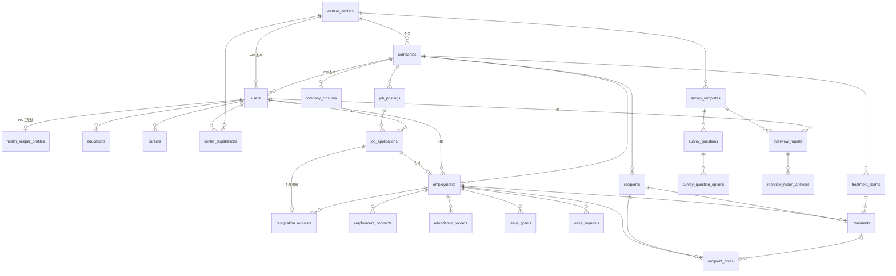

# healkee DB 테이블 정의서

| 항목 | 내용 |
|---|---|
| 문서 버전 | v1.0 (검수 완료, 2026-11-09 변경사항 반영) |
| 작성일 | 2026-11-09 |
| DBMS | MySQL 8.4 LTS (InnoDB, utf8mb4) |
| ORM | Prisma |
| 관련 문서 | [프로젝트 개요](01-project-overview.md) · [요구기능정의서](02-functional-requirements.md) · [기술스펙정의서](04-tech-spec.md) |

## 공통 규칙

| 항목 | 규칙 |
|---|---|
| 테이블명 | snake_case 복수형. Prisma 모델은 PascalCase 단수형이며 `@@map`으로 연결 |
| 컬럼명 | snake_case. Prisma 필드는 camelCase이며 `@map`으로 연결 |
| 기본 키 | 모든 테이블 `id BIGINT UNSIGNED AUTO_INCREMENT`. 예외: `system_settings`는 `key`가 기본 키 |
| 공통 컬럼 | 모든 테이블에 `created_at DATETIME(3) NOT NULL DEFAULT CURRENT_TIMESTAMP(3)`, `updated_at DATETIME(3) NOT NULL ON UPDATE CURRENT_TIMESTAMP(3)`가 있다. 아래 표에서는 생략한다. 예외는 각 표 비고에 적는다 |
| 소프트 삭제 | `deleted_at DATETIME(3) NULL`이 있는 테이블은 삭제 시 값만 채우고 조회에서 제외한다. 그 외 테이블은 물리 삭제 또는 상태 컬럼으로 관리 |
| 시간 | 모든 DATETIME은 UTC로 저장한다. 업무 기준 날짜(`work_date` 등 DATE 타입)는 Asia/Seoul 기준 날짜다 |
| 열거형 | Prisma `enum`으로 정의하고 MySQL 네이티브 ENUM 컬럼으로 저장한다 (Prisma 기본 매핑). 값 추가나 변경은 마이그레이션으로 처리한다. 아래 표의 "ENUM" 표기는 이를 뜻하며 값 목록은 부록 A |
| 불리언 | `TINYINT(1)` |
| 금액 | `INT UNSIGNED` (원 단위) |
| 외래 키 | 모두 실제 FK 제약을 건다. 삭제 규칙은 기본 `RESTRICT`, 종속 데이터(옵션, 답변, 파일 연결)는 `CASCADE` |
| 사용자 참조 | `*_by` 컬럼은 `users.id`를 참조한다. 헬스키퍼를 가리키는 `health_keeper_id`도 `users.id`를 참조한다 |
| 인덱스 | 각 표 아래 "인덱스" 줄에 기재. FK 컬럼은 기본적으로 인덱스를 갖는다 |

## ERD 개요

## 테이블 목록

| 영역 | 테이블 | 설명 |
|---|---|---|
| 계정 및 공통 | users | 모든 사용자 계정 |
| | refresh_tokens | 리프레시 토큰 |
| | device_tokens | 푸시 알림용 기기 토큰 |
| | notifications | 사용자별 알림 |
| | announcements | 공지사항 |
| | files | 업로드 파일 메타데이터 |
| | system_settings | 시스템 설정 |
| | system_setting_histories | 시스템 설정 변경 이력 |
| 조직 | welfare_centers | 장애인복지관 |
| | companies | 기업 |
| 이력서 | health_keeper_profiles | 헬스키퍼 기본정보 및 장애정보 |
| | educations | 학력 |
| | careers | 경력 |
| 구직 및 채용 | center_registrations | 복지관 구직 등록 |
| | job_postings | 채용 공고 |
| | job_applications | 입사지원 및 채용 진행 |
| | application_memos | 채용 진행 메모 |
| | resignation_requests | 퇴사 신청 |
| 재직 | employments | 재직 기록 |
| | employment_contracts | 근로계약 |
| | contract_files | 근로계약서 파일 연결 |
| 근태 및 휴가 | attendance_records | 일별 근태 |
| | leave_grants | 연도별 연차 부여 |
| | leave_requests | 휴가 신청 |
| | public_holidays | 전국 공휴일 |
| | company_closures | 기업 휴무일 |
| 시술 | recipients | 피술자 |
| | treatment_rooms | 시술 장소 |
| | treatments | 시술 일정 및 일지 |
| | recipient_notes | 피술자 노트 |
| 면담 | survey_templates | 면담 설문 양식 |
| | survey_questions | 설문 문항 |
| | survey_question_options | 척도 레이블 및 객관식 선택지 |
| | interview_reports | 면담보고서 |
| | interview_report_answers | 면담보고서 응답 |

---

## 1. 계정 및 공통

### 1.1 users

모든 역할의 사용자 계정. 역할에 따라 `welfare_center_id`(복지관 관리자) 또는 `company_id`(기업 담당자)가 채워진다. 헬스키퍼와 시스템관리자는 둘 다 NULL이다.

| 컬럼명 | 타입 | NULL | 키/제약 | 기본값 | 설명 |
|---|---|---|---|---|---|
| id | BIGINT UNSIGNED | N | PK, AI | | |
| login_id | VARCHAR(50) | N | UK | | 로그인 아이디 |
| password_hash | VARCHAR(255) | N | | | bcrypt 해시 |
| role | ENUM UserRole | N | IDX | | HEALTH_KEEPER, COMPANY_MANAGER, CENTER_MANAGER, SYSTEM_ADMIN |
| name | VARCHAR(50) | N | | | 이름 |
| phone | VARCHAR(20) | Y | | | 휴대폰번호 |
| email | VARCHAR(100) | Y | | | 이메일 |
| welfare_center_id | BIGINT UNSIGNED | Y | FK welfare_centers.id | | 복지관 관리자의 소속 |
| company_id | BIGINT UNSIGNED | Y | FK companies.id | | 기업 담당자의 소속 |
| status | ENUM UserStatus | N | | ACTIVE | ACTIVE, INACTIVE |
| must_change_password | TINYINT(1) | N | | 1 | 다음 로그인 시 비밀번호 변경 강제 |
| failed_login_count | INT | N | | 0 | 연속 로그인 실패 횟수 |
| locked_until | DATETIME(3) | Y | | | 로그인 잠금 해제 시각 |
| last_login_at | DATETIME(3) | Y | | | |
| created_by | BIGINT UNSIGNED | Y | FK users.id | | 생성한 시스템관리자 |
| deleted_at | DATETIME(3) | Y | | | 소프트 삭제 |

인덱스: UK(login_id), IDX(role), IDX(company_id), IDX(welfare_center_id), IDX(name)

### 1.2 refresh_tokens

| 컬럼명 | 타입 | NULL | 키/제약 | 기본값 | 설명 |
|---|---|---|---|---|---|
| id | BIGINT UNSIGNED | N | PK, AI | | |
| user_id | BIGINT UNSIGNED | N | FK users.id, CASCADE | | |
| token_hash | VARCHAR(255) | N | UK | | 토큰 SHA-256 해시 |
| platform | ENUM ClientPlatform | N | | | IOS, ANDROID, WEB |
| device_id | VARCHAR(100) | Y | | | 앱 설치 단위 식별자 |
| expires_at | DATETIME(3) | N | | | 만료 시각 |
| revoked_at | DATETIME(3) | Y | | | 로그아웃 또는 회전으로 무효화된 시각 |

인덱스: UK(token_hash), IDX(user_id), IDX(expires_at). `updated_at` 없음.

### 1.3 device_tokens

| 컬럼명 | 타입 | NULL | 키/제약 | 기본값 | 설명 |
|---|---|---|---|---|---|
| id | BIGINT UNSIGNED | N | PK, AI | | |
| user_id | BIGINT UNSIGNED | N | FK users.id, CASCADE | | |
| platform | ENUM DevicePlatform | N | | | IOS, ANDROID |
| token | VARCHAR(255) | N | UK | | FCM 토큰 |
| last_seen_at | DATETIME(3) | N | | | 마지막 갱신 시각 |

인덱스: UK(token), IDX(user_id)

### 1.4 notifications

| 컬럼명 | 타입 | NULL | 키/제약 | 기본값 | 설명 |
|---|---|---|---|---|---|
| id | BIGINT UNSIGNED | N | PK, AI | | |
| user_id | BIGINT UNSIGNED | N | FK users.id, CASCADE | | 수신자 |
| type | VARCHAR(50) | N | | | 알림 이벤트 코드 (요구기능정의서 부록 B) |
| title | VARCHAR(200) | N | | | |
| body | VARCHAR(1000) | N | | | |
| ref_type | VARCHAR(50) | Y | | | 연결 대상 종류 (JOB_POSTING, TREATMENT 등) |
| ref_id | BIGINT UNSIGNED | Y | | | 연결 대상 id |
| is_read | TINYINT(1) | N | | 0 | |
| read_at | DATETIME(3) | Y | | | |

인덱스: IDX(user_id, is_read, created_at). `updated_at` 없음.

### 1.5 announcements

| 컬럼명 | 타입 | NULL | 키/제약 | 기본값 | 설명 |
|---|---|---|---|---|---|
| id | BIGINT UNSIGNED | N | PK, AI | | |
| title | VARCHAR(200) | N | | | |
| content | TEXT | N | | | 본문 (마크다운 허용) |
| audience | ENUM AnnouncementAudience | N | IDX | | ALL, CENTER, COMPANY, CENTER_AND_COMPANY, HEALTH_KEEPER |
| is_pinned | TINYINT(1) | N | | 0 | 상단 고정 |
| is_published | TINYINT(1) | N | | 0 | 게시 여부 (0이면 임시저장) |
| published_at | DATETIME(3) | Y | | | |
| author_id | BIGINT UNSIGNED | N | FK users.id | | 작성 시스템관리자 |
| deleted_at | DATETIME(3) | Y | | | 소프트 삭제 |

인덱스: IDX(audience, is_published, published_at)

### 1.6 files

| 컬럼명 | 타입 | NULL | 키/제약 | 기본값 | 설명 |
|---|---|---|---|---|---|
| id | BIGINT UNSIGNED | N | PK, AI | | |
| storage_key | VARCHAR(500) | N | UK | | 객체 저장소 키 |
| original_name | VARCHAR(255) | N | | | 원본 파일명 |
| mime_type | VARCHAR(100) | N | | | |
| size_bytes | BIGINT UNSIGNED | N | | | |
| purpose | ENUM FilePurpose | N | | | PROFILE_PHOTO, CONTRACT, OTHER |
| uploaded_by | BIGINT UNSIGNED | N | FK users.id | | |
| deleted_at | DATETIME(3) | Y | | | 소프트 삭제, 배치가 저장소에서 제거 |

인덱스: UK(storage_key), IDX(uploaded_by)

### 1.7 system_settings

| 컬럼명 | 타입 | NULL | 키/제약 | 기본값 | 설명 |
|---|---|---|---|---|---|
| key | VARCHAR(100) | N | PK | | 설정 키 |
| value | VARCHAR(500) | N | | | 설정 값 (문자열) |
| value_type | ENUM SettingValueType | N | | | INT, STRING, BOOLEAN |
| description | VARCHAR(500) | Y | | | 설명 |
| updated_by | BIGINT UNSIGNED | Y | FK users.id | | |

`id`, `created_at` 없음. `updated_at`만 존재.

초기 데이터:

| key | value | value_type | description |
|---|---|---|---|
| recipient_note_purge_days | 7 | INT | 퇴사 후 피술자 노트 폐기까지의 유예일 |

### 1.8 system_setting_histories

| 컬럼명 | 타입 | NULL | 키/제약 | 기본값 | 설명 |
|---|---|---|---|---|---|
| id | BIGINT UNSIGNED | N | PK, AI | | |
| setting_key | VARCHAR(100) | N | IDX | | |
| old_value | VARCHAR(500) | Y | | | |
| new_value | VARCHAR(500) | N | | | |
| changed_by | BIGINT UNSIGNED | N | FK users.id | | |

`updated_at` 없음. `created_at`이 변경 시각.

---

## 2. 조직

### 2.1 welfare_centers

| 컬럼명 | 타입 | NULL | 키/제약 | 기본값 | 설명 |
|---|---|---|---|---|---|
| id | BIGINT UNSIGNED | N | PK, AI | | |
| name | VARCHAR(100) | N | | | 복지관명 |
| address | VARCHAR(300) | Y | | | |
| phone | VARCHAR(20) | Y | | | 대표 전화 |
| department | VARCHAR(100) | Y | | | 헬스키퍼 담당 부서명 |
| status | ENUM OrgStatus | N | | ACTIVE | ACTIVE, INACTIVE |
| deleted_at | DATETIME(3) | Y | | | 소프트 삭제 |

인덱스: IDX(name)

### 2.2 companies

| 컬럼명 | 타입 | NULL | 키/제약 | 기본값 | 설명 |
|---|---|---|---|---|---|
| id | BIGINT UNSIGNED | N | PK, AI | | |
| welfare_center_id | BIGINT UNSIGNED | N | FK welfare_centers.id | | 소속 복지관 (반드시 1개) |
| name | VARCHAR(100) | N | | | 기업명 |
| business_registration_no | VARCHAR(20) | Y | | | 사업자등록번호 |
| address | VARCHAR(300) | Y | | | |
| phone | VARCHAR(20) | Y | | | 대표 전화 |
| status | ENUM OrgStatus | N | | ACTIVE | |
| deleted_at | DATETIME(3) | Y | | | 소프트 삭제 |

인덱스: IDX(welfare_center_id), IDX(name)

---

## 3. 이력서

### 3.1 health_keeper_profiles

헬스키퍼 1명당 1행. 이름, 휴대폰번호, 이메일은 `users`에 있다.

| 컬럼명 | 타입 | NULL | 키/제약 | 기본값 | 설명 |
|---|---|---|---|---|---|
| id | BIGINT UNSIGNED | N | PK, AI | | |
| user_id | BIGINT UNSIGNED | N | FK users.id, UK | | 헬스키퍼 계정 |
| birth_date | DATE | Y | | | 생년월일 |
| gender | ENUM Gender | Y | | | MALE, FEMALE |
| photo_file_id | BIGINT UNSIGNED | Y | FK files.id | | 증명사진 |
| address | VARCHAR(300) | Y | | | 거주지 |
| disability_type | VARCHAR(50) | Y | | | 장애종류 (예: 시각장애) |
| disability_degree | ENUM DisabilityDegree | Y | | | SEVERE(중증), MILD(경증) |

인덱스: UK(user_id)

### 3.2 educations

| 컬럼명 | 타입 | NULL | 키/제약 | 기본값 | 설명 |
|---|---|---|---|---|---|
| id | BIGINT UNSIGNED | N | PK, AI | | |
| health_keeper_id | BIGINT UNSIGNED | N | FK users.id, CASCADE | | |
| start_date | DATE | N | | | 기간 시작 |
| end_date | DATE | Y | | | 기간 종료 (재학 중이면 NULL) |
| institution | VARCHAR(100) | N | | | 기관명 |
| type | ENUM EducationType | N | | | ELEMENTARY, MIDDLE, HIGH, UNIVERSITY, GRADUATE, VOCATIONAL |
| status | ENUM EducationStatus | N | | | ENROLLED(재학중), GRADUATED(졸업), DROPPED_OUT(중퇴), COMPLETED(수료) |
| major | VARCHAR(100) | Y | | | 전공 또는 과정 |
| sort_order | INT | N | | 0 | 표시 순서 |

인덱스: IDX(health_keeper_id, sort_order)

### 3.3 careers

| 컬럼명 | 타입 | NULL | 키/제약 | 기본값 | 설명 |
|---|---|---|---|---|---|
| id | BIGINT UNSIGNED | N | PK, AI | | |
| health_keeper_id | BIGINT UNSIGNED | N | FK users.id, CASCADE | | |
| start_date | DATE | N | | | |
| end_date | DATE | Y | | | 재직 중이면 NULL |
| institution | VARCHAR(100) | N | | | 기관명 |
| employment_type | ENUM CareerType | N | | | INTERN(인턴), TRAINEE(실습), EMPLOYEE(직원) |
| duties | VARCHAR(500) | Y | | | 담당업무 |
| position | VARCHAR(50) | Y | | | 직급 |
| sort_order | INT | N | | 0 | |

인덱스: IDX(health_keeper_id, sort_order)

---

## 4. 구직 및 채용

### 4.1 center_registrations

헬스키퍼와 복지관의 구직 등록 관계. 한 쌍당 1행.

| 컬럼명 | 타입 | NULL | 키/제약 | 기본값 | 설명 |
|---|---|---|---|---|---|
| id | BIGINT UNSIGNED | N | PK, AI | | |
| health_keeper_id | BIGINT UNSIGNED | N | FK users.id | | |
| welfare_center_id | BIGINT UNSIGNED | N | FK welfare_centers.id | | |
| status | ENUM RegistrationStatus | N | | | PENDING, ACTIVE, WITHDRAWN |
| initiated_by | ENUM RegistrationInitiator | N | | | HEALTH_KEEPER(직접 등록), CENTER(복지관 추가) |
| requested_by | BIGINT UNSIGNED | N | FK users.id | | 등록을 시작한 사용자 |
| requested_at | DATETIME(3) | N | | | |
| activated_at | DATETIME(3) | Y | | | 정식 등록 시각 |
| withdrawn_at | DATETIME(3) | Y | | | 해제 시각 |
| withdrawn_by | BIGINT UNSIGNED | Y | FK users.id | | |

인덱스: UK(health_keeper_id, welfare_center_id), IDX(welfare_center_id, status)

### 4.2 job_postings

| 컬럼명 | 타입 | NULL | 키/제약 | 기본값 | 설명 |
|---|---|---|---|---|---|
| id | BIGINT UNSIGNED | N | PK, AI | | |
| company_id | BIGINT UNSIGNED | N | FK companies.id | | 채용 기업 |
| welfare_center_id | BIGINT UNSIGNED | N | FK welfare_centers.id | | 기업의 소속 복지관 (조회 편의를 위한 복제) |
| title | VARCHAR(200) | N | | | 공고 제목 |
| work_location | VARCHAR(300) | N | | | 근무지 |
| work_days | VARCHAR(32) | N | | | 근무 요일, 쉼표 구분 (MON,TUE,WED,THU,FRI) |
| work_start_time | TIME | N | | | 근무 시작 시각 |
| work_end_time | TIME | N | | | 근무 종료 시각 |
| max_daily_treatments | INT | N | | | 하루 최대 시술 횟수 |
| treatment_minutes | INT | N | | 30 | 1건당 시술 시간(분) |
| rest_minutes | INT | N | | 30 | 1건당 휴식 시간(분) |
| preferred_gender | ENUM PreferredGender | N | | ANY | MALE, FEMALE, ANY |
| salary_type | ENUM SalaryType | N | | | MONTHLY(월급), HOURLY(시급) |
| salary_amount | INT UNSIGNED | N | | | 급여 금액(원) |
| benefits | TEXT | Y | | | 복리후생 |
| expected_start_date | DATE | N | | | 근무 시작 예정일 (재직 중 지원 검사 기준) |
| contract_type | ENUM ContractType | N | | | FIXED_TERM(기간제), INDEFINITE(기간의 정함 없음) |
| expected_end_date | DATE | Y | | | 계약 종료 예정일 (기간제일 때) |
| headcount | INT | N | | 1 | 모집 인원 |
| description | TEXT | Y | | | 상세 설명 |
| deadline_date | DATE | Y | | | 마감 예정일 (자동 마감 기준) |
| status | ENUM JobPostingStatus | N | | DRAFT | DRAFT, PENDING_APPROVAL, REJECTED, PUBLISHED, CLOSED |
| submitted_at | DATETIME(3) | Y | | | 승인 요청 시각 |
| approved_by | BIGINT UNSIGNED | Y | FK users.id | | |
| approved_at | DATETIME(3) | Y | | | 게시 시각 |
| reject_reason | VARCHAR(500) | Y | | | 반려 사유 |
| rejected_at | DATETIME(3) | Y | | | |
| closed_by | BIGINT UNSIGNED | Y | FK users.id | | 마감 처리자 (자동 마감이면 NULL) |
| closed_at | DATETIME(3) | Y | | | |
| created_by | BIGINT UNSIGNED | N | FK users.id | | 작성자 (기업 담당자 또는 복지관 관리자) |
| author_type | ENUM PostingAuthorType | N | | | COMPANY(기업 작성, 복지관 승인 필요), CENTER(복지관 작성, 즉시 게시) |
| deleted_at | DATETIME(3) | Y | | | 소프트 삭제 (작성중, 반려 상태만) |

인덱스: IDX(company_id, status), IDX(welfare_center_id, status), IDX(status, deadline_date), IDX(status, approved_at)

### 4.3 job_applications

| 컬럼명 | 타입 | NULL | 키/제약 | 기본값 | 설명 |
|---|---|---|---|---|---|
| id | BIGINT UNSIGNED | N | PK, AI | | |
| job_posting_id | BIGINT UNSIGNED | N | FK job_postings.id | | |
| health_keeper_id | BIGINT UNSIGNED | N | FK users.id | | 지원자 |
| status | ENUM ApplicationStatus | N | | | 부록 A 참고 |
| applied_at | DATETIME(3) | N | | | 지원 시각 (복지관 승인 대기 포함) |
| resignation_request_id | BIGINT UNSIGNED | Y | FK resignation_requests.id | | 재직 중 조기 이직 지원 시 생성된 퇴사 신청 |
| document_result_at | DATETIME(3) | Y | | | 서류심사 결과 입력 시각 |
| document_result_by | BIGINT UNSIGNED | Y | FK users.id | | |
| interview_at | DATETIME(3) | Y | | | 면접 일시 |
| interview_location | VARCHAR(300) | Y | | | 면접 장소 |
| interview_note | VARCHAR(500) | Y | | | 면접 안내 사항 |
| interview_scheduled_by | BIGINT UNSIGNED | Y | FK users.id | | |
| final_result_at | DATETIME(3) | Y | | | 최종 결과 입력 시각 |
| final_result_by | BIGINT UNSIGNED | Y | FK users.id | | |
| start_date | DATE | Y | | | 실제 출근 시작일 |
| hired_at | DATETIME(3) | Y | | | 출근 시작일 입력 시각 |
| hired_by | BIGINT UNSIGNED | Y | FK users.id | | |
| employment_id | BIGINT UNSIGNED | Y | FK employments.id, UK | | 입사로 생성된 재직 기록 |
| cancelled_at | DATETIME(3) | Y | | | 취소 시각 |
| cancel_reason | VARCHAR(500) | Y | | | 취소 사유 (복지관 반려 사유 포함) |
| declined_at | DATETIME(3) | Y | | | 입사 포기 시각 |
| declined_by | BIGINT UNSIGNED | Y | FK users.id | | 입사 포기 처리자 (HK 본인 또는 담당자) |

인덱스: UK(job_posting_id, health_keeper_id), IDX(health_keeper_id, status), IDX(job_posting_id, status), UK(employment_id)

### 4.4 application_memos

기업 담당자와 복지관 관리자가 공유하는 채용 진행 메모. 헬스키퍼 비공개.

| 컬럼명 | 타입 | NULL | 키/제약 | 기본값 | 설명 |
|---|---|---|---|---|---|
| id | BIGINT UNSIGNED | N | PK, AI | | |
| job_application_id | BIGINT UNSIGNED | N | FK job_applications.id, CASCADE | | |
| author_id | BIGINT UNSIGNED | N | FK users.id | | |
| content | TEXT | N | | | |
| deleted_at | DATETIME(3) | Y | | | |

인덱스: IDX(job_application_id, created_at)

### 4.5 resignation_requests

| 컬럼명 | 타입 | NULL | 키/제약 | 기본값 | 설명 |
|---|---|---|---|---|---|
| id | BIGINT UNSIGNED | N | PK, AI | | |
| employment_id | BIGINT UNSIGNED | N | FK employments.id | | 퇴사 대상 재직 |
| health_keeper_id | BIGINT UNSIGNED | N | FK users.id | | |
| source | ENUM ResignationSource | N | | | DIRECT(앱 직접 신청), APPLICATION(재직 중 지원), CENTER(복지관 직접 처리) |
| job_application_id | BIGINT UNSIGNED | Y | FK job_applications.id | | source가 APPLICATION일 때 |
| planned_date | DATE | N | | | 헬스키퍼가 입력한 퇴사 예정일 |
| reason | VARCHAR(1000) | N | | | 퇴사 사유 |
| status | ENUM ResignationStatus | N | | PENDING | PENDING, CONDITIONALLY_APPROVED(조기 이직 지원 조건부 승인), APPROVED, REJECTED, WITHDRAWN |
| confirmed_date | DATE | Y | | | 확정 퇴사일. 직접 신청은 복지관 승인 시, 조기 이직은 입사 확정 시 채워짐 |
| reviewed_by | BIGINT UNSIGNED | Y | FK users.id | | 승인 또는 반려한 복지관 관리자 |
| reviewed_at | DATETIME(3) | Y | | | |
| review_note | VARCHAR(500) | Y | | | 반려 사유 또는 승인 메모 |
| company_notified_at | DATETIME(3) | Y | | | 기업 알림 발송 시각 |
| created_by | BIGINT UNSIGNED | N | FK users.id | | 신청 생성자 (HK 또는 WM) |

인덱스: IDX(employment_id, status), IDX(health_keeper_id)

---

## 5. 재직

### 5.1 employments

헬스키퍼의 기업별 재직 기록. 한 헬스키퍼에게 `status = PENDING`인 행과 `status = ACTIVE`인 행은 각각 최대 하나만 존재한다 (서비스 계층에서 보장).

| 컬럼명 | 타입 | NULL | 키/제약 | 기본값 | 설명 |
|---|---|---|---|---|---|
| id | BIGINT UNSIGNED | N | PK, AI | | |
| health_keeper_id | BIGINT UNSIGNED | N | FK users.id | | |
| company_id | BIGINT UNSIGNED | N | FK companies.id | | |
| welfare_center_id | BIGINT UNSIGNED | N | FK welfare_centers.id | | 입사 당시 기업의 소속 복지관 |
| job_application_id | BIGINT UNSIGNED | Y | FK job_applications.id, UK | | 입사 근거 지원 (복지관 직접 등록은 NULL) |
| source | ENUM EmploymentSource | N | | APPLICATION | APPLICATION(채용 절차), MANUAL(복지관 직접 등록) |
| start_date | DATE | N | | | 출근 시작일 |
| end_date | DATE | Y | | | 확정 퇴사일. 퇴사 승인 시 채워짐 |
| status | ENUM EmploymentStatus | N | | PENDING | PENDING(입사 예정), ACTIVE(재직중), RESIGNED(퇴사), CANCELLED(입사 취소) |
| activated_at | DATETIME(3) | Y | | | 배치가 ACTIVE로 전환한 시각 |
| resigned_at | DATETIME(3) | Y | | | 배치가 RESIGNED로 전환한 시각 |
| cancelled_at | DATETIME(3) | Y | | | 입사 포기로 CANCELLED된 시각 |
| note_purge_scheduled_at | DATETIME(3) | Y | | | 피술자 노트 폐기 예정 시각 (퇴사일 + 유예일) |
| note_purged_at | DATETIME(3) | Y | | | 실제 폐기 시각 |
| created_by | BIGINT UNSIGNED | N | FK users.id | | 재직 생성자 (출근일 입력자 또는 직접 등록자) |

인덱스: IDX(health_keeper_id, status), IDX(company_id, status), IDX(welfare_center_id), IDX(status, start_date), IDX(status, end_date), IDX(note_purge_scheduled_at)

### 5.2 employment_contracts

| 컬럼명 | 타입 | NULL | 키/제약 | 기본값 | 설명 |
|---|---|---|---|---|---|
| id | BIGINT UNSIGNED | N | PK, AI | | |
| employment_id | BIGINT UNSIGNED | N | FK employments.id | | |
| contract_type | ENUM ContractType | N | | | FIXED_TERM, INDEFINITE |
| start_date | DATE | N | | | 계약 시작일 |
| end_date | DATE | Y | | | 계약 종료일 (INDEFINITE면 NULL) |
| work_location | VARCHAR(300) | N | | | 근무 장소 |
| job_description | VARCHAR(500) | N | | | 업무 내용 |
| work_days | VARCHAR(32) | N | | | 근무 요일 (MON,TUE,...) |
| work_start_time | TIME | N | | | 소정 근로 시작 시각 (지각 판정 기준) |
| work_end_time | TIME | N | | | 소정 근로 종료 시각 |
| break_minutes | INT | N | | 0 | 휴게 시간(분) |
| weekly_holiday | VARCHAR(32) | Y | | | 주휴일 (SUN 등) |
| annual_leave_days | DECIMAL(4,1) | Y | | | 연차 부여일수 |
| salary_type | ENUM SalaryType | N | | | MONTHLY, HOURLY |
| salary_amount | INT UNSIGNED | N | | | 급여 금액(원) |
| bonus | VARCHAR(500) | Y | | | 상여금 |
| allowances | VARCHAR(500) | Y | | | 기타 수당 |
| pay_day | TINYINT UNSIGNED | Y | | | 급여 지급일 (1~31) |
| pay_method | VARCHAR(50) | Y | | | 지급 방법 (계좌이체 등) |
| insurance_employment | TINYINT(1) | N | | 1 | 고용보험 |
| insurance_accident | TINYINT(1) | N | | 1 | 산재보험 |
| insurance_pension | TINYINT(1) | N | | 1 | 국민연금 |
| insurance_health | TINYINT(1) | N | | 1 | 건강보험 |
| max_daily_treatments | INT | N | | | 하루 최대 시술 횟수 |
| treatment_minutes | INT | N | | 30 | 1건당 시술 시간(분) |
| rest_minutes | INT | N | | 30 | 휴식 시간(분) |
| signed_date | DATE | Y | | | 계약서 서명일 |
| is_current | TINYINT(1) | N | | 1 | 가장 최근 등록된 계약 여부. 새 계약 추가 시 이전 계약은 0. 날짜별 판정은 해당 날짜에 유효한 계약을 우선 사용 |
| is_auto_generated | TINYINT(1) | N | | 0 | 입사 시 공고 조건으로 자동 생성된 초기 계약 여부 |
| note | VARCHAR(1000) | Y | | | 비고 |
| created_by | BIGINT UNSIGNED | N | FK users.id | | |

인덱스: IDX(employment_id, is_current), IDX(end_date)

### 5.3 contract_files

| 컬럼명 | 타입 | NULL | 키/제약 | 기본값 | 설명 |
|---|---|---|---|---|---|
| id | BIGINT UNSIGNED | N | PK, AI | | |
| contract_id | BIGINT UNSIGNED | N | FK employment_contracts.id, CASCADE | | |
| file_id | BIGINT UNSIGNED | N | FK files.id | | |

인덱스: UK(contract_id, file_id). `updated_at` 없음.

---

## 6. 근태 및 휴가

### 6.1 attendance_records

재직 기록과 근무일 기준으로 하루 1행.

| 컬럼명 | 타입 | NULL | 키/제약 | 기본값 | 설명 |
|---|---|---|---|---|---|
| id | BIGINT UNSIGNED | N | PK, AI | | |
| employment_id | BIGINT UNSIGNED | N | FK employments.id | | |
| work_date | DATE | N | | | 근무일 (Asia/Seoul 기준) |
| check_in_at | DATETIME(3) | Y | | | 출근 시각 (서버 시각) |
| check_out_at | DATETIME(3) | Y | | | 퇴근 시각 |
| check_in_lat | DECIMAL(10,7) | Y | | | 출근 위치 위도 (참고용) |
| check_in_lng | DECIMAL(10,7) | Y | | | 출근 위치 경도 |
| check_out_lat | DECIMAL(10,7) | Y | | | |
| check_out_lng | DECIMAL(10,7) | Y | | | |
| status | ENUM AttendanceStatus | N | | | NORMAL, LATE, EARLY_LEAVE, LATE_EARLY_LEAVE, ABSENT, ON_LEAVE |
| half_day_type | ENUM HalfDayType | Y | | | AM(오전 반차), PM(오후 반차). 반차가 아니면 NULL |
| expected_start_at | DATETIME(3) | Y | | | 판정 당시 기준 출근 시각 (계약 + 반차 반영) |
| expected_end_at | DATETIME(3) | Y | | | 판정 당시 기준 퇴근 시각 (마지막 세트 종료) |
| late_minutes | INT | N | | 0 | 지각 분 |
| early_leave_minutes | INT | N | | 0 | 조퇴 분 |
| hk_late_reason | VARCHAR(500) | Y | | | 헬스키퍼가 입력한 지각 사유 |
| hk_early_leave_reason | VARCHAR(500) | Y | | | 헬스키퍼가 입력한 조퇴 사유 |
| leave_request_id | BIGINT UNSIGNED | Y | FK leave_requests.id | | 휴가 또는 반차 연결 |
| is_corrected | TINYINT(1) | N | | 0 | 기업 담당자 정정 여부 |
| corrected_by | BIGINT UNSIGNED | Y | FK users.id | | |
| corrected_at | DATETIME(3) | Y | | | |
| correction_note | VARCHAR(500) | Y | | | 정정 사유 |

인덱스: UK(employment_id, work_date), IDX(work_date, status)

### 6.2 leave_grants

| 컬럼명 | 타입 | NULL | 키/제약 | 기본값 | 설명 |
|---|---|---|---|---|---|
| id | BIGINT UNSIGNED | N | PK, AI | | |
| employment_id | BIGINT UNSIGNED | N | FK employments.id | | |
| year | SMALLINT UNSIGNED | N | | | 귀속 연도 |
| granted_days | DECIMAL(4,1) | N | | | 부여 연차일수 |
| note | VARCHAR(300) | Y | | | |
| created_by | BIGINT UNSIGNED | N | FK users.id | | |

인덱스: UK(employment_id, year). 사용일수는 `leave_requests`에서 집계한다.

### 6.3 leave_requests

| 컬럼명 | 타입 | NULL | 키/제약 | 기본값 | 설명 |
|---|---|---|---|---|---|
| id | BIGINT UNSIGNED | N | PK, AI | | |
| employment_id | BIGINT UNSIGNED | N | FK employments.id | | |
| leave_type | ENUM LeaveType | N | | | ANNUAL, HALF_DAY_AM, HALF_DAY_PM, SICK, FAMILY_EVENT, OFFICIAL, UNPAID |
| start_date | DATE | N | | | |
| end_date | DATE | N | | | 반차는 start_date와 동일 |
| days | DECIMAL(4,1) | N | | | 신청 일수 (근무 요일 기준 계산, 반차 0.5) |
| reason | VARCHAR(1000) | Y | | | |
| status | ENUM LeaveStatus | N | | PENDING | PENDING, APPROVED, REJECTED, WITHDRAWN, CANCELLED |
| reviewed_by | BIGINT UNSIGNED | Y | FK users.id | | 승인 또는 반려한 기업 담당자 |
| reviewed_at | DATETIME(3) | Y | | | |
| reject_reason | VARCHAR(500) | Y | | | |
| cancelled_by | BIGINT UNSIGNED | Y | FK users.id | | 승인 후 취소한 기업 담당자 |
| cancelled_at | DATETIME(3) | Y | | | |
| cancel_reason | VARCHAR(500) | Y | | | |

인덱스: IDX(employment_id, start_date), IDX(employment_id, status)

### 6.4 public_holidays

시스템관리자가 관리하는 전국 공휴일. 모든 기업의 근무일 계산에서 제외된다.

| 컬럼명 | 타입 | NULL | 키/제약 | 기본값 | 설명 |
|---|---|---|---|---|---|
| id | BIGINT UNSIGNED | N | PK, AI | | |
| holiday_date | DATE | N | UK | | 공휴일 날짜 |
| name | VARCHAR(100) | N | | | 명칭 (설날, 대체공휴일 등) |
| created_by | BIGINT UNSIGNED | N | FK users.id | | |

인덱스: UK(holiday_date)

### 6.5 company_closures

기업 담당자가 관리하는 기업별 휴무일. 해당 기업의 근무일 계산에서 제외된다.

| 컬럼명 | 타입 | NULL | 키/제약 | 기본값 | 설명 |
|---|---|---|---|---|---|
| id | BIGINT UNSIGNED | N | PK, AI | | |
| company_id | BIGINT UNSIGNED | N | FK companies.id, CASCADE | | |
| closure_date | DATE | N | | | 휴무일 날짜 |
| name | VARCHAR(100) | N | | | 명칭 (창립기념일 등) |
| created_by | BIGINT UNSIGNED | N | FK users.id | | |

인덱스: UK(company_id, closure_date)

---

## 7. 시술

### 7.1 recipients

기업별 피술자(시술받는 직원) 목록. 물리 삭제하지 않고 비활성화한다.

| 컬럼명 | 타입 | NULL | 키/제약 | 기본값 | 설명 |
|---|---|---|---|---|---|
| id | BIGINT UNSIGNED | N | PK, AI | | |
| company_id | BIGINT UNSIGNED | N | FK companies.id | | |
| name | VARCHAR(50) | N | | | 피술자명 |
| contact | VARCHAR(100) | Y | | | 내선번호 또는 사내메신저 |
| position | VARCHAR(50) | Y | | | 직급 |
| team | VARCHAR(100) | Y | | | 소속팀 |
| gender | ENUM Gender | Y | | | MALE, FEMALE |
| cautions | VARCHAR(1000) | Y | | | 주의사항 (임신 중, 특정 부위 부상 등) |
| is_active | TINYINT(1) | N | | 1 | 비활성화 시 0 |
| created_by | BIGINT UNSIGNED | N | FK users.id | | |

인덱스: IDX(company_id, is_active), IDX(company_id, name)

### 7.2 treatment_rooms

기업별 시술 장소(헬스키퍼실 등) 목록. 물리 삭제하지 않고 비활성화한다.

| 컬럼명 | 타입 | NULL | 키/제약 | 기본값 | 설명 |
|---|---|---|---|---|---|
| id | BIGINT UNSIGNED | N | PK, AI | | |
| company_id | BIGINT UNSIGNED | N | FK companies.id | | |
| name | VARCHAR(100) | N | | | 장소명 (예: 2층 헬스키퍼실) |
| location_note | VARCHAR(300) | Y | | | 위치 설명 (층, 호실, 찾아가는 방법) |
| is_active | TINYINT(1) | N | | 1 | 비활성화 시 0 |
| created_by | BIGINT UNSIGNED | N | FK users.id | | |

인덱스: IDX(company_id, is_active), UK(company_id, name)

### 7.3 treatments

시술 일정이자 시술 일지. 등록 시 SCHEDULED로 생성되고 상태가 바뀌며 일지가 된다.

| 컬럼명 | 타입 | NULL | 키/제약 | 기본값 | 설명 |
|---|---|---|---|---|---|
| id | BIGINT UNSIGNED | N | PK, AI | | |
| company_id | BIGINT UNSIGNED | N | FK companies.id | | |
| employment_id | BIGINT UNSIGNED | N | FK employments.id | | 시술자 (재직 기록을 통해 헬스키퍼 식별) |
| recipient_id | BIGINT UNSIGNED | N | FK recipients.id | | 피술자 |
| treatment_room_id | BIGINT UNSIGNED | Y | FK treatment_rooms.id | | 시술 장소. 장소가 한 곳뿐인 기업은 생략 가능 |
| scheduled_at | DATETIME(3) | N | | | 시술 시작일시 |
| treatment_minutes | INT | N | | | 시술 시간(분) |
| rest_minutes | INT | N | | | 휴식 시간(분). 세트 종료 = scheduled_at + treatment + rest |
| status | ENUM TreatmentStatus | N | | SCHEDULED | SCHEDULED, COMPLETED, NO_SHOW, CANCELLED |
| recipient_cautions_snapshot | VARCHAR(1000) | Y | | | 등록 시점 피술자 주의사항 복사본 |
| session_note | VARCHAR(1000) | Y | | | 건별 주의사항 |
| completed_at | DATETIME(3) | Y | | | 시술완료 처리 시각 |
| status_changed_by | BIGINT UNSIGNED | Y | FK users.id | | 마지막 상태 변경자 |
| status_changed_at | DATETIME(3) | Y | | | |
| cancel_reason | VARCHAR(300) | Y | | | 예약취소 사유 |
| created_by | BIGINT UNSIGNED | N | FK users.id | | 등록 기업 담당자 |

인덱스: IDX(employment_id, scheduled_at), IDX(company_id, scheduled_at), IDX(recipient_id, scheduled_at), IDX(treatment_room_id, scheduled_at), IDX(status)

### 7.4 recipient_notes

헬스키퍼 전용 피술자 메모. `employment_id` 기준으로 퇴사 후 물리 삭제된다.

| 컬럼명 | 타입 | NULL | 키/제약 | 기본값 | 설명 |
|---|---|---|---|---|---|
| id | BIGINT UNSIGNED | N | PK, AI | | |
| health_keeper_id | BIGINT UNSIGNED | N | FK users.id | | 작성자 (유일한 열람자) |
| employment_id | BIGINT UNSIGNED | N | FK employments.id | | 작성 당시 재직 기록 (폐기 기준) |
| recipient_id | BIGINT UNSIGNED | N | FK recipients.id | | |
| treatment_id | BIGINT UNSIGNED | Y | FK treatments.id | | 시술 건에서 작성한 경우 연결 |
| noted_at | DATETIME(3) | N | | | 메모 기준 일시 (시술 건 연결 시 시술 시작일시) |
| content | TEXT | N | | | 메모 내용 |

인덱스: IDX(health_keeper_id, recipient_id, noted_at), IDX(employment_id), IDX(treatment_id)

---

## 8. 면담

### 8.1 survey_templates

복지관별 면담 설문 양식. 수정 시 새 행(새 버전)을 만들고 `root_template_id`로 묶는다.

| 컬럼명 | 타입 | NULL | 키/제약 | 기본값 | 설명 |
|---|---|---|---|---|---|
| id | BIGINT UNSIGNED | N | PK, AI | | |
| welfare_center_id | BIGINT UNSIGNED | N | FK welfare_centers.id | | |
| root_template_id | BIGINT UNSIGNED | Y | FK survey_templates.id | | 최초 버전 id. 최초 버전은 NULL |
| version | INT | N | | 1 | 버전 번호 |
| title | VARCHAR(200) | N | | | 양식명 |
| status | ENUM SurveyTemplateStatus | N | | DRAFT | DRAFT, ACTIVE, ARCHIVED |
| created_by | BIGINT UNSIGNED | N | FK users.id | | |

인덱스: IDX(welfare_center_id, status), IDX(root_template_id, version)

### 8.2 survey_questions

| 컬럼명 | 타입 | NULL | 키/제약 | 기본값 | 설명 |
|---|---|---|---|---|---|
| id | BIGINT UNSIGNED | N | PK, AI | | |
| template_id | BIGINT UNSIGNED | N | FK survey_templates.id, CASCADE | | |
| sort_order | INT | N | | | 문항 순서 |
| type | ENUM SurveyQuestionType | N | | | SCALE(척도), SINGLE_CHOICE(객관식 단일), MULTI_CHOICE(객관식 복수), TEXT(주관식) |
| content | VARCHAR(500) | N | | | 문항 내용 |
| is_required | TINYINT(1) | N | | 1 | 필수 응답 여부 |
| scale_max | TINYINT UNSIGNED | Y | | | 척도형 최대 점수 (3, 5, 10 등). 최소는 1 |

인덱스: IDX(template_id, sort_order). `updated_at` 없음 (양식은 버전으로만 변경).

### 8.3 survey_question_options

척도형 문항의 점수별 레이블(선택 사항, 레이블이 있는 점수만 저장)과 객관식 문항의 선택지를 함께 저장한다.

| 컬럼명 | 타입 | NULL | 키/제약 | 기본값 | 설명 |
|---|---|---|---|---|---|
| id | BIGINT UNSIGNED | N | PK, AI | | |
| question_id | BIGINT UNSIGNED | N | FK survey_questions.id, CASCADE | | |
| sort_order | INT | N | | | 표시 순서 |
| value | INT | N | | | 척도형: 점수(1~scale_max), 객관식: 선택지 번호 |
| label | VARCHAR(100) | N | | | 척도형: 점수 레이블(매우 만족 등), 객관식: 선택지 내용 |

인덱스: UK(question_id, value). `updated_at` 없음.

### 8.4 interview_reports

| 컬럼명 | 타입 | NULL | 키/제약 | 기본값 | 설명 |
|---|---|---|---|---|---|
| id | BIGINT UNSIGNED | N | PK, AI | | |
| welfare_center_id | BIGINT UNSIGNED | N | FK welfare_centers.id | | 작성 복지관 (열람 범위 기준) |
| health_keeper_id | BIGINT UNSIGNED | N | FK users.id | | 면담 대상 |
| employment_id | BIGINT UNSIGNED | Y | FK employments.id | | 면담 당시 재직 기록 (구직 중이면 NULL) |
| template_id | BIGINT UNSIGNED | N | FK survey_templates.id | | 사용한 양식 버전 |
| method | ENUM InterviewMethod | N | | | VISIT(방문), PHONE(전화) |
| interviewed_at | DATETIME(3) | N | | | 면담 일시 |
| summary | TEXT | Y | | | 종합 의견 |
| status | ENUM ReportStatus | N | | DRAFT | DRAFT(임시저장), COMPLETED(완료) |
| author_id | BIGINT UNSIGNED | N | FK users.id | | 작성자 |
| updated_by | BIGINT UNSIGNED | Y | FK users.id | | 마지막 수정자 |
| deleted_at | DATETIME(3) | Y | | | 소프트 삭제 |

인덱스: IDX(welfare_center_id, interviewed_at), IDX(health_keeper_id, interviewed_at), IDX(employment_id)

### 8.5 interview_report_answers

문항당 1행. 객관식 복수 선택은 선택지마다 1행. 척도형은 numeric_value, 객관식은 option_id, 주관식은 text_value를 채운다.

| 컬럼명 | 타입 | NULL | 키/제약 | 기본값 | 설명 |
|---|---|---|---|---|---|
| id | BIGINT UNSIGNED | N | PK, AI | | |
| report_id | BIGINT UNSIGNED | N | FK interview_reports.id, CASCADE | | |
| question_id | BIGINT UNSIGNED | N | FK survey_questions.id | | |
| numeric_value | INT | Y | | | 척도형 응답 점수 (1 ~ scale_max) |
| option_id | BIGINT UNSIGNED | Y | FK survey_question_options.id | | 객관식 응답 선택지 |
| text_value | TEXT | Y | | | 주관식 응답 |

인덱스: IDX(report_id, question_id)

---

## 부록 A. 열거형 정의

| 열거형 | 값 | 사용 테이블 |
|---|---|---|
| UserRole | HEALTH_KEEPER, COMPANY_MANAGER, CENTER_MANAGER, SYSTEM_ADMIN | users |
| UserStatus | ACTIVE, INACTIVE | users |
| OrgStatus | ACTIVE, INACTIVE | welfare_centers, companies |
| ClientPlatform | IOS, ANDROID, WEB | refresh_tokens |
| DevicePlatform | IOS, ANDROID | device_tokens |
| AnnouncementAudience | ALL, CENTER, COMPANY, CENTER_AND_COMPANY, HEALTH_KEEPER | announcements |
| FilePurpose | PROFILE_PHOTO, CONTRACT, OTHER | files |
| SettingValueType | INT, STRING, BOOLEAN | system_settings |
| Gender | MALE, FEMALE | health_keeper_profiles, recipients |
| DisabilityDegree | SEVERE, MILD | health_keeper_profiles |
| EducationType | ELEMENTARY, MIDDLE, HIGH, UNIVERSITY, GRADUATE, VOCATIONAL | educations |
| EducationStatus | ENROLLED, GRADUATED, DROPPED_OUT, COMPLETED | educations |
| CareerType | INTERN, TRAINEE, EMPLOYEE | careers |
| RegistrationStatus | PENDING, ACTIVE, WITHDRAWN | center_registrations |
| RegistrationInitiator | HEALTH_KEEPER, CENTER | center_registrations |
| PreferredGender | MALE, FEMALE, ANY | job_postings |
| SalaryType | MONTHLY, HOURLY | job_postings, employment_contracts |
| ContractType | FIXED_TERM, INDEFINITE | job_postings, employment_contracts |
| JobPostingStatus | DRAFT, PENDING_APPROVAL, REJECTED, PUBLISHED, CLOSED | job_postings |
| PostingAuthorType | COMPANY, CENTER | job_postings |
| ApplicationStatus | PENDING_CENTER_APPROVAL, APPLIED, DOCUMENT_PASSED, DOCUMENT_FAILED, INTERVIEW_SCHEDULED, PASSED, FAILED, HIRED, DECLINED, CANCELLED | job_applications |
| ResignationSource | DIRECT, APPLICATION, CENTER | resignation_requests |
| ResignationStatus | PENDING, CONDITIONALLY_APPROVED, APPROVED, REJECTED, WITHDRAWN | resignation_requests |
| EmploymentStatus | PENDING, ACTIVE, RESIGNED, CANCELLED | employments |
| EmploymentSource | APPLICATION, MANUAL | employments |
| AttendanceStatus | NORMAL, LATE, EARLY_LEAVE, LATE_EARLY_LEAVE, ABSENT, ON_LEAVE | attendance_records |
| HalfDayType | AM, PM | attendance_records |
| LeaveType | ANNUAL, HALF_DAY_AM, HALF_DAY_PM, SICK, FAMILY_EVENT, OFFICIAL, UNPAID | leave_requests |
| LeaveStatus | PENDING, APPROVED, REJECTED, WITHDRAWN, CANCELLED | leave_requests |
| TreatmentStatus | SCHEDULED, COMPLETED, NO_SHOW, CANCELLED | treatments |
| SurveyTemplateStatus | DRAFT, ACTIVE, ARCHIVED | survey_templates |
| SurveyQuestionType | SCALE, SINGLE_CHOICE, MULTI_CHOICE, TEXT | survey_questions |
| InterviewMethod | VISIT, PHONE | interview_reports |
| ReportStatus | DRAFT, COMPLETED | interview_reports |

## 부록 B. 주요 비즈니스 제약 (서비스 계층 보장)

DB 제약만으로 표현하기 어려워 서비스 계층에서 검증하는 규칙이다.

| 번호 | 규칙 | 관련 테이블 |
|---|---|---|
| 1 | 헬스키퍼 1명당 `status = PENDING`인 재직 기록과 `status = ACTIVE`인 재직 기록은 각각 최대 1개. 새 재직의 start_date는 기존 재직의 end_date보다 커야 한다 | employments |
| 2 | 재직 기록 1개당 `is_current = 1`인 근로계약은 최대 1개 | employment_contracts |
| 3 | `users.role`에 따라 `welfare_center_id`, `company_id` 중 허용된 컬럼만 채워진다 (CM은 company_id 필수, WM은 welfare_center_id 필수, HK와 SA는 둘 다 NULL) | users |
| 4 | 같은 시술자의 시술 시간대(scheduled_at ~ scheduled_at + treatment_minutes)는 겹칠 수 없다 (CANCELLED 제외) | treatments |
| 5 | `treatments.recipient_id`, `treatments.treatment_room_id`의 기업과 `treatments.company_id`, `employments.company_id`가 모두 일치해야 한다 | treatments |
| 6 | `recipient_notes`는 `health_keeper_id`가 요청자와 같을 때만 조회, 수정, 삭제 가능 | recipient_notes |
| 7 | `interview_reports`는 요청자의 `welfare_center_id`와 같을 때만 접근 가능 | interview_reports |
| 8 | 공고 지원 시 `center_registrations(health_keeper_id, job_postings.welfare_center_id).status = ACTIVE`여야 한다 | job_applications |
| 9 | 연차 신청 시 (부여 - 사용) 잔여일수 이내여야 한다 | leave_requests, leave_grants |
| 10 | 피술자 노트 폐기 유예일은 `system_settings.recipient_note_purge_days`를 퇴사 처리 시점에 읽어 `note_purge_scheduled_at`에 고정한다 | employments, system_settings |
| 11 | 기업의 `welfare_center_id` 변경은 해당 기업에 PENDING 또는 ACTIVE 재직 기록이 없을 때만 허용 | companies, employments |
| 12 | 근태 판정과 시술 기본값은 해당 날짜에 유효한 계약(start_date 이하, end_date 이상 또는 end_date NULL)을 사용하고, 없으면 `is_current = 1` 계약을 사용한다 | employment_contracts |
| 13 | 근무일은 계약 근무 요일에 해당하면서 public_holidays와 해당 기업의 company_closures에 없는 날짜다. 결근 생성과 휴가 일수 계산에 사용 | public_holidays, company_closures |
| 14 | recipients.cautions 변경 시 `status = SCHEDULED`이고 scheduled_at이 미래인 treatments의 recipient_cautions_snapshot을 갱신한다 | recipients, treatments |
| 15 | 조기 이직 지원(resignation_requests.source = APPLICATION)의 퇴사 신청은 연결된 지원이 HIRED가 될 때 APPROVED로, DOCUMENT_FAILED, FAILED, CANCELLED, DECLINED가 될 때 WITHDRAWN으로 전환한다 | resignation_requests, job_applications |
