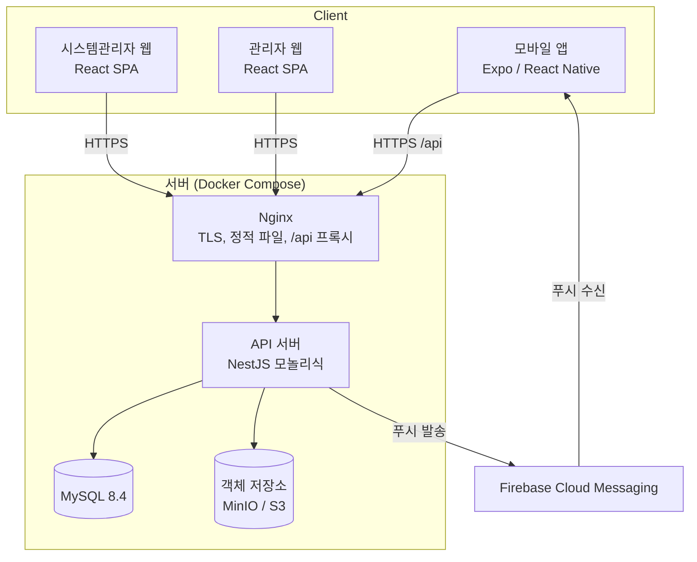

# healkee 기술스펙정의서

| 항목 | 내용 |
|---|---|
| 문서 버전 | v1.0 (검수 완료, 2026-11-09 변경사항 반영) |
| 작성일 | 2026-11-09 |
| 관련 문서 | [프로젝트 개요](01-project-overview.md) · [요구기능정의서](02-functional-requirements.md) · [DB 테이블 정의서](03-database-schema.md) |

---

## 1. 기술 스택 요약

모든 구성요소는 TypeScript로 작성한다. 아래 버전은 기준 버전이며, 프로젝트 세팅 시점의 최신 안정(LTS) 버전을 사용한다.

| 영역 | 기술 | 기준 버전 | 비고 |
|---|---|---|---|
| 언어 | TypeScript | 5.x | 전 구성요소 `strict: true` |
| 런타임 | Node.js | 22 LTS | 서버, 빌드 도구 |
| 패키지 매니저 | pnpm | 10.x | 워크스페이스로 모노레포 구성 |
| 모노레포 도구 | Turborepo | 2.x | 빌드, 린트, 테스트 파이프라인 캐시 |
| 백엔드 프레임워크 | NestJS | 11.x | 모놀리식 REST API |
| ORM | Prisma | 6.x | MySQL 커넥터 |
| 데이터베이스 | MySQL | 8.4 LTS | InnoDB, utf8mb4 |
| API 문서 | @nestjs/swagger (OpenAPI 3) | - | 클라이언트 타입 생성 원천 |
| 인증 | @nestjs/passport, passport-jwt, bcrypt | - | JWT 액세스 + 리프레시 |
| 검증 | class-validator, class-transformer | - | DTO 검증 |
| 스케줄러 | @nestjs/schedule | - | 일 배치 (노트 폐기, 결근 생성 등) |
| 엑셀 | exceljs | - | 근태, 시술 일지, 휴가, 면담 내보내기 |
| 푸시 | firebase-admin (FCM) | - | iOS, Android 공통 |
| 파일 저장소 | S3 호환 객체 저장소 (로컬: MinIO, 운영: AWS S3 또는 동급) | - | @aws-sdk/client-s3 |
| 로깅 | nestjs-pino | - | JSON 구조화 로그 |
| 관리자 웹 / 시스템관리자 웹 | React + Vite | React 19, Vite 7 | SPA |
| 웹 UI 라이브러리 | MUI (Material UI) | 7.x | 다크 테마, 접근성 내장 |
| 웹 라우팅 | React Router | 7.x | |
| 서버 상태 | TanStack Query | 5.x | 웹, 앱 공통 |
| 폼 | react-hook-form + zod | 7.x / 4.x | 웹, 앱 공통 |
| HTTP 클라이언트 | axios | 1.x | 인터셉터로 토큰 갱신 |
| 모바일 앱 | React Native (Expo) | Expo SDK 54, RN 0.81 | iOS 15+, Android 8+ |
| 앱 라우팅 | Expo Router | 6.x | 파일 기반 라우팅 |
| 앱 UI 라이브러리 | React Native Paper | 5.x | Material 3, 다크 테마, 접근성 |
| 앱 보안 저장소 | expo-secure-store | - | 리프레시 토큰 보관 |
| 앱 생체인증 | expo-local-authentication | - | Face ID, Touch ID, 지문 |
| 앱 푸시 | @react-native-firebase/messaging | - | FCM 토큰 |
| 앱 위치 | expo-location | - | 출퇴근 참고 위치 |
| 앱 빌드 | EAS Build, EAS Update | - | 스토어 배포, OTA 업데이트 |
| 컨테이너 | Docker, Docker Compose | Compose v2 | 개발, 배포 동일 구성 |
| 리버스 프록시 | Nginx | 1.27 | 정적 웹 서빙, API 프록시, TLS 종료 |
| 코드 품질 | ESLint 9 (flat config), Prettier 3 | - | 공통 설정 패키지 |
| 테스트 | Jest (API, 앱), Vitest (웹), Supertest (API e2e) | - | |
| Git 훅 | Husky + lint-staged | - | 커밋 전 린트, 포맷 |
| CI | GitHub Actions | - | 린트, 타입체크, 테스트, 도커 빌드 |

---

## 2. 시스템 아키텍처



| 원칙 | 내용 |
|---|---|
| 단일 API | 세 클라이언트가 같은 REST API를 사용한다. 역할별 차이는 인가 규칙으로 처리한다 |
| 모놀리식 | API 서버는 하나의 NestJS 애플리케이션이다. 모듈 경계를 명확히 두어 추후 분리 가능하게 한다 |
| 무상태 서버 | 세션은 JWT로 처리하고 서버 인스턴스는 상태를 갖지 않는다. 파일은 객체 저장소에 둔다 |
| 배치 내장 | 별도 워커 없이 API 서버 내부 스케줄러가 일 배치를 실행한다. 다중 인스턴스 운영 시 `SCHEDULER_ENABLED` 환경 변수로 한 인스턴스만 켠다 |

---

## 3. 저장소 구조 (모노레포)

```
healkee/
├─ apps/
│  ├─ api/                 # NestJS API 서버
│  ├─ admin-web/           # 관리자 웹 (기업 담당자, 복지관 관리자)
│  ├─ system-web/          # 시스템관리자 웹
│  └─ mobile/              # Expo 모바일 앱 (헬스키퍼)
├─ packages/
│  ├─ shared/              # 공유 타입, 열거형, 상수, zod 스키마, 날짜 유틸
│  ├─ api-client/          # OpenAPI에서 생성한 API 타입과 클라이언트 래퍼
│  ├─ ui-web/              # 관리자 웹과 시스템관리자 웹 공용 컴포넌트, MUI 테마
│  ├─ eslint-config/       # 공용 ESLint 설정
│  └─ tsconfig/            # 공용 tsconfig 베이스
├─ docker/
│  ├─ api.Dockerfile
│  ├─ web.Dockerfile       # admin-web, system-web 공용 (빌드 인자로 구분)
│  ├─ nginx/
│  │  ├─ nginx.conf
│  │  └─ conf.d/default.conf
│  └─ mysql/
│     └─ init/             # 초기 DB, 문자셋 설정 SQL
├─ scripts/
│  ├─ rename-project.mjs   # 프로젝트명 일괄 변경
│  └─ generate-api-client.mjs
├─ docs/                   # 개발 문서 (본 문서 포함)
├─ docker-compose.yml      # 공통 서비스 정의
├─ docker-compose.dev.yml  # 개발용 오버라이드 (핫 리로드, 포트 노출)
├─ docker-compose.prod.yml # 운영용 오버라이드
├─ project.config.json     # 프로젝트명, 표시명, 패키지 스코프, 번들 ID
├─ .env.example
├─ turbo.json
├─ pnpm-workspace.yaml
└─ package.json
```

패키지 스코프는 `@healkee/*`이며 프로젝트명 변경 시 함께 바뀐다 (10장 참고).

---

## 4. 백엔드 (API 서버)

### 4.1 모듈 구성

| 모듈 | 책임 | 관련 요구기능 |
|---|---|---|
| auth | 로그인, 토큰 발급과 갱신, 로그아웃, 비밀번호 변경, 로그인 실패 제한 | AUTH |
| users | 계정 CRUD(시스템관리자), 내 정보, 비밀번호 초기화 | AUTH, SYSM |
| organizations | 복지관, 기업 CRUD | SYSM |
| system-settings | 설정 조회, 수정, 이력 | SYSM |
| announcements | 공지사항 CRUD, 공개 범위 필터 | ANNC |
| notifications | 알림 생성, 목록, 읽음, 푸시 발송, 기기 토큰 | NOTI |
| files | 업로드 URL 발급, 다운로드 권한 검사, 메타데이터 | RESM, EMPL |
| resumes | 프로필, 장애정보, 학력, 경력 | RESM |
| registrations | 복지관 구직 등록 | REGI |
| job-postings | 공고 CRUD, 승인, 반려, 즉시 게시(복지관 작성), 마감 | JOBP |
| applications | 지원, 재직 중 지원 검사, 심사, 면접, 합격, 출근일 확정, 메모 | APPL |
| employments | 재직 기록, 재직 이력 | EMPL |
| contracts | 근로계약, 계약 파일 | EMPL |
| resignations | 퇴사 신청, 승인, 반려, 직접 처리 | RESG |
| attendance | 출퇴근, 판정, 정정, 조회, 집계, 엑셀 | ATTD |
| leaves | 연차 부여, 휴가 신청, 승인, 취소, 잔여, 엑셀 | LEAV |
| holidays | 전국 공휴일(SA), 기업 휴무일(CM) 관리, 근무일 계산 서비스 | SYSM-012, ATTD-014 |
| recipients | 피술자 CRUD | RCPT |
| treatment-rooms | 시술 장소 CRUD | TRTM-018 |
| treatments | 시술 일정, 상태 변경, 시술자·장소 중복 검사, 일지 조회, 통계, 엑셀 | TRTM |
| recipient-notes | 피술자 노트 CRUD, 접근 제한 | NOTE |
| surveys | 설문 양식, 문항, 버전 | SURV |
| interview-reports | 면담보고서 작성, 조회, 엑셀 | SURV |
| dashboard | 역할별 대시보드 집계 | DASH |
| scheduler | 일 배치 작업 등록 | 4.9 |
| excel | exceljs 공통 래퍼 | 4.10 |
| prisma | PrismaService, 트랜잭션 헬퍼 | - |
| common | 가드, 데코레이터, 필터, 인터셉터, 페이지네이션 DTO | - |

### 4.2 레이어 규칙

| 레이어 | 역할 | 규칙 |
|---|---|---|
| Controller | HTTP 요청 수신, DTO 검증, 인가 데코레이터 | 비즈니스 로직 금지. 서비스 호출 후 응답 DTO로 변환 |
| Service | 비즈니스 규칙, 트랜잭션, 알림 트리거 | Prisma를 직접 사용. 복잡한 쿼리는 Repository로 분리 가능 |
| Repository (선택) | 재사용되는 복잡한 Prisma 쿼리 | 비즈니스 판단 금지 |
| DTO | 요청, 응답 스키마 | `class-validator` 데코레이터 + `@ApiProperty` 필수 |
| Entity 변환 | Prisma 모델 → 응답 DTO | 민감 컬럼(password_hash 등)은 응답 DTO에 절대 포함하지 않음 |

### 4.3 API 규약

| 항목 | 규칙 |
|---|---|
| 기본 경로 | `/api/v1` |
| 리소스 명명 | 복수 명사, kebab-case. 예: `/api/v1/job-postings/{id}/approve` |
| 메서드 | 조회 GET, 생성 POST, 전체 수정 PUT, 부분 수정 PATCH, 삭제 DELETE. 상태 전이는 POST + 동사 하위 경로 (`/approve`, `/reject`, `/close`, `/check-in`) |
| 성공 응답 | `{ "data": ..., "meta": { ... } }`. 목록은 `data` 배열 + `meta.page`, `meta.size`, `meta.total` |
| 오류 응답 | `{ "error": { "code": "JOB_POSTING_NOT_PUBLISHED", "message": "사용자용 한국어 메시지", "details": [...] } }`. HTTP 상태 코드와 함께 도메인 오류 코드를 반드시 포함 |
| 페이지네이션 | `?page=1&size=20` (최대 100). 정렬 `?sort=createdAt,desc` |
| 날짜·시간 | 요청과 응답 모두 ISO 8601. 일시는 UTC(`Z`), 날짜만은 `YYYY-MM-DD`. 클라이언트가 Asia/Seoul로 표시 |
| 열거형 | DB 테이블 정의서 부록 A의 코드 문자열 그대로 사용 |
| ID | 숫자 문자열이 아닌 숫자(number)로 응답. BigInt는 서버에서 Number로 변환 (2^53 이내) |
| 버전 관리 | 하위 호환이 깨지는 변경은 `/api/v2`로 분리 |
| 문서 | Swagger UI `/api/docs` (개발, 스테이징만 노출). OpenAPI JSON은 클라이언트 타입 생성에 사용 |

### 4.4 인증

| 항목 | 규칙 |
|---|---|
| 방식 | JWT. 액세스 토큰 30분, 리프레시 토큰 14일 |
| 리프레시 토큰 | 발급 시 SHA-256 해시를 `refresh_tokens`에 저장. 갱신 시 기존 토큰 무효화 후 새 토큰 발급(회전). 재사용 감지 시 해당 사용자의 모든 토큰 무효화 |
| 비밀번호 | bcrypt, cost 12. 정책: 최소 8자, 영문과 숫자 포함 |
| 로그인 플랫폼 검사 | 요청 헤더 `X-Client-Platform` 값은 ios, android, web-admin, web-system 중 하나. HK는 ios, android만, CM과 WM은 web-admin만, SA는 web-system만 허용 |
| 최초 로그인 | `must_change_password = 1`이면 비밀번호 변경 API 외 모든 API가 403 `PASSWORD_CHANGE_REQUIRED` |
| 로그인 잠금 | 연속 5회 실패 시 `locked_until = now + 10분` |
| 생체인증 | 서버는 관여하지 않는다. 앱이 리프레시 토큰을 보안 저장소에 두고 생체인증 성공 시 꺼내 갱신 요청 |
| 웹 토큰 저장 | 액세스 토큰은 메모리, 리프레시 토큰은 `HttpOnly; Secure; SameSite=Strict` 쿠키 |

### 4.5 인가 (역할과 범위)

| 계층 | 규칙 |
|---|---|
| 역할 가드 | `@Roles(UserRole.COMPANY_MANAGER, ...)` 데코레이터로 엔드포인트별 허용 역할 지정 |
| 범위 가드 | 역할만으로 부족한 소속 범위를 서비스 계층에서 검사한다. CM은 `user.companyId`와 자원의 `companyId`가 같아야 하고, WM은 `user.welfareCenterId`와 자원의 `welfareCenterId`(기업의 소속 복지관 포함)가 같아야 한다. HK는 본인 자원만 |
| 교차 복지관 예외 | 조기 이직 지원의 조건부 승인(APPL-005)을 위해, 퇴사 신청을 처리하는 WM은 그 신청에 연결된 지원 건의 요약(공고 제목, 기업명, 공고 복지관명, 근무 시작 예정일, 지원 상태)을 읽을 수 있다. 공고 상세와 다른 지원자 정보는 읽을 수 없다 |
| 이력서 범위 | CM은 자기 공고 지원자와 자기 기업 재직(이력 포함) HK, WM은 자기 복지관 등록 HK와 소속 기업 재직(이력 포함) HK의 이력서를 읽을 수 있다 |
| 조회 동등성 | CM과 WM의 근태, 휴가, 시술 일지 조회 API는 같은 엔드포인트를 쓰고, 범위 조건만 다르게 적용한다 |
| 편집 권한 | 근태 정정, 휴가 승인, 시술 일정 등록은 CM만. 공고 승인, 재직 중 지원 승인, 퇴사 승인, 면담보고서는 WM만 |
| 피술자 노트 | 모든 API에서 `health_keeper_id = 요청자 id` 조건을 강제한다. SA 포함 어떤 역할도 타인 노트를 읽는 경로가 없다 |
| 면담보고서 | WM 전용. `welfare_center_id = 요청자 소속` 강제 |

### 4.6 유효성 검증

- 모든 요청 DTO는 `ValidationPipe({ whitelist: true, forbidNonWhitelisted: true, transform: true })`로 검증한다.
- 날짜 범위, 상태 전이 가능 여부, 중복 검사 등 비즈니스 검증은 서비스 계층에서 도메인 오류 코드로 반환한다.
- 상태 전이는 모듈별 상태 머신 맵(`allowedTransitions`)으로 정의하고 전이 전에 반드시 검사한다.

### 4.7 파일 업로드와 다운로드

| 항목 | 규칙 |
|---|---|
| 저장소 | S3 호환. 로컬 개발은 MinIO 컨테이너, 운영은 AWS S3 또는 동급 서비스. 버킷은 비공개 |
| 업로드 | 클라이언트가 `POST /files/upload-url`로 사전 서명 URL을 받아 저장소에 직접 PUT한 뒤 `POST /files/complete`로 메타데이터를 확정한다 |
| 키 규칙 | `{purpose}/{yyyy}/{mm}/{uuid}.{ext}` |
| 제한 | 증명사진 JPG, PNG 10MB. 계약서 PDF, JPG, PNG 20MB. MIME 타입을 서버에서 검증 |
| 다운로드 | `GET /files/{id}/download-url`에서 권한 검사 후 5분짜리 사전 서명 URL 반환. 증명사진은 HK 본인, 이력서 열람 범위에 해당하는 WM과 CM만. 계약서는 해당 재직의 HK, CM, WM만 |
| 삭제 | 소프트 삭제 후 일 배치가 저장소 객체 제거 |

### 4.8 푸시 알림

| 항목 | 규칙 |
|---|---|
| 발송 | 서비스에서 도메인 이벤트 발생 시 `NotificationsService.notify(userIds, event, payload)` 호출. 알림 행 생성 후 HK 수신자에게만 FCM 발송 |
| 이벤트 정의 | 요구기능정의서 부록 B의 번호를 `type` 코드로 사용 (`APPLICATION_DOCUMENT_RESULT` 등 의미 있는 상수명) |
| 페이로드 | 제목, 본문, `refType`, `refId`. 앱은 `refType`에 따라 화면 이동 |
| 토큰 관리 | 발송 실패 코드가 `registration-token-not-registered`이면 해당 기기 토큰 삭제 |
| 비동기 | 발송은 요청 트랜잭션 커밋 후 비동기로 수행하고 실패는 로그만 남긴다 (업무 처리에 영향 없음) |

### 4.9 배치 작업

모두 `@nestjs/schedule` Cron으로 등록하며 시간대는 Asia/Seoul 기준이다.

| 작업 | 시각 | 내용 | 관련 요구기능 |
|---|---|---|---|
| 재직 상태 전환 | 매일 00:10 | `start_date <= 오늘`인 PENDING 재직을 ACTIVE로 전환. `end_date < 오늘`인 ACTIVE 재직을 RESIGNED로 전환하고 `note_purge_scheduled_at = end_date + 유예일` 기록 | RESG-006 |
| 피술자 노트 폐기 | 매일 00:20 | `note_purge_scheduled_at <= now`이고 미폐기인 재직의 `recipient_notes` 물리 삭제, `note_purged_at` 기록 | NOTE-007 |
| 결근 생성 | 매일 00:30 | 전날이 근무일(계약 근무 요일이면서 공휴일, 기업 휴무일이 아닌 날)인 ACTIVE 재직 중 출근 기록과 승인 휴가가 없는 건에 ABSENT 생성 | ATTD-005 |
| 공고 자동 마감 | 매일 00:40 | `deadline_date < 오늘`인 PUBLISHED 공고를 CLOSED로 전환 | JOBP-008 |
| 계약 만료 알림 | 매일 09:00 | `end_date = 오늘 + 30일`인 현재 계약에 대해 알림 | EMPL-007 |
| 시술 리마인더 | 매 1분 | 10분 뒤 시작하는 SCHEDULED 시술에 대해 HK 푸시 | NOTI-006 |
| 삭제 파일 정리 | 매일 03:00 | `deleted_at`이 7일 지난 파일의 저장소 객체 삭제 | 4.7 |
| 만료 토큰 정리 | 매일 03:10 | 만료 또는 무효화된 리프레시 토큰 삭제 | 4.4 |

배치는 멱등하게 작성하고, 실행 결과(처리 건수, 실패)를 로그로 남긴다.

### 4.10 엑셀 내보내기

| 항목 | 규칙 |
|---|---|
| 라이브러리 | exceljs, 스트리밍 writer 사용 |
| 대상 | 근태(일별 + 월 집계 시트), 휴가(신청 내역 + 연차 현황 시트), 시술 일지(건별 + 월 통계 시트), 면담보고서(응답 시트) |
| 파일명 | `{문서종류}_{기업명 또는 복지관명}_{YYYYMMDD}-{YYYYMMDD}.xlsx` |
| 헤더 | 한국어 컬럼명. 시술 일지는 시술자명, 피술자명, 피술자 연락처, 직급, 소속팀, 성별, 시술 장소, 시술 시작일시, 시술 상태, 주의사항 순 |
| 시간 표기 | Asia/Seoul 기준 `YYYY-MM-DD HH:mm` |
| 응답 | `Content-Disposition: attachment`, 파일명은 RFC 5987 인코딩 |

### 4.11 로깅, 모니터링, 헬스체크

| 항목 | 규칙 |
|---|---|
| 로그 | nestjs-pino JSON 로그. 요청 ID, 사용자 ID, 경로, 상태 코드, 처리 시간 포함. 요청 본문은 로깅하지 않음 (개인정보) |
| 헬스체크 | `GET /api/health` (DB 연결 포함), `GET /api/health/live` (프로세스만). Docker healthcheck에 사용 |
| 오류 추적 | 5xx는 스택 포함 로그. 운영에서는 Sentry 연동 가능하도록 훅 자리 마련 (1차 범위 외) |

---

## 5. 데이터베이스

### 5.1 MySQL 설정

| 항목 | 값 |
|---|---|
| 버전 | 8.4 LTS |
| 문자셋 | `utf8mb4`, 콜레이션 `utf8mb4_0900_ai_ci` |
| 시간대 | 서버 `UTC`. 애플리케이션이 Asia/Seoul 변환 |
| 엔진 | InnoDB |
| 연결 | Prisma 커넥션 풀 기본값 사용. `connection_limit`는 환경 변수로 조정 |

### 5.2 Prisma 규칙

- 스키마 파일은 `apps/api/prisma/schema.prisma` 하나로 관리한다.
- 모델명은 PascalCase 단수, 테이블명은 `@@map("snake_case_plural")`, 필드는 camelCase + `@map("snake_case")`.
- 열거형은 Prisma `enum`으로 정의하고 MySQL 네이티브 ENUM 컬럼으로 저장한다 (Prisma 기본 매핑). 값 추가는 마이그레이션으로 처리한다.
- 모든 FK에 `@relation`을 명시하고 `onDelete` 규칙을 DB 테이블 정의서대로 지정한다.
- `BigInt` 컬럼은 서비스 계층에서 `Number`로 변환해 응답한다.
- 소프트 삭제 테이블은 Prisma Client Extension으로 기본 `where: { deletedAt: null }`을 적용한다.

### 5.3 마이그레이션과 시드

| 환경 | 명령 | 설명 |
|---|---|---|
| 개발 | `pnpm --filter api prisma migrate dev` | 마이그레이션 생성과 적용 |
| 운영 | `pnpm --filter api prisma migrate deploy` | 컨테이너 시작 전 적용 (entrypoint) |
| 시드 | `pnpm --filter api prisma db seed` | 시스템관리자 계정 1개, `system_settings` 초기값. 시드 계정 아이디와 비밀번호는 환경 변수 `SEED_ADMIN_LOGIN_ID`, `SEED_ADMIN_PASSWORD`에서 읽는다 |

마이그레이션 파일은 반드시 커밋하며, 운영 DB에 `migrate dev`를 실행하지 않는다.

### 5.4 시간대 처리 규칙

| 상황 | 규칙 |
|---|---|
| 저장 | 모든 일시는 UTC |
| 업무 날짜 | `work_date`, `start_date` 같은 DATE는 Asia/Seoul 날짜. 서버가 UTC 시각을 Asia/Seoul로 변환해 계산 |
| 근태 판정 | 계약의 `work_start_time`(TIME)과 `work_date`를 Asia/Seoul로 결합해 `expected_start_at`(UTC)을 만든다 |
| 유효 계약 | 날짜별 판정에는 해당 날짜에 유효한 계약(start_date 이하, end_date 이상 또는 end_date NULL)을 조회해 사용하고, 없으면 `is_current` 계약을 사용한다. 공통 서비스 `ContractResolver.forDate(employmentId, date)`로 일원화 |
| 근무일 판정 | 공통 서비스 `WorkdayService.isWorkday(employmentId, date)`가 계약 근무 요일, 전국 공휴일, 기업 휴무일을 함께 검사한다 |
| 클라이언트 | 표시 시 Asia/Seoul 고정 (기기 시간대 무시) |
| 라이브러리 | `date-fns` + `date-fns-tz`를 `@healkee/shared`에서 래핑해 공통 사용 |

---

## 6. 관리자 웹, 시스템관리자 웹

### 6.1 구성

| 항목 | 내용 |
|---|---|
| 앱 분리 | `admin-web`(CM, WM)과 `system-web`(SA)은 별도 Vite 앱, 별도 도메인 또는 경로로 배포. 공용 컴포넌트와 테마는 `@healkee/ui-web` |
| 렌더링 | SPA. Nginx가 정적 파일 서빙, `/api`는 API 서버로 프록시 |
| 역할별 메뉴 | `admin-web`은 로그인 사용자의 역할(CM 또는 WM)에 따라 메뉴와 편집 버튼을 다르게 노출. 조회 화면은 공유 |
| 라우팅 | React Router. 인증 필요 라우트는 가드 컴포넌트로 보호, 역할 불일치 시 403 페이지 |
| 서버 상태 | TanStack Query. 쿼리 키 규칙 `[도메인, 식별자, 필터]` |
| 폼 | react-hook-form + zod. zod 스키마는 `@healkee/shared`에서 API DTO와 동기화 |
| HTTP | axios 인스턴스. 401 시 리프레시 1회 후 재시도, 실패 시 로그아웃 |
| 표 | MUI DataGrid (Community). 서버 사이드 페이지네이션 |
| 날짜 입력 | MUI X Date Pickers, Asia/Seoul 고정 |

### 6.2 디자인과 접근성

| 항목 | 규칙 |
|---|---|
| 테마 | MUI 다크 테마 기본. 설정에서 라이트 전환, 선택은 `localStorage` |
| 글자 크기 | 본문 16px, 표 본문 15px, 제목 24px 이상. MUI 타이포그래피 스케일을 이 기준으로 재정의 |
| 대비 | 텍스트 대비 WCAG AA(4.5:1) 이상. 주요 버튼은 7:1 목표. 다크 배경 `#121212` 계열, 본문 텍스트 `#E0E0E0` 이상 |
| 포커스 | 모든 상호작용 요소에 2px 이상 가시 포커스 링 |
| 키보드 | 모달, 드롭다운, 표 모두 키보드 조작 가능 (MUI 기본 동작 유지) |
| 상태 색상 | 색상만으로 상태를 구분하지 않고 텍스트 레이블을 함께 표시 |
| 반응형 | 최소 1280px 데스크톱 기준. 태블릿(1024px)까지 표 가로 스크롤로 대응 |

### 6.3 화면 구성 (admin-web)

| 메뉴 | CM | WM |
|---|---|---|
| 대시보드 | 기업 대시보드 | 복지관 대시보드 |
| 헬스키퍼 | 재직 헬스키퍼 목록, 상세 | 구직 등록자 목록, 재직 헬스키퍼 목록, 재직 직접 등록, 상세(이력서 대리 작성 포함) |
| 채용 | 공고 관리, 지원자 관리 | 공고 작성(즉시 게시), 공고 승인, 지원 승인(재직 중 지원), 지원자 관리 |
| 근로계약 | 계약 등록, 조회 | 계약 등록, 조회 |
| 퇴사 | 퇴사 통보 조회 | 퇴사 신청 처리, 직접 처리 |
| 근태 | 근태 조회, 정정, 기업 휴무일 관리, 엑셀 | 근태 조회, 기업 휴무일 조회, 엑셀 |
| 휴가 | 연차 설정, 승인, 조회, 엑셀 | 조회, 엑셀 |
| 피술자·시술 장소 | 피술자 관리, 시술 장소 관리 | 피술자 조회, 시술 장소 조회 |
| 시술 | 일정 등록, 일지 조회, 통계, 엑셀 | 일지 조회, 통계, 엑셀 |
| 면담 | - | 설문 양식 관리, 면담보고서 작성, 조회, 엑셀 |
| 공지사항 | 조회 | 조회 |
| 알림 | 목록 | 목록 |
| 내 정보 | 조회, 수정, 비밀번호 변경 | 동일 |

### 6.4 화면 구성 (system-web)

| 메뉴 | 내용 |
|---|---|
| 대시보드 | 기관 수, 계정 수, 재직 헬스키퍼 수, 게시 중 공고 수 |
| 복지관 관리 | 목록, 등록, 수정, 비활성화 |
| 기업 관리 | 목록, 등록, 수정, 비활성화, 소속 복지관 지정 |
| 계정 관리 | 역할별 목록, 생성, 수정, 비활성화, 삭제, 비밀번호 초기화 |
| 공지사항 | 작성, 수정, 삭제, 공개 범위 |
| 시스템 설정 | 설정 값 수정, 변경 이력 |
| 공휴일 관리 | 연도별 전국 공휴일 등록, 수정, 삭제 |
| 내 정보 | 비밀번호 변경 |

---

## 7. 모바일 앱 (헬스키퍼)

### 7.1 구성

| 항목 | 내용 |
|---|---|
| 프레임워크 | Expo (개발 빌드 사용, Expo Go 미사용). 네이티브 모듈: Firebase Messaging, Local Authentication, Secure Store, Location |
| 라우팅 | Expo Router. 하단 탭 5개: 홈, 일정, 근태, 노트, 더보기 |
| 더보기 하위 | 이력서, 구직 등록, 채용 공고, 지원 현황, 휴가, 근로계약, 퇴사 신청, 공지사항, 알림, 설정(테마, 생체인증), 내 정보 |
| 서버 상태 | TanStack Query + axios (웹과 동일 패턴). 오프라인 시 마지막 조회 캐시 표시, 쓰기 동작은 네트워크 필요 |
| 폼 | react-hook-form + zod |
| UI | React Native Paper (Material 3). 테마 토큰을 `@healkee/shared`의 디자인 토큰과 맞춤 |
| 상태 저장 | 리프레시 토큰은 expo-secure-store. 테마, 생체인증 사용 여부는 AsyncStorage |

### 7.2 주요 화면과 동작

| 화면 | 핵심 동작 |
|---|---|
| 홈 | 상단에 출근 또는 퇴근 큰 버튼 1개(상태에 따라 전환). 오늘 일정 요약, 다음 시술 카드(피술자명, 시각, 주의사항 유무, 노트 바로가기), 미읽음 알림 수, 최신 공지 1건 |
| 일정 | 오늘, 일별, 주별 탭. 시술 건 목록. 각 건에서 시술완료, 미시술 큰 버튼. 상세에서 피술자 정보, 시술 장소, 주의사항, 건별 주의사항 입력, 노트 바로가기 |
| 근태 | 월별 달력 또는 목록. 일별 상태와 시각. 지각, 조퇴 사유 입력. 잔여 연차와 휴가 신청 바로가기 |
| 노트 | 재직 기업 피술자 목록(검색). 피술자별 기본정보 + 시술 일시별 메모. 메모 작성, 수정, 삭제 |
| 더보기 | 위 7.1 하위 메뉴 |

### 7.3 접근성 구현 규칙

| 항목 | 규칙 |
|---|---|
| 테마 | 다크 기본. 설정에서 라이트 전환 가능 |
| 글자 크기 | 본문 18pt, 제목 24pt 이상. `allowFontScaling` 유지, `maxFontSizeMultiplier` 지정하지 않음. 최대 배율(약 2.0)에서도 잘리지 않도록 고정 높이 금지 |
| 대비 | 텍스트 4.5:1 이상, 주요 버튼 7:1 목표 |
| 터치 영역 | 주요 동작 버튼 높이 64pt 이상, 그 외 48pt 이상. 버튼 간 간격 12pt 이상 |
| 레이블 | 모든 Pressable, 입력, 아이콘, 이미지에 `accessibilityLabel`. 역할은 `accessibilityRole`, 상태는 `accessibilityState` |
| 화면 진입 | 화면 제목에 `accessibilityRole="header"`, 진입 시 `AccessibilityInfo.setAccessibilityFocus`로 제목에 포커스 |
| 동적 안내 | 출근 완료, 시술완료 등 상태 변경 시 `AccessibilityInfo.announceForAccessibility`로 음성 안내, `expo-haptics`로 진동 |
| 목록 순서 | 시술 목록은 시각 순, 각 항목은 "n번째 시술, 10시, 2층 헬스키퍼실, 피술자 홍길동, 주의사항 있음" 형태의 통합 레이블 |
| 폼 오류 | 오류 메시지를 입력 필드의 `accessibilityHint`와 연결하고 제출 실패 시 첫 오류로 포커스 이동 |
| 제스처 | 스와이프 전용 동작 금지. 모든 동작은 버튼으로도 가능 |
| 시간 제한 | 자동 닫힘 토스트 사용 금지. 결과는 화면 내 텍스트와 음성 안내로 전달 |
| 테스트 | 출시 전 VoiceOver(iOS), TalkBack(Android)으로 핵심 흐름(로그인, 출퇴근, 시술완료, 노트 작성, 휴가 신청, 지원) 전수 점검 체크리스트 운영 |

### 7.4 인증과 생체인증

1. 아이디, 비밀번호 로그인 성공 시 리프레시 토큰을 expo-secure-store에 저장한다.
2. 설정에서 생체인증 사용을 켜면 앱 재진입 시 `expo-local-authentication`으로 인증 후 저장된 토큰으로 갱신한다.
3. 생체인증 5회 실패 또는 미지원 기기는 비밀번호 로그인으로 대체한다.
4. 로그아웃 시 보안 저장소의 토큰을 삭제하고 서버에 무효화를 요청한다.

### 7.5 푸시와 위치

| 항목 | 규칙 |
|---|---|
| 푸시 | 로그인 후 FCM 토큰을 `POST /device-tokens`로 등록. 알림 수신 시 `refType`에 따라 해당 화면으로 이동. 포그라운드 수신은 화면 내 배너 + 음성 안내 |
| 위치 | 출퇴근 버튼 시 `expo-location`으로 현재 위치 1회 조회(권한 거부 시 생략). 위치는 참고용이며 출퇴근을 막지 않는다 |

### 7.6 빌드와 배포

| 항목 | 규칙 |
|---|---|
| 빌드 | EAS Build. 프로파일 `development`, `preview`, `production` |
| 배포 | App Store, Google Play. JS 변경은 EAS Update로 OTA 배포 |
| 식별자 | iOS 번들 ID, Android 패키지명은 `project.config.json`의 `bundleId`에서 생성 (기본 `com.healkee.app`) |
| 환경 | `EXPO_PUBLIC_API_BASE_URL`로 API 주소 주입 |

---

## 8. 공유 패키지

| 패키지 | 내용 | 사용처 |
|---|---|---|
| @healkee/shared | 열거형(DB 부록 A와 동일), 상태 전이 맵, 상수(휴가 종류 레이블, 알림 타입), zod 스키마, 날짜 유틸(Asia/Seoul), 디자인 토큰(색상, 글자 크기) | api, admin-web, system-web, mobile |
| @healkee/api-client | API 서버의 OpenAPI JSON에서 `openapi-typescript`로 생성한 타입과 axios 래퍼. `pnpm generate:api`로 재생성 | admin-web, system-web, mobile |
| @healkee/ui-web | MUI 테마(다크 기본), 공용 레이아웃, 표, 폼 컴포넌트, 상태 뱃지 | admin-web, system-web |
| @healkee/eslint-config | ESLint flat config (typescript-eslint, react, react-native, import 정렬) | 전체 |
| @healkee/tsconfig | `base.json`, `nest.json`, `react.json`, `react-native.json` | 전체 |

API 서버의 열거형은 Prisma enum이 원천이며, `@healkee/shared`의 열거형과 값이 같은지 테스트로 검증한다.

---

## 9. 개발 환경과 Docker

### 9.1 Docker Compose 서비스

| 서비스 | 이미지 또는 빌드 | 포트(개발) | 역할 |
|---|---|---|---|
| mysql | mysql:8.4 | 3306 | DB. 볼륨 `mysql_data`. `docker/mysql/init`의 SQL로 문자셋과 DB 생성 |
| minio | minio/minio | 9000 (API), 9001 (콘솔) | 로컬 객체 저장소. 볼륨 `minio_data` |
| minio-init | minio/mc | - | 버킷 생성 후 종료 |
| api | docker/api.Dockerfile | 3000 | NestJS. 개발 모드에서는 소스 볼륨 마운트 + `nest start --watch` |
| admin-web | docker/web.Dockerfile (APP=admin-web) | 5173 | 개발: Vite dev server. 운영: Nginx 정적 서빙 |
| system-web | docker/web.Dockerfile (APP=system-web) | 5174 | 동일 |
| nginx | nginx:1.27 | 80, 443 | 운영 전용. 정적 파일과 `/api` 프록시, TLS |

모바일 앱은 컨테이너로 실행하지 않고 개발자 PC에서 Expo 개발 빌드로 실행하며, API는 `http://<PC IP>:3000`으로 접속한다.

### 9.2 Dockerfile 규칙

| 항목 | 규칙 |
|---|---|
| 베이스 | `node:22-alpine` |
| 멀티 스테이지 | `deps`(pnpm fetch) → `build`(turbo build) → `runner`(프로덕션 의존성만). 최종 이미지에 소스와 devDependencies 미포함 |
| pnpm | `corepack enable`로 버전 고정. `pnpm deploy --filter api --prod`로 격리된 산출물 생성 |
| API 엔트리포인트 | `prisma migrate deploy` 실행 후 `node dist/main.js` |
| 웹 | 빌드 산출물을 `nginx:1.27-alpine`에 복사. 환경별 API 주소는 빌드 시 `VITE_API_BASE_URL`로 주입 |
| 헬스체크 | api는 `/api/health/live`, mysql은 `mysqladmin ping` |
| 사용자 | 컨테이너는 비root 사용자로 실행 |

### 9.3 환경 변수

`.env.example`을 복사해 `.env`를 만든다. 비밀 값은 커밋하지 않는다.

| 변수 | 예시 | 설명 |
|---|---|---|
| COMPOSE_PROJECT_NAME | healkee | 컨테이너, 네트워크, 볼륨 접두어 |
| APP_NAME | healkee | 내부 식별자 (로그, 메트릭) |
| APP_DISPLAY_NAME | healkee | 화면 표시명 (앱, 웹 타이틀, 알림) |
| NODE_ENV | development | development, production |
| TZ | UTC | 컨테이너 시간대 |
| API_PORT | 3000 | |
| API_BASE_URL | http://localhost:3000 | 사전 서명 URL 등 절대 경로 생성용 |
| DATABASE_URL | mysql://healkee:pw@mysql:3306/healkee | Prisma 접속 문자열 |
| MYSQL_ROOT_PASSWORD, MYSQL_DATABASE, MYSQL_USER, MYSQL_PASSWORD | | mysql 컨테이너 초기화 |
| JWT_ACCESS_SECRET, JWT_REFRESH_SECRET | | 32자 이상 임의 문자열 |
| JWT_ACCESS_TTL, JWT_REFRESH_TTL | 30m, 14d | |
| S3_ENDPOINT | http://minio:9000 | 운영은 S3 엔드포인트 |
| S3_REGION, S3_BUCKET, S3_ACCESS_KEY, S3_SECRET_KEY | | |
| S3_FORCE_PATH_STYLE | true | MinIO는 true |
| FCM_SERVICE_ACCOUNT_JSON | (base64) | Firebase 서비스 계정 키 |
| SCHEDULER_ENABLED | true | 배치 실행 여부 |
| SEED_ADMIN_LOGIN_ID, SEED_ADMIN_PASSWORD | | 초기 시스템관리자 |
| CORS_ORIGINS | http://localhost:5173,http://localhost:5174 | 허용 오리진 |
| SWAGGER_ENABLED | true | 운영은 false |
| LOG_LEVEL | info | |
| VITE_API_BASE_URL | http://localhost:3000 | 웹 빌드 시 |
| EXPO_PUBLIC_API_BASE_URL | http://192.168.0.10:3000 | 앱 개발 시 |

### 9.4 로컬 시작 절차

```bash
cp .env.example .env
```

```bash
pnpm install
```

```bash
docker compose -f docker-compose.yml -f docker-compose.dev.yml up -d
```

```bash
pnpm --filter api prisma migrate dev && pnpm --filter api prisma db seed
```

```bash
pnpm --filter mobile start
```

- API: http://localhost:3000, Swagger: http://localhost:3000/api/docs
- 관리자 웹: http://localhost:5173, 시스템관리자 웹: http://localhost:5174
- MinIO 콘솔: http://localhost:9001

---

## 10. 프로젝트명 변경 가이드

프로젝트명 `healkee`는 가칭이다. 이름이 쓰이는 곳을 한 설정 파일로 모으고 스크립트로 일괄 변경한다.

### 10.1 설정 파일 `project.config.json`

```json
{
  "name": "healkee",
  "displayName": "healkee",
  "packageScope": "@healkee",
  "bundleId": "com.healkee.app",
  "dbName": "healkee"
}
```

### 10.2 이름이 쓰이는 위치

| 위치 | 항목 | 변경 방식 |
|---|---|---|
| 루트 `package.json`, 각 앱과 패키지의 `package.json` | `name` (`@healkee/api` 등) | 스크립트 치환 |
| 소스 코드의 import 경로 | `@healkee/shared` 등 | 스크립트 치환 |
| `.env`, `.env.example` | COMPOSE_PROJECT_NAME, APP_NAME, APP_DISPLAY_NAME, DATABASE_URL의 DB명 | 스크립트 치환 |
| `docker/mysql/init/*.sql` | DB명, 사용자명 | 스크립트 치환 |
| `apps/mobile/app.config.ts` | `name`, `slug`, `scheme`, `ios.bundleIdentifier`, `android.package` | `project.config.json`을 읽어 동적 생성 (치환 불필요) |
| 웹 `index.html` 타이틀, 앱 화면 표시명 | 표시명 | 런타임에 `APP_DISPLAY_NAME`, `EXPO_PUBLIC_APP_DISPLAY_NAME` 환경 변수 사용 (하드코딩 금지) |
| 푸시 알림 제목, 엑셀 파일명 | 표시명 | 서버가 `APP_DISPLAY_NAME` 사용 |

### 10.3 변경 절차

```bash
pnpm rename-project --name newname --display-name "새이름" --scope @newname --bundle-id com.newname.app
```

1. 스크립트가 `project.config.json`을 갱신하고 위 표의 "스크립트 치환" 항목을 모두 바꾼다.
2. `pnpm install`로 워크스페이스 링크를 재생성한다.
3. 기존 Docker 볼륨은 이전 이름으로 남으므로 `docker compose down -v` 후 재시작하거나 볼륨명을 수동 변경한다.
4. 이미 스토어에 출시된 앱의 번들 ID는 변경할 수 없으므로, 출시 전에 최종 이름을 확정한다.

---

## 11. 코드 품질과 협업 규칙

| 항목 | 규칙 |
|---|---|
| 린트, 포맷 | ESLint 9 + Prettier 3. 커밋 전 lint-staged로 변경 파일만 검사 |
| 타입 | `strict: true`, `noUncheckedIndexedAccess: true`. `any` 금지 (불가피하면 주석으로 사유) |
| 커밋 메시지 | Conventional Commits (`feat:`, `fix:`, `docs:`, `chore:`, `refactor:`, `test:`). 범위에 앱명 (`feat(api): ...`) |
| 브랜치 | `main`(배포), `develop`(통합), `feature/*`, `fix/*`. PR 필수, 리뷰 1명 이상 |
| 테스트 | API: 서비스 단위 테스트(비즈니스 규칙, 상태 전이, 근태 판정) + 핵심 흐름 e2e(로그인, 지원, 출퇴근, 노트 접근 제한). 웹: 핵심 컴포넌트와 폼 검증. 앱: 유틸과 훅 단위 테스트 |
| 커버리지 목표 | API 서비스 계층 80% 이상 |
| CI | PR마다 린트, 타입체크, 테스트, Docker 빌드. `main` 머지 시 이미지 빌드와 태그 |
| 문서 | API 변경 시 Swagger 데코레이터 갱신. DB 변경 시 마이그레이션과 DB 테이블 정의서 동시 갱신 |
| 비밀 | `.env`, 서비스 계정 키는 커밋 금지. `.gitignore`와 CI secret 사용 |

---

## 12. 보안

| 영역 | 규칙 |
|---|---|
| 전송 | 운영은 HTTPS만. Nginx에서 TLS 종료, HSTS |
| 인증 토큰 | 4.4 참고. 웹 리프레시 토큰은 HttpOnly 쿠키, 앱은 보안 저장소 |
| 비밀번호 | bcrypt cost 12. 평문 로그 금지. 초기 비밀번호는 다음 로그인 시 변경 강제 |
| 입력 | DTO 화이트리스트 검증. Prisma 파라미터 바인딩으로 SQL 인젝션 방지 |
| 헤더 | helmet 적용. CORS는 `CORS_ORIGINS` 화이트리스트 |
| 속도 제한 | @nestjs/throttler. 로그인 API는 IP당 분당 10회 |
| 개인정보 | 이력서(장애정보 포함), 면담보고서, 피술자 노트는 최소 권한 원칙. 응답에 불필요한 개인정보 포함 금지. 로그에 요청 본문 미기록 |
| 파일 | 비공개 버킷 + 사전 서명 URL. 다운로드 시 권한 검사 |
| 감사 | 근태 정정, 휴가 승인, 공고 승인, 퇴사 승인, 계정 변경은 처리자와 시각을 테이블에 기록 |
| 의존성 | `pnpm audit`을 CI에 포함. 주요 취약점은 머지 차단 |

---

## 13. 배포와 운영

| 항목 | 1차 구성 |
|---|---|
| 인프라 | 단일 리눅스 서버(VM)에 Docker Compose로 nginx, api, admin-web, system-web, mysql 배포. 객체 저장소는 외부 S3 사용 권장 (서버 장애 시 파일 보존) |
| 배포 절차 | CI가 빌드한 이미지를 레지스트리에 푸시 → 서버에서 `docker compose -f docker-compose.yml -f docker-compose.prod.yml pull && up -d` |
| 마이그레이션 | api 컨테이너 시작 시 `prisma migrate deploy` 자동 실행 |
| 백업 | 매일 `mysqldump` 압축 후 객체 저장소에 업로드, 30일 보관. 복구 절차 문서화 |
| 로그 | 컨테이너 표준 출력 → Docker json-file 드라이버(용량 제한) → 필요 시 외부 수집기 |
| 모니터링 | 헬스체크 실패 시 재시작 (`restart: unless-stopped`). 외부 업타임 모니터로 `/api/health` 감시 |
| 확장 | 트래픽 증가 시 api 컨테이너 수평 확장 가능 (무상태). 이때 `SCHEDULER_ENABLED`는 한 인스턴스만 true |
| 환경 | 개발(로컬 Docker), 스테이징(선택), 운영 세 단계. 스테이징은 운영과 같은 compose 파일 사용 |

---

## 14. 비기능 요구사항

| 항목 | 목표 |
|---|---|
| 응답 시간 | 일반 조회 API p95 500ms 이내, 엑셀 생성 1만 행 기준 10초 이내 |
| 동시 사용자 | 1차 기준 동시 접속 500명 |
| 가용성 | 업무 시간(평일 07:00~20:00) 99.5% |
| 브라우저 | 최신 Chrome, Edge, Safari, Firefox. 데스크톱 1280px 이상 기준 |
| 모바일 OS | iOS 15 이상, Android 8.0(API 26) 이상 |
| 접근성 | 모바일 앱 WCAG 2.1 AA 준수, VoiceOver와 TalkBack 핵심 흐름 전수 통과 |
| 데이터 보존 | 근태, 시술 일지, 채용 기록은 영구 보존(소프트 삭제). 피술자 노트는 퇴사 후 유예일 경과 시 물리 삭제 |
| 언어 | 한국어 단일 |
