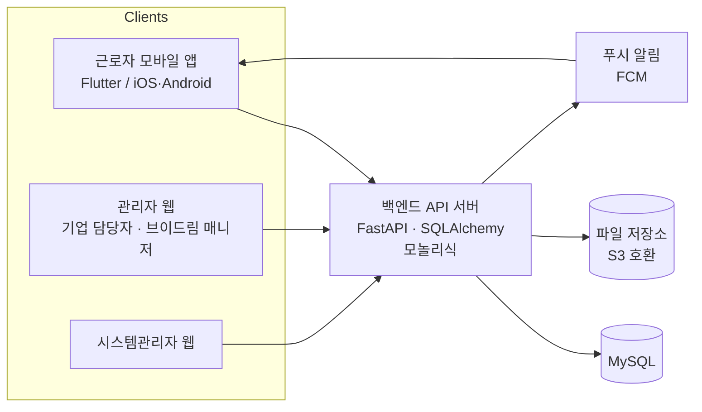

# my-vdream 프로젝트 개요

| 항목 | 내용 |
|---|---|
| 프로젝트명 | my-vdream (가칭, 추후 변경 가능하도록 설정) |
| 문서 버전 | v1.0 (초안, 2026-11-18 작성) |
| 작성일 | 2026-11-18 |
| 문서 성격 | 프로젝트의 목적, 사용자, 필요 기능, 핵심 업무 규칙을 정의하는 최상위 문서 |
| 기반 문서 | healkee v1.0 문서 체계를 유지하면서 장애인 재택근무 관리 시스템에 맞게 재작성. 변경 요약은 12장 |
| 관련 문서 | [요구기능정의서](02-functional-requirements.md) · [DB 테이블 정의서](03-database-schema.md) · [기술스펙정의서](04-tech-spec.md) · [개발 계획](05-development-plan.md) |

---

## 1. 배경

### 1.1 장애인 재택근무란

상시근로자 50명 이상인 기업은 장애인 의무고용률을 지켜야 하고, 미달하면 장애인고용부담금을 낸다. 그러나 사무실 출근이 어려운 장애인이 많고, 기업도 장애인이 수행할 직무를 설계하고 관리해 본 경험이 부족해 채용이 쉽지 않다. 재택근무는 이동 제약을 없애 지체, 시각, 청각, 발달 등 다양한 장애 유형의 근로자가 집에서 일할 수 있게 하고, 기업은 의무고용을 이행하면서 실제 업무 성과를 얻는다.

브이드림은 이런 장애인 재택근무를 전문으로 운영하는 회사다. 구직자를 모집해 기업과 연결하고, 채용 뒤에도 근태, 업무 배정, 업무일지, 상담을 플랫폼으로 관리하며 근로자와 기업 사이를 조율한다. 이 프로젝트는 브이드림의 운영 방식을 벤치마킹하여 근로자, 기업, 운영사(브이드림)가 함께 쓰는 재택근무 관리 시스템을 만든다.

### 1.2 현재의 문제

| 영역 | 현재 방식 | 문제 |
|---|---|---|
| 채용 | 기업 → 운영사 → 근로자 순으로 채용 조건, 이력서, 면접 일시, 합격 여부를 사람이 일일이 전달 | 전달 지연, 누락, 기록 부재 |
| 근태 | 재택 근로자가 메신저나 전화로 출퇴근을 보고 | 기록이 남지 않고, 실제 근무 여부를 확인할 방법이 없음 |
| 업무 배정 | 기업 담당자가 메일, 메신저로 업무를 전달 | 기한과 진행 상황을 추적하기 어렵고 누락이 잦음 |
| 업무일지 | 수기, 엑셀, 메신저 보고 | 기업과 운영사가 같은 기록을 보기 어렵고 누적 관리가 안 됨 |
| 상담 기록 | 운영사 매니저가 전화, 화상 상담 후 개별 기록 | 매니저마다 양식이 다르고 이력 추적이 어려움 |
| 접근성 | 기업의 기존 HRM, 협업 도구는 다양한 장애 유형에 대한 접근성이 낮음 | 근로자가 시스템을 직접 쓰지 못하고 담당자에게 의존 |

---

## 2. 목적

1. 근로자, 기업, 브이드림 세 당사자가 **하나의 시스템에서 같은 정보를 실시간으로 공유**한다.
2. 근로자가 **스스로 사용할 수 있는 접근성 높은 모바일 앱**을 제공한다. 스크린리더 대응, 큰 글씨와 고대비, 단순한 화면 구조, 소리에 의존하지 않는 알림을 기본 원칙으로 하여 시각, 청각, 지체, 발달 장애를 모두 고려한다.
3. 채용부터 근태, 업무, 퇴사까지 **재택 근로자 고용의 전체 생애주기를 기록**하여 기업과 브이드림이 각자의 시스템에 옮겨 적을 수 있는 근거 자료(엑셀)를 제공한다.
4. 기업마다 다른 운영 방식을 모두 수용하기보다 **가장 단순한 공통 흐름**을 정확하게 구현한다.

---

## 3. 용어 정의

| 용어 | 정의 |
|---|---|
| 근로자 (WK) | 브이드림을 통해 기업에 채용되어 재택으로 근무하는 장애인 근로자. 이 시스템의 모바일 앱 사용자 |
| 기업 | 근로자를 고용하는 회사. 모든 기업은 브이드림과 협력한다 |
| 기업 담당자 (CM) | 기업 안에서 근로자의 채용, 근태, 업무 배정, 업무일지 확인을 담당하는 직원. 관리자 웹 사용자 |
| 브이드림 (운영사) | 장애인 재택근무 서비스를 운영하는 회사. 근로자의 구직 등록을 받아 기업과 연결하고 재직 중 상담을 담당한다. 시스템에 하나만 존재한다 |
| 브이드림 매니저 (VM) | 브이드림에서 기업과 근로자를 담당하는 직원. 관리자 웹 사용자 |
| 담당 매니저 | 특정 기업을 전담하도록 지정된 브이드림 매니저. 해당 기업 관련 알림을 받는다 |
| 시스템관리자 (SA) | 기업, 모든 계정, 공지사항, 공휴일, 시스템 설정을 관리하는 운영자. 시스템관리자 웹 사용자 |
| 구직 등록 | 근로자가 브이드림의 구직자 명단에 올라가 공고에 지원할 수 있는 상태가 되는 것 |
| 채용 공고 (공고) | 기업이 작성하고 브이드림이 승인하여 게시하는 재택 근로자 모집 공고 |
| 입사지원 (지원) | 근로자가 공고에 지원하는 행위와 그 이후의 서류심사, 면접, 합격, 출근일 확정까지의 기록 |
| 재직 | 근로자가 특정 기업에 입사하여 근무 중인 상태 또는 그 기록 |
| 근로계약 | 재직에 대해 체결한 계약. 갱신 시 새 계약이 추가되어 이력이 남는다 |
| 업무 | 기업 담당자가 근로자에게 배정하는 일의 단위. 제목, 내용, 우선순위, 기한, 첨부파일로 구성 |
| 업무일지 | 근로자가 근무일마다 작성하는 하루 업무 기록. 수행한 업무 항목, 수행 내용, 소요 시간, 산출물 파일, 특이사항으로 구성 |
| 업무일지 확인 | 기업 담당자가 제출된 업무일지를 검토하여 확인하거나 보완을 요청하는 것 |
| 휴게 | 근무 시간 중 쉬는 시간. 근로자가 앱에서 시작과 종료를 기록한다 |
| 근무 확인 | 근무 시간 중 임의 시각에 앱 푸시로 근무 중임을 확인하는 절차. 기업이 선택적으로 사용한다 |
| 상담보고서 | 브이드림 매니저가 근로자와 전화, 화상, 방문, 메신저로 상담한 뒤 작성하는 설문 형식의 보고서. 브이드림만 열람 |
| 재택근무 환경 | PC, 인터넷, 보조기기 등 근로자의 근무 환경 정보. 이력서의 일부 |

---

## 4. 사용자 종류 및 역할

| 사용자 | 약어 | 소속 | 사용 플랫폼 | 주요 역할 |
|---|---|---|---|---|
| 장애인 근로자 | WK | 개인 (브이드림에 구직 등록, 재직은 한 기업만) | 모바일 앱 (iOS, Android) | 이력서 작성, 구직 등록, 공고 조회 및 지원, 출퇴근·휴게 체크, 휴가 신청, 배정된 업무 수행과 상태 변경, 업무일지 작성·제출, 근무 확인 응답, 퇴사 신청 |
| 기업 담당자 | CM | 기업 (1개) | 관리자 웹 | 공고 작성, 지원자 심사, 면접 및 합격 처리, 근로계약 등록, 업무 배정, 업무일지 확인, 근태 확인 및 정정, 휴가 승인, 근무 확인 설정, 통계 및 엑셀 |
| 브이드림 매니저 | VM | 브이드림 | 관리자 웹 | 구직 등록자 관리, 이력서 대리 작성, 공고 작성·승인·마감, 채용 진행 입력, 재직 중 지원 승인, 퇴사 승인, 근태·업무·업무일지 조회, 상담보고서 양식 설정 및 작성 |
| 시스템관리자 | SA | 브이드림 (운영 조직) | 시스템관리자 웹 | 기업 등록, 담당 매니저 지정, 모든 계정 생성·수정·삭제, 공지사항, 공휴일, 시스템 설정 |

### 4.1 권한 요약

| 영역 | WK | CM | VM | SA |
|---|---|---|---|---|
| 이력서 | 본인 작성·수정 | 지원자·재직 근로자 열람 | 전체 열람·대리 작성 | - |
| 구직 등록 | 등록·해제 | - | 조회·대리 등록·해제 | - |
| 채용 공고 | 전체 조회·지원 | 작성·마감 | 작성·승인·반려·마감 | - |
| 채용 진행 | 본인 현황 조회 | 입력 | 입력 | - |
| 근로계약 | 본인 조회 | 등록 | 등록·조회 | - |
| 근태 | 출퇴근·휴게 체크·본인 조회 | 전체 조회·정정·엑셀 | 전체 조회·엑셀 | - |
| 휴가 | 신청·본인 조회 | 승인·반려·조회·엑셀 | 조회·엑셀 | - |
| 업무 | 본인 업무 조회·상태 변경·댓글 | 배정·수정·취소·보류·댓글 | 조회 | - |
| 업무일지 | 작성·제출·본인 조회 | 확인·보완 요청·조회·엑셀 | 조회·엑셀 | - |
| 근무 확인 | 응답·본인 결과 조회 | 사용 설정·결과 조회 | 결과 조회 | 기본값 설정 |
| 상담보고서 | 불가 | 불가 | 양식 설정·작성·조회 | - |
| 퇴사 | 신청·입사 포기 | 통보 조회 | 승인·반려·직접 처리 | - |
| 공지사항 | 조회 | 조회 | 조회 | 작성·수정·삭제 |
| 기업·계정 | - | - | 기업 조회 | 전체 |
| 시스템 설정 | - | - | - | 전체 |
| 공휴일·휴무일 | - | 기업 휴무일 관리 | 조회 | 전국 공휴일 관리 |
| 재직 직접 등록 | - | - | 등록 | - |

---

## 5. 시스템 구성

| 구성 요소 | 사용자 | 설명 |
|---|---|---|
| 백엔드 API 서버 | 전체 | 단일 모놀리식 서버 (Python, FastAPI). 인증, 비즈니스 로직, 배치 작업, 푸시 발송, 엑셀 생성 |
| 근로자 모바일 앱 | WK | Flutter로 iOS, Android 동시 제공. 접근성 최우선 |
| 관리자 웹 | CM, VM | 같은 웹 앱(React)을 역할에 따라 메뉴와 권한만 다르게 제공 |
| 시스템관리자 웹 | SA | 별도 웹 앱(React) |
| 데이터베이스 | - | MySQL |
| 파일 저장소 | - | 증명사진, 근로계약서, 업무 첨부파일, 업무일지 산출물 |
| 개발·배포 환경 | - | Docker, Docker Compose |

백엔드는 Python(FastAPI), 모바일 앱은 Dart(Flutter), 웹은 TypeScript(React)로 작성한다. 상세 기술 구성은 [기술스펙정의서](04-tech-spec.md) 참고.

---

## 6. 조직 구조와 핵심 업무 규칙

### 6.1 조직 관계

1. 브이드림은 시스템에 **하나만 존재하는 운영 조직**이며, 기업은 여러 곳이 시스템을 사용한다.
2. 모든 기업은 브이드림과 협력한다. 기업마다 **담당 매니저**를 지정할 수 있으며(선택), 담당 매니저는 해당 기업과 소속 근로자 관련 알림을 받는다. 담당 매니저가 없는 기업의 알림은 모든 브이드림 매니저에게 간다.
3. 브이드림 매니저의 조회 범위는 **브이드림 전체**다. 모든 기업과 근로자를 볼 수 있되, 목록 화면은 "내 담당 기업"을 기본 필터로 먼저 보여준다.
4. 근로자는 브이드림에 **한 번 구직 등록**한다. 운영 조직이 하나이므로 기관별 등록 개념은 없다.
5. 근로자는 **한 번에 하나의 기업에서만 재직**할 수 있다.
6. 한 기업에는 담당자 계정이 여러 개 있을 수 있다.

### 6.2 계정 규칙

1. 근로자, 기업 담당자, 브이드림 매니저 계정은 **시스템관리자가 시스템관리자 웹에서 직접 생성**한다. 자가 회원가입은 없다.
2. 시스템관리자는 모든 계정을 수정, 비활성화, 삭제할 수 있고 비밀번호를 초기화할 수 있다.
3. 최초 로그인 시 비밀번호 변경을 강제한다.
4. 근로자 계정을 만들면 비어 있는 이력서 프로필이 함께 생성된다.

### 6.3 구직 등록 규칙

1. 근로자가 앱에서 구직 등록을 켜면 즉시 **구직중** 상태가 되고 브이드림 매니저에게 알림이 간다.
2. 브이드림 매니저가 근로자의 의사를 전화 등으로 확인한 뒤 대리로 구직 등록할 수 있다. 근로자에게 알림이 가며 별도 승인 절차는 없다.
3. 공고에 지원하려면 구직중 상태여야 한다. 구직 안 함 상태로 지원을 시도하면 구직 등록 안내 화면을 거쳐 등록과 지원을 한 흐름으로 처리한다.
4. 입사(재직중 전환) 시 구직 등록은 자동으로 해제된다. 재직 중 이직을 원하면 다시 등록한 뒤 지원한다(6.5 적용).
5. 진행 중인 지원이 있으면 구직 등록을 해제할 수 없다.

### 6.4 채용 규칙

1. 공고는 기업 담당자 또는 브이드림 매니저가 작성한다. 기업 담당자가 작성한 공고는 브이드림 매니저가 승인해야 게시되고, 반려 시 사유와 함께 기업 담당자에게 돌아간다. 브이드림 매니저가 기업을 지정해 작성한 공고는 승인 절차 없이 즉시 게시된다.
2. 공고 마감, 면접 일시, 합격 여부, 실제 출근 시작일은 기업 담당자와 브이드림 매니저 **모두** 입력할 수 있다.
3. 공고의 채용 조건은 직무 분야, 주요 업무 내용, 근무 형태(재택, 혼합), 근무 요일과 시간, 주 소정근로시간, 급여, 복리후생, 지원 장비, 필요 역량, 근무 시작 예정일, 계약 기간, 모집 인원으로 구성한다. 성별 조건은 두지 않는다.
4. 지원 시 근로자의 이력서가 기업에 공개된다. 기업은 자기 공고의 지원자 이력서만 볼 수 있다.
5. 최종 합격 후 출근 시작일이 입력되면 입사 예정 상태의 재직 기록과 공고 조건을 복사한 초기 근로계약이 생성된다. 출근 시작일이 되면 재직중으로 전환되어 근태와 업무일지 기능이 열리고, 업무는 출근 시작일 이후 기한으로 미리 배정할 수 있다.
6. 최종 합격자가 입사를 포기하면 지원은 입사 포기 상태가 되고, 이미 만들어진 입사 예정 재직 기록은 취소된다.
7. 시스템 도입 전부터 재직 중인 근로자는 브이드림 매니저가 재직 기록과 근로계약을 직접 등록한다.

### 6.5 재직 중 입사지원 규칙

1. 재직 중에도 다른 공고에 지원할 수 있다. 입사 시 해제된 구직 등록은 다시 켜야 한다.
2. 지원하려는 공고의 근무 시작 예정일이 **현재 재직 종료일 이후**이면 아무 절차 없이 지원된다. 재직 종료일은 승인된 퇴사일이 있으면 그 날짜, 없으면 현재 유효한 근로계약의 종료일이다.
3. 근무 시작 예정일이 **현재 재직 종료일 이전**이거나 **종료일이 없으면**, 경고 팝업을 띄우고 퇴사 예정일과 퇴사 사유를 입력받는다. 이 내용은 현재 재직 기업의 담당 매니저에게 자동으로 알려지고, 브이드림 매니저가 승인해야 지원이 정상 접수된다. 반려되면 지원은 취소된다.
4. 이때 입력한 퇴사 예정일과 사유는 퇴사 신청으로 저장되며, 브이드림 매니저의 승인은 **조건부 승인**이다. 지원이 최종 합격을 거쳐 출근 시작일이 확정되는 시점에 퇴사가 확정되어 현재 재직의 종료일이 설정되고 기업 담당자에게 통보된다. 지원이 불합격이나 취소로 끝나면 퇴사 신청은 자동 철회되고 현재 재직은 그대로 유지된다.
5. 새 출근 시작일은 기존 재직 종료일 이후여야 한다. 퇴사 신청 없이 지원된 경우 입사 시점에 기존 재직 종료일이 현재 계약 종료일로 설정된다.

### 6.6 근태 규칙

1. 근태는 기업 담당자가 전적으로 관리한다. 브이드림 매니저는 기업 담당자와 **동일한 정보를 조회**하고 엑셀로 내려받을 수 있지만 정정이나 승인은 할 수 없다.
2. 출퇴근은 근로자가 앱에서 버튼으로 기록한다. 시각은 서버 시각을 사용한다. 기기 위치(권한이 있을 때)와 접속 IP는 참고용으로만 저장하며 출퇴근을 막는 조건으로 쓰지 않는다.
3. 지각은 근로계약의 소정 근로 시작 시각 이후 출근, 조퇴는 소정 근로 종료 시각 이전 퇴근으로 자동 판정한다. 근로자는 사유를 적을 수 있고, 기업 담당자는 기록을 정정할 수 있다.
4. 근로자는 근무 중 휴게 시작과 종료를 기록할 수 있다(선택). 실근무 시간은 퇴근 시각에서 출근 시각과 휴게 시간을 뺀 값이며 집계와 엑셀에 표시한다. 휴게 기록은 근태 상태 판정에 쓰지 않는다.
5. 휴가는 근로자가 신청하고 기업 담당자가 승인 또는 반려한다. 연차 부여일수는 기업 담당자가 입력하며 시스템이 사용분을 차감한다.
6. 근무일은 근로계약의 근무 요일에서 전국 공휴일과 기업 휴무일을 뺀 날이다. 공휴일은 시스템관리자가, 기업 휴무일은 기업 담당자가 관리한다. 결근 생성과 휴가 일수 계산은 근무일만 센다.
7. 근태 판정에 쓰는 계약 조건은 그 날짜에 유효한 근로계약의 것이다. 갱신 계약을 미리 등록해도 시작일 전까지는 기존 계약 조건이 적용된다.
8. 퇴근 체크 시 그날 업무일지가 제출되지 않았으면 작성을 안내한다. 퇴근 자체는 막지 않는다.

### 6.7 근무 확인 규칙 (선택 기능)

1. 근무 확인은 기업 담당자가 기업별로 켜고 끈다. 끈 기업에는 아무 요청도 가지 않는다.
2. 켠 기업의 근로자가 출근 체크하면 그날 근무 시간 안에서 하루 N회의 임의 시각이 정해지고, 그 시각에 앱 푸시로 근무 확인 요청이 간다. 근로자는 제한 시간 안에 앱에서 확인 버튼을 누른다. 횟수와 제한 시간의 기본값은 시스템관리자가 설정하고(기본 하루 2회, 10분), 횟수는 기업별로 바꿀 수 있다.
3. 휴게 중이거나 퇴근한 뒤에는 요청을 보내지 않는다. 휴게 중이면 요청을 미루고, 퇴근하면 남은 요청을 건너뛴다.
4. 미응답은 기록으로만 남겨 기업 담당자와 브이드림 매니저가 참고한다. 근태 상태를 바꾸거나 자동으로 불이익을 주지 않는다.
5. 화면 캡처, 키보드 입력 기록 같은 감시형 모니터링은 하지 않는다. 근무 확인은 근로자가 스스로 응답하는 방식만 사용한다.

### 6.8 업무 규칙

1. 업무는 기업 담당자가 근로자 한 명에게 건별로 배정한다. 여러 명에게 같은 일을 주려면 건별로 등록한다. 배정 시 근로자에게 알림이 간다.
2. 업무는 제목, 내용, 우선순위(낮음, 보통, 높음), 기한(선택), 첨부파일로 구성한다. 입사 예정 근로자에게도 출근 시작일 이후 기한으로 미리 배정할 수 있다.
3. 업무 상태는 배정됨, 진행중, 완료, 보류, 취소 다섯 가지다. 진행중과 완료는 근로자가, 보류와 취소, 완료된 업무의 재오픈은 기업 담당자가 처리한다.
4. 업무 건별로 기업 담당자와 근로자가 댓글을 남겨 질문과 답변을 주고받을 수 있다. 브이드림 매니저는 조회만 한다. 업무 맥락을 벗어난 자유 채팅은 제공하지 않는다.
5. 기한 전날과 기한 초과 시 알림을 보낸다.

### 6.9 업무일지 규칙

1. 근로자는 출근한 근무일마다 업무일지를 1건 작성한다. 업무일지는 여러 항목으로 구성되며 각 항목은 배정된 업무를 선택하거나 업무명을 직접 입력하고, 수행 내용과 소요 시간(분)을 적는다. 하루 요약, 특이사항·건의, 산출물 파일을 함께 넣을 수 있다.
2. 작성 중에는 임시저장 상태이며, 근로자가 제출하면 기업 담당자에게 알림이 간다. 제출 후 기업 담당자가 확인하기 전까지는 근로자가 수정하여 다시 제출할 수 있다.
3. 기업 담당자는 제출된 업무일지를 **확인**하거나 사유를 적어 **보완 요청**한다. 보완 요청된 업무일지는 근로자가 수정하여 다시 제출한다. 확인된 업무일지는 기업 담당자만 확인을 취소할 수 있다.
4. 브이드림 매니저는 업무일지를 기업 담당자와 동일하게 조회하고 엑셀로 내려받을 수 있지만 확인이나 보완 요청은 할 수 없다.
5. 업무일지가 제출되면 항목에 연결된 업무의 누적 소요 시간이 갱신된다.
6. 소정 근로 종료 시각이 지나도 업무일지가 제출되지 않으면 근로자에게 리마인더를 보낸다.

### 6.10 상담 규칙

1. 상담보고서는 설문지 형식이며, 문항 구성, 척도 점수 수, 점수별 레이블, 객관식과 주관식 구성을 **브이드림 매니저가 브이드림 공통 양식으로 관리**한다. 양식은 여러 개 둘 수 있다.
2. 상담 방식은 전화, 화상, 방문, 메신저 네 가지다.
3. 상담보고서는 브이드림 매니저만 볼 수 있다. 근로자와 기업 담당자는 볼 수 없다.

### 6.11 퇴사 규칙

1. 근로자는 브이드림 매니저에게 먼저 퇴사 의사를 알린다. 앱에서 퇴사 예정일과 사유를 넣어 신청하면 담당 매니저에게 알림이 간다.
2. 브이드림 매니저가 충분히 소통한 뒤 승인하면 기업 담당자에게 알림이 간다.
3. 퇴사일이 지나면 재직 상태가 종료된다. 퇴사 후 해당 기업의 근태, 업무, 업무일지는 조회만 가능하다.
4. 근로자가 구두로 퇴사 의사를 전한 경우 브이드림 매니저가 퇴사일과 사유를 직접 입력해 처리할 수 있다.
5. 기업 담당자는 승인된 퇴사 내역을 조회할 수 있다.

### 6.12 공지사항 규칙

1. 공지사항은 시스템관리자만 작성, 수정, 삭제한다.
2. 공개 범위는 모두 공개, 브이드림 매니저 대상 공개, 기업 대상 공개, 브이드림과 기업에게만 공개, 근로자에게만 공개 다섯 가지다.

---

## 7. 필요 기능 요약

| 카테고리 | 주요 기능 | 상세 |
|---|---|---|
| 공통 | 로그인, 비밀번호 관리, 생체인증 재로그인(앱), 푸시 알림, 알림 목록, 공지사항 조회 | [요구기능정의서 1~3장](02-functional-requirements.md) |
| 시스템관리 | 기업 등록, 담당 매니저 지정, 계정 생성·수정·삭제, 비밀번호 초기화, 공지사항 관리, 공휴일 관리, 시스템 설정 | 4장 |
| 근로자 이력 관리 및 입사지원 | 이력서(기본정보, 장애정보, 재택근무 환경, 희망 직무, 학력, 경력, 자격증), 구직 등록, 공고 작성·승인·게시·마감, 지원, 서류심사, 면접, 합격, 출근일 확정, 근로계약, 퇴사 | 5~10장 |
| 근태관리 (휴가 포함) | 출퇴근 체크, 휴게 기록, 지각·조퇴·결근 판정, 근태 정정, 연차 부여, 휴가 신청·승인, 월별 현황, 엑셀 | 11~12장 |
| 업무 관리 | 업무 배정·수정·취소·보류, 상태 변경, 업무 댓글, 기한 알림, 업무 목록·상세 | 13장 |
| 업무일지 | 일지 작성·제출, 확인·보완 요청, 산출물 첨부, 미제출 현황, 월별 통계, 엑셀 | 14장 |
| 근무 확인 | 기업별 사용 설정, 임의 시각 확인 요청, 응답, 미응답 기록, 결과 조회 | 15장 |
| 브이드림 상담 | 설문 양식 설정, 상담보고서 작성·조회 | 16장 |
| 대시보드 및 접근성 | 역할별 대시보드, 테마와 고대비, 큰 글씨, 스크린리더, 소리에 의존하지 않는 피드백, 쉬운 문장 | 17~18장 |

---

## 8. 핵심 업무 흐름

### 8.1 채용 흐름

1. 시스템관리자가 기업, 기업 담당자 계정, 브이드림 매니저 계정, 근로자 계정을 생성하고 기업에 담당 매니저를 지정한다.
2. 근로자가 앱에서 이력서를 작성하고(또는 브이드림 매니저가 대리 작성) 구직 등록을 켠다.
3. 기업 담당자가 채용 조건(직무 분야, 주요 업무, 근무 형태, 근무 요일과 시간, 주 소정근로시간, 급여, 복리후생, 지원 장비, 필요 역량, 근무 시작 예정일, 계약 기간, 모집 인원)을 담아 공고를 작성하고 승인을 요청한다. 브이드림 매니저가 기업을 대신해 직접 작성할 수도 있다.
4. 기업 담당자가 작성한 공고는 브이드림 매니저가 승인하면 게시된다. 반려 시 수정 후 다시 요청한다. 브이드림 매니저가 작성한 공고는 즉시 게시된다.
5. 근로자가 앱에서 공고를 보고 지원한다. 구직 안 함 상태면 구직 등록 후 지원된다. 재직 중이면 6.5 규칙이 적용된다.
6. 기업 담당자(또는 브이드림 매니저)가 지원자 이력서를 보고 서류심사 결과를 입력한다.
7. 면접 일시와 방식(화상 또는 방문)을 입력하면 근로자와 브이드림 매니저에게 알림이 간다. 화상 면접 링크나 방문 장소는 안내 사항에 적는다. 브이드림 매니저가 면접에 배석한다.
8. 면접 결과(최종 합격, 불합격)를 입력한다.
9. 출근 시작일을 입력하면 입사 예정 상태의 재직 기록과 공고 조건을 복사한 초기 근로계약이 생성된다.
10. 실제 계약 내용으로 근로계약을 수정하고 서명된 계약서 파일을 첨부한다.
11. 출근 시작일이 되면 재직중으로 전환되고 구직 등록은 해제된다.
12. 기업 담당자 또는 브이드림 매니저가 공고를 마감한다.

### 8.2 일일 근무 흐름

1. 기업 담당자가 전날 또는 당일에 업무를 배정한다. 근로자에게 푸시 알림이 간다.
2. 근로자가 근무 시작 시각에 앱에서 출근 버튼을 누른다. 소정 근로 시작 시각보다 늦으면 지각으로 기록되고 사유를 적을 수 있다.
3. 앱 홈에서 오늘 업무 목록과 업무일지 상태를 확인하고, 일을 시작한 업무를 진행중으로 바꾼다.
4. 근무 중 휴게를 시작하고 끝낼 때 버튼을 누른다. 근무 확인 요청이 오면 제한 시간 안에 확인 버튼을 누른다.
5. 업무를 하면서 업무일지에 항목을 추가한다. 배정된 업무를 선택하고 수행 내용과 소요 시간을 적고 산출물 파일을 첨부한다.
6. 끝낸 업무는 완료로 표시한다. 기업 담당자에게 알림이 간다.
7. 퇴근 전에 업무일지를 제출하고 퇴근 버튼을 누른다. 소정 근로 종료 시각보다 이르면 조퇴로 기록된다. 업무일지를 제출하지 않았으면 안내가 뜬다.
8. 기업 담당자가 업무일지를 확인하거나 보완을 요청한다. 브이드림 매니저는 근태와 업무일지를 기업 담당자와 동일하게 조회한다.

### 8.3 휴가 흐름

1. 근로자가 앱에서 휴가 종류, 기간, 사유를 넣어 신청한다.
2. 기업 담당자에게 알림이 가고, 담당자가 승인 또는 반려한다.
3. 승인된 날짜의 근태는 휴가로 기록되고, 연차에 해당하면 잔여일수가 차감된다.

### 8.4 브이드림 상담 흐름

1. 브이드림 매니저가 상담 설문 양식을 설정한다.
2. 근로자와 전화, 화상, 방문, 메신저로 상담한 뒤 양식에 따라 상담보고서를 작성한다.
3. 보고서는 브이드림 매니저만 열람한다.

### 8.5 퇴사 흐름

1. 근로자가 앱에서 퇴사 예정일과 사유를 넣어 퇴사를 신청한다. 재직 중 다른 공고에 조기 이직 지원을 하면서 입력한 퇴사 예정일과 사유도 같은 기록으로 저장되며, 이 경우 브이드림 승인은 조건부이고 출근 시작일 확정 시 퇴사가 확정된다.
2. 담당 매니저에게 알림이 가고, 매니저가 근로자와 소통한 뒤 승인한다.
3. 승인되면 기업 담당자에게 알림이 간다.
4. 퇴사일이 지나면 재직 상태가 종료된다. 해당 기업의 근태, 업무, 업무일지는 조회만 가능하다.

---

## 9. 범위 제외

다음은 이번 개발에서 다루지 않는다.

| 항목 | 이유 |
|---|---|
| 급여 계산, 급여 명세서 | 근로계약의 급여 조건은 기록하지만 계산은 기업 급여 시스템이 담당 |
| 기업 HRM 시스템과의 자동 연동 | 엑셀 내려받기로 대체 |
| 근로자용 PC 웹 화면 | 1차는 모바일 앱만 제공. 같은 Flutter 코드로 웹 빌드가 가능하므로 2차에서 검토 |
| 자가 회원가입, 소셜 로그인 | 모든 계정은 시스템관리자가 생성 |
| 전자서명 | 근로계약서는 서명된 파일을 업로드하여 보관 |
| 사용자 간 1:1 메시지, 채팅 | 업무 댓글, 알림, 공지사항으로 대체 |
| 화상회의 기능 자체 | 면접과 상담은 외부 화상 도구를 쓰고 링크만 안내 사항에 기록 |
| 화면 캡처, 키보드 기록 등 감시형 모니터링 | 근무 확인은 근로자가 스스로 응답하는 방식만 |
| 교육·훈련 콘텐츠 관리 | 공지사항으로 안내하는 수준까지만 |
| 업무 성과 평가, 점수화 | 업무일지와 업무 완료 기록만 남기고 평가는 기업 내부 절차 |
| 재택근무 장비 자산 관리 | 공고와 계약에 지원 장비를 문자로 기록하는 수준까지만 |
| 다국어 | 한국어만 지원 |
| 위치 기반 출퇴근 제한 | 위치와 IP는 참고용 저장만 |
| 기존 데이터 엑셀 일괄 이관 도구 | 도입 전 재직자는 브이드림 매니저가 화면에서 직접 등록 |
| 연차 자동 산정 | 연차 부여일수는 기업 담당자가 입력 |

---

## 10. 비기능 요구사항 요약

| 영역 | 요구사항 |
|---|---|
| 접근성 | 모바일 앱은 WCAG 2.1 AA 준수. 테마는 OS 설정을 따르되 다크, 라이트, 고대비 선택 가능. 크고 선명한 글씨(모바일 본문 최소 18pt, 웹 본문 최소 16px). VoiceOver, TalkBack 등 스크린리더 완전 대응, 시스템 글꼴 크기 반영, 큰 터치 영역, 소리·진동과 함께 항상 화면 텍스트로 안내(청각장애), 쉬운 문장과 일관된 용어, 한 화면 한 동작(발달장애), 애니메이션 줄이기 설정 반영 |
| 보안 | 비밀번호 해시 저장, JWT 기반 인증, 역할과 소속 범위에 따른 접근 제어, HTTPS, 개인정보(이력서, 장애정보, 상담보고서) 접근 권한 엄격 통제 |
| 데이터 보존 | 주요 데이터는 소프트 삭제. 근태, 업무일지, 채용 기록은 영구 보존 |
| 운영 | Docker Compose로 로컬 개발 환경과 서버 배포 환경을 동일하게 구성. 매일 자동 배치(결근 생성, 재직 전환, 공고 마감, 알림) |
| 유지보수 | 백엔드 Python, 앱 Dart, 웹 TypeScript. OpenAPI 스키마를 원천으로 웹과 앱 클라이언트 타입을 생성해 열거형과 DTO를 동기화. 프로젝트명을 한 곳에서 바꿀 수 있는 구조 |

---

## 11. 설계 과정에서 결정한 사항 (검수 포인트)

아래는 요구사항에서 직접 확인되지 않아 작성자가 결정한 사항이다. 검수 시 특히 확인이 필요하다.

| 번호 | 결정 사항 | 근거 |
|---|---|---|
| 1 | 브이드림은 시스템에 하나만 존재하는 운영 조직으로 두고, healkee의 복지관(다중 운영기관) 개념은 제거한다 | 벤치마킹 대상이 단일 운영사 |
| 2 | 기업마다 담당 매니저를 선택적으로 지정하고, 매니저의 조회 범위는 브이드림 전체로 한다 | 운영 조직 안에서 담당 교체와 대리 업무가 잦음 |
| 3 | 담당 매니저가 없는 기업의 알림은 모든 매니저에게 보낸다 | 알림 누락 방지 |
| 4 | 구직 등록은 기관별 등록 테이블이 아니라 근로자 프로필의 구직 상태(구직중, 구직 안 함)로 둔다 | 운영 조직이 하나 |
| 5 | 입사(재직중 전환) 시 구직 등록을 자동 해제한다 | 재직자가 구직자 목록에 남지 않도록 |
| 6 | 매니저가 근로자를 대리 구직 등록할 때 근로자 승인 절차를 두지 않는다 | 운영사가 의사 확인 후 등록. 알림으로 통지 |
| 7 | 시술 일정, 시술 일지, 피술자, 시술 장소, 피술자 노트를 모두 제거하고 업무 배정과 업무일지로 대체한다 | 재택근무 시스템에는 시술 관련 데이터가 필요 없음 |
| 8 | 업무는 근로자 1명에게 배정하며 여러 명에게 같은 일을 줄 때는 건별로 등록한다 | 단순화 |
| 9 | 업무일지는 근무일당 1건이며 항목 단위로 배정 업무를 연결한다 | 업무별 소요 시간 누적 가능 |
| 10 | 업무일지 제출 후 담당자 확인 전까지 근로자가 수정하고 다시 제출할 수 있다 | 오기 정정 |
| 11 | 업무일지 상태는 임시저장, 제출됨, 확인됨, 보완 요청 네 가지다 | 기업 검토 흐름 표현 |
| 12 | 조퇴 판정 기준은 근로계약의 소정 근로 종료 시각이다 | 시술 세트 개념 제거 |
| 13 | 휴게 기록은 선택 기능이며 실근무 시간 계산에만 쓰고 근태 상태 판정에는 쓰지 않는다 | 강제 시 부담 |
| 14 | 근무 확인은 기업별로 켜고 끄며, 미응답은 기록만 남기고 근태 상태를 바꾸지 않는다 | 감시가 아닌 자기 확인 |
| 15 | 근무 확인 횟수와 제한 시간 기본값은 시스템 설정(하루 2회, 10분)이며 횟수는 기업별로 바꿀 수 있다 | 기업별 운영 차이 |
| 16 | 근무 확인의 임의 시각은 출근 체크 시점에 계획하고, 휴게 중이면 미루고 퇴근하면 건너뛴다 | 휴게·퇴근 중 요청 방지 |
| 17 | 공고에서 희망 성별 항목을 제거한다 | 재택 사무 직무에서 불필요하고 차별 소지 |
| 18 | 공고와 계약에 직무 분야, 근무 형태(재택, 혼합), 주 소정근로시간, 지원 장비를 추가한다 | 재택근무 조건 표현. 주 소정근로시간은 장애인 고용 인정 기준 확인에 참고 |
| 19 | 직무 분야는 열거형으로 두고 기타를 포함한다 | 필터링과 알림 대상 선정에 사용 |
| 20 | 새 공고 게시 알림은 구직중이면서 희망 직무 분야가 일치하거나 희망 분야를 지정하지 않은 근로자에게 보낸다 | 전체 발송 시 알림 과다 |
| 21 | 장애정보는 주 장애유형, 부 장애유형(선택), 장애정도, 보조기기로 구성한다 | 다양한 장애 유형 수용 |
| 22 | 이력서에 재택근무 환경(PC, 인터넷, 사용 가능 소프트웨어), 희망 직무 분야, 보유 기술, 자기소개, 자격증을 추가한다 | 재택 직무 매칭에 필요 |
| 23 | 면담보고서를 상담보고서로 바꾸고 상담 방식에 화상과 메신저를 추가한다 | 재택 환경 |
| 24 | 상담 설문 양식은 브이드림 공통으로 매니저 누구나 관리한다 | 운영 조직이 하나 |
| 25 | 테마는 OS 설정을 따르는 것을 기본으로 하고 다크, 라이트, 고대비를 선택할 수 있게 한다 | 시각장애 외 유형은 라이트 선호 가능 |
| 26 | 소리나 진동만으로 알리지 않고 항상 화면 텍스트를 함께 표시한다 | 청각장애 고려 |
| 27 | 근로자 클라이언트는 1차에서 iOS, Android 앱만 제공하고 PC 웹은 2차 검토(Flutter Web)로 둔다 | 요구사항 범위 |
| 28 | 출퇴근 시 위치(권한 있을 때)와 접속 IP를 참고용으로 저장한다 | 재택 근무 증빙 참고 |
| 29 | 업무 댓글을 두되 사용자 간 자유 채팅은 제외한다 | 업무 맥락 안의 소통만 허용 |
| 30 | 근로자 계정 생성 시 빈 이력서 프로필을 함께 만든다 | 구직 상태 컬럼을 프로필에 두기 위해 |
| 31 | 관리자 웹과 시스템관리자 웹은 healkee와 같이 React로 유지한다 | 요구사항은 백엔드와 앱의 기술 변경만 지정. 데이터 표 중심 관리 화면에 적합 |
| 32 | 열거형의 원천은 백엔드 Python 열거형이며 OpenAPI를 거쳐 웹(TypeScript)과 앱(Dart) 클라이언트로 생성한다 | 세 언어 간 값 불일치 방지 |
| 33 | healkee에서 확정된 채용·근태·휴가 규칙(재직 상태 네 가지, 조기 이직 조건부 승인, 유효 계약 우선, 반차 별도 컬럼, 설문 양식 버전 관리, 학력 여섯 구분, 휴가 종류 일곱 가지 등)은 그대로 유지한다 | 해당 흐름은 변경 요구 없음 |

---

## 12. healkee 대비 변경 요약

| 영역 | healkee | my-vdream |
|---|---|---|
| 대상 근로자 | 안마 기술을 가진 시각장애인 헬스키퍼 | 다양한 장애 유형의 재택 근로자 |
| 운영 조직 | 복지관 여러 곳, 기업은 한 복지관 소속 | 브이드림 하나, 기업별 담당 매니저 |
| 역할 | HK, CM, WM(복지관 관리자), SA | WK, CM, VM(브이드림 매니저), SA |
| 구직 등록 | 복지관별 등록, 복지관 추가 시 헬스키퍼 승인 | 브이드림 단일 구직 상태, 승인 절차 없음, 입사 시 자동 해제 |
| 채용 공고 | 시술 횟수·시간, 희망 성별 포함 | 직무 분야, 근무 형태, 주 소정근로시간, 지원 장비, 필요 역량. 성별 제거 |
| 입사지원 | 동일 | 동일 (승인 주체만 매니저로) |
| 이력서 | 기본정보, 장애정보(시각), 학력, 경력 | 장애유형 확대, 재택근무 환경, 희망 직무, 보유 기술, 자격증 추가 |
| 시술 일정·일지 | 피술자, 시술 장소, 세트, 시술 상태 | 제거. 업무 배정과 업무일지로 대체 |
| 피술자 노트 | 헬스키퍼 전용 메모, 퇴사 후 폐기 | 제거 |
| 근태 | 조퇴 기준은 마지막 시술 세트 종료 | 조퇴 기준은 계약 종료 시각. 휴게 기록, 접속 IP, 근무 확인(선택) 추가 |
| 면담 | 복지관별 양식, 방문·전화 | 브이드림 공통 양식, 전화·화상·방문·메신저. 명칭은 상담보고서 |
| 공지 범위 | 복지관 대상 포함 | 브이드림 매니저 대상으로 변경 |
| 테마 | 다크모드 기본 | OS 설정 따름 기본, 다크·라이트·고대비 선택 |
| 백엔드 | NestJS, Prisma, TypeScript | FastAPI, SQLAlchemy 2.0, Alembic, Python |
| 모바일 앱 | React Native (Expo) | Flutter |
| 관리자 웹 | React + Vite + MUI | 동일 |
| 데이터베이스 | MySQL 8.4 | 동일 |
