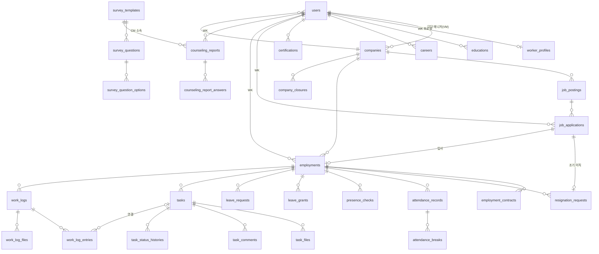

# my-vdream DB 테이블 정의서

| 항목 | 내용 |
|---|---|
| 문서 버전 | v1.0 (초안, 2026-11-18 작성) |
| 작성일 | 2026-11-18 |
| DBMS | MySQL 8.4 LTS (InnoDB, utf8mb4) |
| ORM | SQLAlchemy 2.0 (Alembic 마이그레이션) |
| 관련 문서 | [프로젝트 개요](01-project-overview.md) · [요구기능정의서](02-functional-requirements.md) · [기술스펙정의서](04-tech-spec.md) · [개발 계획](05-development-plan.md) |

## 공통 규칙

| 항목 | 규칙 |
|---|---|
| 테이블명 | snake_case 복수형. SQLAlchemy 모델은 PascalCase 단수형이며 `__tablename__`으로 연결 |
| 컬럼명 | snake_case. 모델 속성명도 동일한 snake_case를 사용한다 (Python 관례) |
| 기본 키 | 모든 테이블 `id BIGINT UNSIGNED AUTO_INCREMENT`. 예외: `system_settings`는 `key`가 기본 키 |
| 공통 컬럼 | 모든 테이블에 `created_at DATETIME(3) NOT NULL DEFAULT CURRENT_TIMESTAMP(3)`, `updated_at DATETIME(3) NOT NULL ON UPDATE CURRENT_TIMESTAMP(3)`가 있다. 아래 표에서는 생략한다. 예외는 각 표 비고에 적는다 |
| 소프트 삭제 | `deleted_at DATETIME(3) NULL`이 있는 테이블은 삭제 시 값만 채우고 조회에서 제외한다. 그 외 테이블은 물리 삭제 또는 상태 컬럼으로 관리 |
| 시간 | 모든 DATETIME은 UTC로 저장한다. 업무 기준 날짜(`work_date` 등 DATE 타입)는 Asia/Seoul 기준 날짜다 |
| 열거형 | Python `enum.Enum`(문자열 값)으로 정의하고 `sqlalchemy.Enum(native_enum=True)`으로 MySQL 네이티브 ENUM 컬럼에 저장한다. 값 추가나 변경은 Alembic 마이그레이션으로 처리한다. 아래 표의 "ENUM" 표기는 이를 뜻하며 값 목록은 부록 A |
| 불리언 | `TINYINT(1)` |
| 금액 | `INT UNSIGNED` (원 단위) |
| 외래 키 | 모두 실제 FK 제약을 건다. 삭제 규칙은 기본 `RESTRICT`, 종속 데이터(항목, 옵션, 답변, 파일 연결, 댓글, 이력)는 `CASCADE` |
| 사용자 참조 | `*_by` 컬럼은 `users.id`를 참조한다. 근로자를 가리키는 `worker_id`도 `users.id`를 참조한다 |
| 인덱스 | 각 표 아래 "인덱스" 줄에 기재. FK 컬럼은 기본적으로 인덱스를 갖는다 |

## ERD 개요

## 테이블 목록

| 영역 | 테이블 | 설명 |
|---|---|---|
| 계정 및 공통 | users | 모든 사용자 계정 |
| | refresh_tokens | 리프레시 토큰 |
| | device_tokens | 푸시 알림용 기기 토큰 |
| | notifications | 사용자별 알림 |
| | announcements | 공지사항 |
| | files | 업로드 파일 메타데이터 |
| | system_settings | 시스템 설정 |
| | system_setting_histories | 시스템 설정 변경 이력 |
| 조직 | companies | 기업 (담당 매니저 포함) |
| 이력서 | worker_profiles | 근로자 기본정보, 장애정보, 재택근무 환경, 희망 직무, 구직 상태 |
| | educations | 학력 |
| | careers | 경력 |
| | certifications | 자격증 |
| 채용 | job_postings | 채용 공고 |
| | job_applications | 입사지원 및 채용 진행 |
| | application_memos | 채용 진행 메모 |
| | resignation_requests | 퇴사 신청 |
| 재직 | employments | 재직 기록 |
| | employment_contracts | 근로계약 |
| | contract_files | 근로계약서 파일 연결 |
| 근태 및 휴가 | attendance_records | 일별 근태 |
| | attendance_breaks | 휴게 기록 |
| | presence_checks | 근무 확인 요청과 응답 |
| | leave_grants | 연도별 연차 부여 |
| | leave_requests | 휴가 신청 |
| | public_holidays | 전국 공휴일 |
| | company_closures | 기업 휴무일 |
| 업무 | tasks | 배정 업무 |
| | task_files | 업무 첨부파일 연결 |
| | task_comments | 업무 댓글 |
| | task_status_histories | 업무 상태 변경 이력 |
| 업무일지 | work_logs | 일별 업무일지 |
| | work_log_entries | 업무일지 항목 |
| | work_log_files | 업무일지 산출물 파일 연결 |
| 상담 | survey_templates | 상담 설문 양식 |
| | survey_questions | 설문 문항 |
| | survey_question_options | 척도 레이블 및 객관식 선택지 |
| | counseling_reports | 상담보고서 |
| | counseling_report_answers | 상담보고서 응답 |

---

## 1. 계정 및 공통

### 1.1 users

모든 역할의 사용자 계정. 기업 담당자만 `company_id`가 채워진다. 근로자, 브이드림 매니저, 시스템관리자는 NULL이다. 브이드림 매니저와 시스템관리자는 모두 브이드림 소속이므로 별도 조직 FK가 없다.

| 컬럼명 | 타입 | NULL | 키/제약 | 기본값 | 설명 |
|---|---|---|---|---|---|
| id | BIGINT UNSIGNED | N | PK, AI | | |
| login_id | VARCHAR(50) | N | UK | | 로그인 아이디 |
| password_hash | VARCHAR(255) | N | | | bcrypt 해시 |
| role | ENUM UserRole | N | IDX | | WORKER, COMPANY_MANAGER, VDREAM_MANAGER, SYSTEM_ADMIN |
| name | VARCHAR(50) | N | | | 이름 |
| phone | VARCHAR(20) | Y | | | 휴대폰번호 |
| email | VARCHAR(100) | Y | | | 이메일 |
| company_id | BIGINT UNSIGNED | Y | FK companies.id | | 기업 담당자의 소속 |
| status | ENUM UserStatus | N | | ACTIVE | ACTIVE, INACTIVE |
| must_change_password | TINYINT(1) | N | | 1 | 다음 로그인 시 비밀번호 변경 강제 |
| failed_login_count | INT | N | | 0 | 연속 로그인 실패 횟수 |
| locked_until | DATETIME(3) | Y | | | 로그인 잠금 해제 시각 |
| last_login_at | DATETIME(3) | Y | | | |
| created_by | BIGINT UNSIGNED | Y | FK users.id | | 생성한 시스템관리자 |
| deleted_at | DATETIME(3) | Y | | | 소프트 삭제 |

인덱스: UK(login_id), IDX(role), IDX(company_id), IDX(name)

### 1.2 refresh_tokens

| 컬럼명 | 타입 | NULL | 키/제약 | 기본값 | 설명 |
|---|---|---|---|---|---|
| id | BIGINT UNSIGNED | N | PK, AI | | |
| user_id | BIGINT UNSIGNED | N | FK users.id, CASCADE | | |
| token_hash | VARCHAR(255) | N | UK | | 토큰 SHA-256 해시 |
| platform | ENUM ClientPlatform | N | | | IOS, ANDROID, WEB |
| device_id | VARCHAR(100) | Y | | | 앱 설치 단위 식별자 |
| expires_at | DATETIME(3) | N | | | 만료 시각 |
| revoked_at | DATETIME(3) | Y | | | 로그아웃 또는 회전으로 무효화된 시각 |

인덱스: UK(token_hash), IDX(user_id), IDX(expires_at). `updated_at` 없음.

### 1.3 device_tokens

| 컬럼명 | 타입 | NULL | 키/제약 | 기본값 | 설명 |
|---|---|---|---|---|---|
| id | BIGINT UNSIGNED | N | PK, AI | | |
| user_id | BIGINT UNSIGNED | N | FK users.id, CASCADE | | |
| platform | ENUM DevicePlatform | N | | | IOS, ANDROID |
| token | VARCHAR(255) | N | UK | | FCM 토큰 |
| last_seen_at | DATETIME(3) | N | | | 마지막 갱신 시각 |

인덱스: UK(token), IDX(user_id)

### 1.4 notifications

| 컬럼명 | 타입 | NULL | 키/제약 | 기본값 | 설명 |
|---|---|---|---|---|---|
| id | BIGINT UNSIGNED | N | PK, AI | | |
| user_id | BIGINT UNSIGNED | N | FK users.id, CASCADE | | 수신자 |
| type | VARCHAR(50) | N | | | 알림 이벤트 코드 (요구기능정의서 부록 B) |
| title | VARCHAR(200) | N | | | |
| body | VARCHAR(1000) | N | | | |
| ref_type | VARCHAR(50) | Y | | | 연결 대상 종류 (JOB_POSTING, TASK, WORK_LOG, PRESENCE_CHECK 등) |
| ref_id | BIGINT UNSIGNED | Y | | | 연결 대상 id |
| is_read | TINYINT(1) | N | | 0 | |
| read_at | DATETIME(3) | Y | | | |

인덱스: IDX(user_id, is_read, created_at). `updated_at` 없음.

### 1.5 announcements

| 컬럼명 | 타입 | NULL | 키/제약 | 기본값 | 설명 |
|---|---|---|---|---|---|
| id | BIGINT UNSIGNED | N | PK, AI | | |
| title | VARCHAR(200) | N | | | |
| content | TEXT | N | | | 본문 (마크다운 허용) |
| audience | ENUM AnnouncementAudience | N | IDX | | ALL, VDREAM, COMPANY, VDREAM_AND_COMPANY, WORKER |
| is_pinned | TINYINT(1) | N | | 0 | 상단 고정 |
| is_published | TINYINT(1) | N | | 0 | 게시 여부 (0이면 임시저장) |
| published_at | DATETIME(3) | Y | | | |
| author_id | BIGINT UNSIGNED | N | FK users.id | | 작성 시스템관리자 |
| deleted_at | DATETIME(3) | Y | | | 소프트 삭제 |

인덱스: IDX(audience, is_published, published_at)

### 1.6 files

| 컬럼명 | 타입 | NULL | 키/제약 | 기본값 | 설명 |
|---|---|---|---|---|---|
| id | BIGINT UNSIGNED | N | PK, AI | | |
| storage_key | VARCHAR(500) | N | UK | | 객체 저장소 키 |
| original_name | VARCHAR(255) | N | | | 원본 파일명 |
| mime_type | VARCHAR(100) | N | | | |
| size_bytes | BIGINT UNSIGNED | N | | | |
| purpose | ENUM FilePurpose | N | | | PROFILE_PHOTO, CONTRACT, TASK_ATTACHMENT, WORK_LOG_ATTACHMENT, OTHER |
| uploaded_by | BIGINT UNSIGNED | N | FK users.id | | |
| deleted_at | DATETIME(3) | Y | | | 소프트 삭제, 배치가 저장소에서 제거 |

인덱스: UK(storage_key), IDX(uploaded_by)

### 1.7 system_settings

| 컬럼명 | 타입 | NULL | 키/제약 | 기본값 | 설명 |
|---|---|---|---|---|---|
| key | VARCHAR(100) | N | PK | | 설정 키 |
| value | VARCHAR(500) | N | | | 설정 값 (문자열) |
| value_type | ENUM SettingValueType | N | | | INT, STRING, BOOLEAN |
| description | VARCHAR(500) | Y | | | 설명 |
| updated_by | BIGINT UNSIGNED | Y | FK users.id | | |

`id`, `created_at` 없음. `updated_at`만 존재.

초기 데이터:

| key | value | value_type | description |
|---|---|---|---|
| presence_check_per_day | 2 | INT | 근무 확인 하루 횟수 기본값 (기업별 재정의 가능) |
| presence_check_timeout_minutes | 10 | INT | 근무 확인 응답 제한 시간(분) |
| work_log_reminder_delay_minutes | 30 | INT | 소정 근로 종료 후 업무일지 미제출 리마인더까지의 지연(분) |

### 1.8 system_setting_histories

| 컬럼명 | 타입 | NULL | 키/제약 | 기본값 | 설명 |
|---|---|---|---|---|---|
| id | BIGINT UNSIGNED | N | PK, AI | | |
| setting_key | VARCHAR(100) | N | IDX | | |
| old_value | VARCHAR(500) | Y | | | |
| new_value | VARCHAR(500) | N | | | |
| changed_by | BIGINT UNSIGNED | N | FK users.id | | |

`updated_at` 없음. `created_at`이 변경 시각.

---

## 2. 조직

### 2.1 companies

브이드림은 시스템에 하나뿐인 운영 조직이므로 테이블로 두지 않는다. 기업만 테이블로 관리하며 담당 매니저는 VM 계정을 가리킨다.

| 컬럼명 | 타입 | NULL | 키/제약 | 기본값 | 설명 |
|---|---|---|---|---|---|
| id | BIGINT UNSIGNED | N | PK, AI | | |
| name | VARCHAR(100) | N | | | 기업명 |
| business_registration_no | VARCHAR(20) | Y | | | 사업자등록번호 |
| industry | VARCHAR(100) | Y | | | 업종 |
| address | VARCHAR(300) | Y | | | |
| phone | VARCHAR(20) | Y | | | 대표 전화 |
| manager_id | BIGINT UNSIGNED | Y | FK users.id | | 담당 매니저 (role = VDREAM_MANAGER). NULL이면 전체 매니저에게 알림 |
| presence_check_enabled | TINYINT(1) | N | | 0 | 근무 확인 사용 여부 |
| presence_check_per_day | TINYINT UNSIGNED | Y | | | 기업별 근무 확인 하루 횟수. NULL이면 시스템 설정 기본값 |
| status | ENUM OrgStatus | N | | ACTIVE | ACTIVE, INACTIVE |
| deleted_at | DATETIME(3) | Y | | | 소프트 삭제 |

인덱스: IDX(name), IDX(manager_id)

---

## 3. 이력서

### 3.1 worker_profiles

근로자 1명당 1행. 근로자 계정 생성 시 빈 행이 함께 생성된다. 이름, 휴대폰번호, 이메일은 `users`에 있다. 구직 상태도 이 표에 둔다.

| 컬럼명 | 타입 | NULL | 키/제약 | 기본값 | 설명 |
|---|---|---|---|---|---|
| id | BIGINT UNSIGNED | N | PK, AI | | |
| user_id | BIGINT UNSIGNED | N | FK users.id, UK | | 근로자 계정 |
| birth_date | DATE | Y | | | 생년월일 |
| gender | ENUM Gender | Y | | | MALE, FEMALE |
| photo_file_id | BIGINT UNSIGNED | Y | FK files.id | | 증명사진 |
| address | VARCHAR(300) | Y | | | 거주지 |
| disability_type | ENUM DisabilityType | Y | | | 주 장애유형 (부록 A) |
| disability_type_secondary | ENUM DisabilityType | Y | | | 부 장애유형 (선택) |
| disability_degree | ENUM DisabilityDegree | Y | | | SEVERE(중증), MILD(경증) |
| assistive_devices | VARCHAR(300) | Y | | | 사용 보조기기 (스크린리더, 확대 프로그램, 보청기 등) |
| has_pc | TINYINT(1) | Y | | | PC 보유 여부 |
| has_internet | TINYINT(1) | Y | | | 인터넷 사용 가능 여부 |
| software_skills | VARCHAR(500) | Y | | | 사용 가능 소프트웨어 |
| work_environment_note | VARCHAR(500) | Y | | | 근무 환경 메모 |
| desired_job_fields | VARCHAR(200) | Y | | | 희망 직무 분야, JobField 코드 쉼표 구분. NULL이면 미지정 |
| skills | VARCHAR(1000) | Y | | | 보유 기술 |
| introduction | TEXT | Y | | | 자기소개 |
| job_seeking_status | ENUM JobSeekingStatus | N | IDX | NOT_SEEKING | NOT_SEEKING, SEEKING |
| job_seeking_registered_at | DATETIME(3) | Y | | | 마지막 구직 등록 시각 |
| job_seeking_registered_by | BIGINT UNSIGNED | Y | FK users.id | | 등록자 (본인 또는 매니저) |
| job_seeking_withdrawn_at | DATETIME(3) | Y | | | 마지막 해제 시각 |

인덱스: UK(user_id), IDX(job_seeking_status), IDX(disability_type)

### 3.2 educations

| 컬럼명 | 타입 | NULL | 키/제약 | 기본값 | 설명 |
|---|---|---|---|---|---|
| id | BIGINT UNSIGNED | N | PK, AI | | |
| worker_id | BIGINT UNSIGNED | N | FK users.id, CASCADE | | |
| start_date | DATE | N | | | 기간 시작 |
| end_date | DATE | Y | | | 기간 종료 (재학 중이면 NULL) |
| institution | VARCHAR(100) | N | | | 기관명 |
| type | ENUM EducationType | N | | | ELEMENTARY, MIDDLE, HIGH, UNIVERSITY, GRADUATE, VOCATIONAL |
| status | ENUM EducationStatus | N | | | ENROLLED(재학중), GRADUATED(졸업), DROPPED_OUT(중퇴), COMPLETED(수료) |
| major | VARCHAR(100) | Y | | | 전공 또는 과정 |
| sort_order | INT | N | | 0 | 표시 순서 |

인덱스: IDX(worker_id, sort_order)

### 3.3 careers

| 컬럼명 | 타입 | NULL | 키/제약 | 기본값 | 설명 |
|---|---|---|---|---|---|
| id | BIGINT UNSIGNED | N | PK, AI | | |
| worker_id | BIGINT UNSIGNED | N | FK users.id, CASCADE | | |
| start_date | DATE | N | | | |
| end_date | DATE | Y | | | 재직 중이면 NULL |
| institution | VARCHAR(100) | N | | | 기관명 |
| employment_type | ENUM CareerType | N | | | INTERN(인턴), TRAINEE(실습), EMPLOYEE(직원) |
| duties | VARCHAR(500) | Y | | | 담당업무 |
| position | VARCHAR(50) | Y | | | 직급 |
| sort_order | INT | N | | 0 | |

인덱스: IDX(worker_id, sort_order)

### 3.4 certifications

| 컬럼명 | 타입 | NULL | 키/제약 | 기본값 | 설명 |
|---|---|---|---|---|---|
| id | BIGINT UNSIGNED | N | PK, AI | | |
| worker_id | BIGINT UNSIGNED | N | FK users.id, CASCADE | | |
| name | VARCHAR(100) | N | | | 자격증명 |
| issuer | VARCHAR(100) | Y | | | 발급기관 |
| acquired_date | DATE | Y | | | 취득일 |
| certificate_no | VARCHAR(50) | Y | | | 자격번호 |
| sort_order | INT | N | | 0 | |

인덱스: IDX(worker_id, sort_order)

---

## 4. 채용

### 4.1 job_postings

| 컬럼명 | 타입 | NULL | 키/제약 | 기본값 | 설명 |
|---|---|---|---|---|---|
| id | BIGINT UNSIGNED | N | PK, AI | | |
| company_id | BIGINT UNSIGNED | N | FK companies.id | | 채용 기업 |
| title | VARCHAR(200) | N | | | 공고 제목 |
| job_field | ENUM JobField | N | IDX | | 직무 분야 (부록 A) |
| main_duties | TEXT | N | | | 주요 업무 내용 |
| work_type | ENUM WorkType | N | | REMOTE | REMOTE(재택), HYBRID(혼합) |
| work_location | VARCHAR(300) | Y | | | 출근 장소 (혼합일 때) |
| work_days | VARCHAR(32) | N | | | 근무 요일, 쉼표 구분 (MON,TUE,WED,THU,FRI) |
| work_start_time | TIME | N | | | 근무 시작 시각 |
| work_end_time | TIME | N | | | 근무 종료 시각 |
| weekly_work_hours | DECIMAL(4,1) | N | | | 주 소정근로시간 |
| salary_type | ENUM SalaryType | N | | | MONTHLY(월급), HOURLY(시급) |
| salary_amount | INT UNSIGNED | N | | | 급여 금액(원) |
| benefits | TEXT | Y | | | 복리후생 |
| equipment_support | VARCHAR(500) | Y | | | 지원 장비 (노트북 대여 등) |
| requirements | TEXT | Y | | | 필요 역량·우대 사항 |
| expected_start_date | DATE | N | | | 근무 시작 예정일 (재직 중 지원 검사 기준) |
| contract_type | ENUM ContractType | N | | | FIXED_TERM(기간제), INDEFINITE(기간의 정함 없음) |
| expected_end_date | DATE | Y | | | 계약 종료 예정일 (기간제일 때) |
| headcount | INT | N | | 1 | 모집 인원 |
| description | TEXT | Y | | | 상세 설명 |
| deadline_date | DATE | Y | | | 마감 예정일 (자동 마감 기준) |
| status | ENUM JobPostingStatus | N | | DRAFT | DRAFT, PENDING_APPROVAL, REJECTED, PUBLISHED, CLOSED |
| submitted_at | DATETIME(3) | Y | | | 승인 요청 시각 |
| approved_by | BIGINT UNSIGNED | Y | FK users.id | | 승인 또는 게시한 매니저 |
| approved_at | DATETIME(3) | Y | | | 게시 시각 |
| reject_reason | VARCHAR(500) | Y | | | 반려 사유 |
| rejected_at | DATETIME(3) | Y | | | |
| closed_by | BIGINT UNSIGNED | Y | FK users.id | | 마감 처리자 (자동 마감이면 NULL) |
| closed_at | DATETIME(3) | Y | | | |
| created_by | BIGINT UNSIGNED | N | FK users.id | | 작성자 (기업 담당자 또는 브이드림 매니저) |
| author_type | ENUM PostingAuthorType | N | | | COMPANY(기업 작성, 브이드림 승인 필요), VDREAM(브이드림 작성, 즉시 게시) |
| deleted_at | DATETIME(3) | Y | | | 소프트 삭제 (작성중, 반려 상태만) |

인덱스: IDX(company_id, status), IDX(status, job_field), IDX(status, deadline_date), IDX(status, approved_at)

### 4.2 job_applications

| 컬럼명 | 타입 | NULL | 키/제약 | 기본값 | 설명 |
|---|---|---|---|---|---|
| id | BIGINT UNSIGNED | N | PK, AI | | |
| job_posting_id | BIGINT UNSIGNED | N | FK job_postings.id | | |
| worker_id | BIGINT UNSIGNED | N | FK users.id | | 지원자 |
| status | ENUM ApplicationStatus | N | | | 부록 A 참고 |
| applied_at | DATETIME(3) | N | | | 지원 시각 (브이드림 승인 대기 포함) |
| resignation_request_id | BIGINT UNSIGNED | Y | FK resignation_requests.id | | 재직 중 조기 이직 지원 시 생성된 퇴사 신청 |
| document_result_at | DATETIME(3) | Y | | | 서류심사 결과 입력 시각 |
| document_result_by | BIGINT UNSIGNED | Y | FK users.id | | |
| interview_at | DATETIME(3) | Y | | | 면접 일시 |
| interview_method | ENUM InterviewMethod | Y | | | VIDEO(화상), VISIT(방문) |
| interview_location | VARCHAR(500) | Y | | | 면접 장소 또는 화상 링크 |
| interview_note | VARCHAR(500) | Y | | | 면접 안내 사항 |
| interview_scheduled_by | BIGINT UNSIGNED | Y | FK users.id | | |
| final_result_at | DATETIME(3) | Y | | | 최종 결과 입력 시각 |
| final_result_by | BIGINT UNSIGNED | Y | FK users.id | | |
| start_date | DATE | Y | | | 실제 출근 시작일 |
| hired_at | DATETIME(3) | Y | | | 출근 시작일 입력 시각 |
| hired_by | BIGINT UNSIGNED | Y | FK users.id | | |
| employment_id | BIGINT UNSIGNED | Y | FK employments.id, UK | | 입사로 생성된 재직 기록 |
| cancelled_at | DATETIME(3) | Y | | | 취소 시각 |
| cancel_reason | VARCHAR(500) | Y | | | 취소 사유 (브이드림 반려 사유 포함) |
| declined_at | DATETIME(3) | Y | | | 입사 포기 시각 |
| declined_by | BIGINT UNSIGNED | Y | FK users.id | | 입사 포기 처리자 (WK 본인 또는 담당자) |

인덱스: UK(job_posting_id, worker_id), IDX(worker_id, status), IDX(job_posting_id, status), UK(employment_id)

### 4.3 application_memos

기업 담당자와 브이드림 매니저가 공유하는 채용 진행 메모. 근로자 비공개.

| 컬럼명 | 타입 | NULL | 키/제약 | 기본값 | 설명 |
|---|---|---|---|---|---|
| id | BIGINT UNSIGNED | N | PK, AI | | |
| job_application_id | BIGINT UNSIGNED | N | FK job_applications.id, CASCADE | | |
| author_id | BIGINT UNSIGNED | N | FK users.id | | |
| content | TEXT | N | | | |
| deleted_at | DATETIME(3) | Y | | | |

인덱스: IDX(job_application_id, created_at)

### 4.4 resignation_requests

| 컬럼명 | 타입 | NULL | 키/제약 | 기본값 | 설명 |
|---|---|---|---|---|---|
| id | BIGINT UNSIGNED | N | PK, AI | | |
| employment_id | BIGINT UNSIGNED | N | FK employments.id | | 퇴사 대상 재직 |
| worker_id | BIGINT UNSIGNED | N | FK users.id | | |
| source | ENUM ResignationSource | N | | | DIRECT(앱 직접 신청), APPLICATION(재직 중 지원), MANAGER(브이드림 직접 처리) |
| job_application_id | BIGINT UNSIGNED | Y | FK job_applications.id | | source가 APPLICATION일 때 |
| planned_date | DATE | N | | | 근로자가 입력한 퇴사 예정일 |
| reason | VARCHAR(1000) | N | | | 퇴사 사유 |
| status | ENUM ResignationStatus | N | | PENDING | PENDING, CONDITIONALLY_APPROVED, APPROVED, REJECTED, WITHDRAWN |
| confirmed_date | DATE | Y | | | 확정 퇴사일. 직접 신청은 브이드림 승인 시, 조기 이직은 입사 확정 시 채워짐 |
| reviewed_by | BIGINT UNSIGNED | Y | FK users.id | | 승인 또는 반려한 브이드림 매니저 |
| reviewed_at | DATETIME(3) | Y | | | |
| review_note | VARCHAR(500) | Y | | | 반려 사유 또는 승인 메모 |
| company_notified_at | DATETIME(3) | Y | | | 기업 알림 발송 시각 |
| created_by | BIGINT UNSIGNED | N | FK users.id | | 신청 생성자 (WK 또는 VM) |

인덱스: IDX(employment_id, status), IDX(worker_id)

---

## 5. 재직

### 5.1 employments

근로자의 기업별 재직 기록. 한 근로자에게 `status = PENDING`인 행과 `status = ACTIVE`인 행은 각각 최대 하나만 존재한다 (서비스 계층에서 보장).

| 컬럼명 | 타입 | NULL | 키/제약 | 기본값 | 설명 |
|---|---|---|---|---|---|
| id | BIGINT UNSIGNED | N | PK, AI | | |
| worker_id | BIGINT UNSIGNED | N | FK users.id | | |
| company_id | BIGINT UNSIGNED | N | FK companies.id | | |
| job_application_id | BIGINT UNSIGNED | Y | FK job_applications.id, UK | | 입사 근거 지원 (브이드림 직접 등록은 NULL) |
| source | ENUM EmploymentSource | N | | APPLICATION | APPLICATION(채용 절차), MANUAL(브이드림 직접 등록) |
| start_date | DATE | N | | | 출근 시작일 |
| end_date | DATE | Y | | | 확정 퇴사일. 퇴사 승인 시 채워짐 |
| status | ENUM EmploymentStatus | N | | PENDING | PENDING(입사 예정), ACTIVE(재직중), RESIGNED(퇴사), CANCELLED(입사 취소) |
| activated_at | DATETIME(3) | Y | | | 배치가 ACTIVE로 전환한 시각 |
| resigned_at | DATETIME(3) | Y | | | 배치가 RESIGNED로 전환한 시각 |
| cancelled_at | DATETIME(3) | Y | | | 입사 포기로 CANCELLED된 시각 |
| created_by | BIGINT UNSIGNED | N | FK users.id | | 재직 생성자 (출근일 입력자 또는 직접 등록자) |

인덱스: IDX(worker_id, status), IDX(company_id, status), IDX(status, start_date), IDX(status, end_date)

### 5.2 employment_contracts

| 컬럼명 | 타입 | NULL | 키/제약 | 기본값 | 설명 |
|---|---|---|---|---|---|
| id | BIGINT UNSIGNED | N | PK, AI | | |
| employment_id | BIGINT UNSIGNED | N | FK employments.id | | |
| contract_type | ENUM ContractType | N | | | FIXED_TERM, INDEFINITE |
| start_date | DATE | N | | | 계약 시작일 |
| end_date | DATE | Y | | | 계약 종료일 (INDEFINITE면 NULL) |
| work_type | ENUM WorkType | N | | REMOTE | REMOTE, HYBRID |
| work_location | VARCHAR(300) | N | | | 근무 장소 (자택 등) |
| job_description | VARCHAR(500) | N | | | 업무 내용 |
| work_days | VARCHAR(32) | N | | | 근무 요일 (MON,TUE,...) |
| work_start_time | TIME | N | | | 소정 근로 시작 시각 (지각 판정 기준) |
| work_end_time | TIME | N | | | 소정 근로 종료 시각 (조퇴 판정, 업무일지 리마인더 기준) |
| break_minutes | INT | N | | 0 | 계약상 휴게 시간(분) |
| weekly_work_hours | DECIMAL(4,1) | N | | | 주 소정근로시간 |
| weekly_holiday | VARCHAR(32) | Y | | | 주휴일 (SUN 등) |
| annual_leave_days | DECIMAL(4,1) | Y | | | 연차 부여일수 |
| salary_type | ENUM SalaryType | N | | | MONTHLY, HOURLY |
| salary_amount | INT UNSIGNED | N | | | 급여 금액(원) |
| bonus | VARCHAR(500) | Y | | | 상여금 |
| allowances | VARCHAR(500) | Y | | | 기타 수당 |
| pay_day | TINYINT UNSIGNED | Y | | | 급여 지급일 (1~31) |
| pay_method | VARCHAR(50) | Y | | | 지급 방법 (계좌이체 등) |
| insurance_employment | TINYINT(1) | N | | 1 | 고용보험 |
| insurance_accident | TINYINT(1) | N | | 1 | 산재보험 |
| insurance_pension | TINYINT(1) | N | | 1 | 국민연금 |
| insurance_health | TINYINT(1) | N | | 1 | 건강보험 |
| equipment_support | VARCHAR(500) | Y | | | 지원 장비 |
| signed_date | DATE | Y | | | 계약서 서명일 |
| is_current | TINYINT(1) | N | | 1 | 가장 최근 등록된 계약 여부. 새 계약 추가 시 이전 계약은 0. 날짜별 판정은 해당 날짜에 유효한 계약을 우선 사용 |
| is_auto_generated | TINYINT(1) | N | | 0 | 입사 시 공고 조건으로 자동 생성된 초기 계약 여부 |
| note | VARCHAR(1000) | Y | | | 비고 |
| created_by | BIGINT UNSIGNED | N | FK users.id | | |

인덱스: IDX(employment_id, is_current), IDX(end_date)

### 5.3 contract_files

| 컬럼명 | 타입 | NULL | 키/제약 | 기본값 | 설명 |
|---|---|---|---|---|---|
| id | BIGINT UNSIGNED | N | PK, AI | | |
| contract_id | BIGINT UNSIGNED | N | FK employment_contracts.id, CASCADE | | |
| file_id | BIGINT UNSIGNED | N | FK files.id | | |

인덱스: UK(contract_id, file_id). `updated_at` 없음.

---

## 6. 근태 및 휴가

### 6.1 attendance_records

재직 기록과 근무일 기준으로 하루 1행.

| 컬럼명 | 타입 | NULL | 키/제약 | 기본값 | 설명 |
|---|---|---|---|---|---|
| id | BIGINT UNSIGNED | N | PK, AI | | |
| employment_id | BIGINT UNSIGNED | N | FK employments.id | | |
| work_date | DATE | N | | | 근무일 (Asia/Seoul 기준) |
| check_in_at | DATETIME(3) | Y | | | 출근 시각 (서버 시각) |
| check_out_at | DATETIME(3) | Y | | | 퇴근 시각 |
| check_in_lat | DECIMAL(10,7) | Y | | | 출근 위치 위도 (참고용) |
| check_in_lng | DECIMAL(10,7) | Y | | | 출근 위치 경도 |
| check_out_lat | DECIMAL(10,7) | Y | | | |
| check_out_lng | DECIMAL(10,7) | Y | | | |
| check_in_ip | VARCHAR(45) | Y | | | 출근 요청 IP (참고용, IPv6 포함) |
| check_out_ip | VARCHAR(45) | Y | | | 퇴근 요청 IP |
| status | ENUM AttendanceStatus | N | | | NORMAL, LATE, EARLY_LEAVE, LATE_EARLY_LEAVE, ABSENT, ON_LEAVE |
| half_day_type | ENUM HalfDayType | Y | | | AM(오전 반차), PM(오후 반차). 반차가 아니면 NULL |
| expected_start_at | DATETIME(3) | Y | | | 판정 당시 기준 출근 시각 (계약 + 반차 반영) |
| expected_end_at | DATETIME(3) | Y | | | 판정 당시 기준 퇴근 시각 (계약 소정 근로 종료) |
| late_minutes | INT | N | | 0 | 지각 분 |
| early_leave_minutes | INT | N | | 0 | 조퇴 분 |
| break_minutes | INT | N | | 0 | 휴게 기록 합계(분). attendance_breaks에서 집계 |
| work_minutes | INT | Y | | | 실근무 시간(분) = 퇴근 - 출근 - 휴게. 퇴근 시 계산 |
| worker_late_reason | VARCHAR(500) | Y | | | 근로자가 입력한 지각 사유 |
| worker_early_leave_reason | VARCHAR(500) | Y | | | 근로자가 입력한 조퇴 사유 |
| leave_request_id | BIGINT UNSIGNED | Y | FK leave_requests.id | | 휴가 또는 반차 연결 |
| is_corrected | TINYINT(1) | N | | 0 | 기업 담당자 정정 여부 |
| corrected_by | BIGINT UNSIGNED | Y | FK users.id | | |
| corrected_at | DATETIME(3) | Y | | | |
| correction_note | VARCHAR(500) | Y | | | 정정 사유 |

인덱스: UK(employment_id, work_date), IDX(work_date, status)

### 6.2 attendance_breaks

근로자가 기록한 휴게. 진행 중인 휴게는 `ended_at`이 NULL이며 재직 기록당 최대 1건 (서비스 계층에서 보장).

| 컬럼명 | 타입 | NULL | 키/제약 | 기본값 | 설명 |
|---|---|---|---|---|---|
| id | BIGINT UNSIGNED | N | PK, AI | | |
| attendance_record_id | BIGINT UNSIGNED | N | FK attendance_records.id, CASCADE | | |
| started_at | DATETIME(3) | N | | | 휴게 시작 (서버 시각) |
| ended_at | DATETIME(3) | Y | | | 휴게 종료. 퇴근 시 자동 종료 |
| minutes | INT | Y | | | 휴게 분. 종료 시 계산 |

인덱스: IDX(attendance_record_id, started_at). `updated_at` 없음.

### 6.3 presence_checks

근무 확인 요청 1건당 1행. 출근 체크 시 PLANNED 상태로 생성되고 배치가 상태를 바꾼다.

| 컬럼명 | 타입 | NULL | 키/제약 | 기본값 | 설명 |
|---|---|---|---|---|---|
| id | BIGINT UNSIGNED | N | PK, AI | | |
| employment_id | BIGINT UNSIGNED | N | FK employments.id | | |
| work_date | DATE | N | | | 근무일 |
| scheduled_at | DATETIME(3) | N | | | 계획된 요청 시각 (출근 시 임의 생성, 휴게로 미뤄지면 갱신) |
| requested_at | DATETIME(3) | Y | | | 실제 푸시 발송 시각 |
| deadline_at | DATETIME(3) | Y | | | 응답 기한 = requested_at + 제한 시간 |
| responded_at | DATETIME(3) | Y | | | 근로자 응답 시각 |
| status | ENUM PresenceCheckStatus | N | | PLANNED | PLANNED, REQUESTED, CONFIRMED, MISSED, SKIPPED |
| skip_reason | VARCHAR(100) | Y | | | 건너뜀 사유 (CHECKED_OUT, ON_LEAVE 등) |

인덱스: IDX(employment_id, work_date), IDX(status, scheduled_at), IDX(status, deadline_at). `updated_at` 없음.

### 6.4 leave_grants

| 컬럼명 | 타입 | NULL | 키/제약 | 기본값 | 설명 |
|---|---|---|---|---|---|
| id | BIGINT UNSIGNED | N | PK, AI | | |
| employment_id | BIGINT UNSIGNED | N | FK employments.id | | |
| year | SMALLINT UNSIGNED | N | | | 귀속 연도 |
| granted_days | DECIMAL(4,1) | N | | | 부여 연차일수 |
| note | VARCHAR(300) | Y | | | |
| created_by | BIGINT UNSIGNED | N | FK users.id | | |

인덱스: UK(employment_id, year). 사용일수는 `leave_requests`에서 집계한다.

### 6.5 leave_requests

| 컬럼명 | 타입 | NULL | 키/제약 | 기본값 | 설명 |
|---|---|---|---|---|---|
| id | BIGINT UNSIGNED | N | PK, AI | | |
| employment_id | BIGINT UNSIGNED | N | FK employments.id | | |
| leave_type | ENUM LeaveType | N | | | ANNUAL, HALF_DAY_AM, HALF_DAY_PM, SICK, FAMILY_EVENT, OFFICIAL, UNPAID |
| start_date | DATE | N | | | |
| end_date | DATE | N | | | 반차는 start_date와 동일 |
| days | DECIMAL(4,1) | N | | | 신청 일수 (근무 요일 기준 계산, 반차 0.5) |
| reason | VARCHAR(1000) | Y | | | |
| status | ENUM LeaveStatus | N | | PENDING | PENDING, APPROVED, REJECTED, WITHDRAWN, CANCELLED |
| reviewed_by | BIGINT UNSIGNED | Y | FK users.id | | 승인 또는 반려한 기업 담당자 |
| reviewed_at | DATETIME(3) | Y | | | |
| reject_reason | VARCHAR(500) | Y | | | |
| cancelled_by | BIGINT UNSIGNED | Y | FK users.id | | 승인 후 취소한 기업 담당자 |
| cancelled_at | DATETIME(3) | Y | | | |
| cancel_reason | VARCHAR(500) | Y | | | |

인덱스: IDX(employment_id, start_date), IDX(employment_id, status)

### 6.6 public_holidays

시스템관리자가 관리하는 전국 공휴일. 모든 기업의 근무일 계산에서 제외된다.

| 컬럼명 | 타입 | NULL | 키/제약 | 기본값 | 설명 |
|---|---|---|---|---|---|
| id | BIGINT UNSIGNED | N | PK, AI | | |
| holiday_date | DATE | N | UK | | 공휴일 날짜 |
| name | VARCHAR(100) | N | | | 명칭 (설날, 대체공휴일 등) |
| created_by | BIGINT UNSIGNED | N | FK users.id | | |

인덱스: UK(holiday_date)

### 6.7 company_closures

기업 담당자가 관리하는 기업별 휴무일. 해당 기업의 근무일 계산에서 제외된다.

| 컬럼명 | 타입 | NULL | 키/제약 | 기본값 | 설명 |
|---|---|---|---|---|---|
| id | BIGINT UNSIGNED | N | PK, AI | | |
| company_id | BIGINT UNSIGNED | N | FK companies.id, CASCADE | | |
| closure_date | DATE | N | | | 휴무일 날짜 |
| name | VARCHAR(100) | N | | | 명칭 (창립기념일 등) |
| created_by | BIGINT UNSIGNED | N | FK users.id | | |

인덱스: UK(company_id, closure_date)

---

## 7. 업무

### 7.1 tasks

기업 담당자가 근로자에게 배정한 업무. 근로자 1명당 1건이며 재직 기록을 통해 근로자와 기업을 식별한다.

| 컬럼명 | 타입 | NULL | 키/제약 | 기본값 | 설명 |
|---|---|---|---|---|---|
| id | BIGINT UNSIGNED | N | PK, AI | | |
| company_id | BIGINT UNSIGNED | N | FK companies.id | | 조회 편의를 위한 복제 (employments.company_id와 일치) |
| employment_id | BIGINT UNSIGNED | N | FK employments.id | | 담당 근로자의 재직 기록 |
| title | VARCHAR(200) | N | | | 업무 제목 |
| description | TEXT | Y | | | 업무 내용 |
| priority | ENUM TaskPriority | N | | NORMAL | LOW, NORMAL, HIGH |
| due_date | DATE | Y | | | 기한 (Asia/Seoul 날짜) |
| status | ENUM TaskStatus | N | | ASSIGNED | ASSIGNED, IN_PROGRESS, COMPLETED, ON_HOLD, CANCELLED |
| started_at | DATETIME(3) | Y | | | 근로자가 처음 진행중으로 바꾼 시각 |
| completed_at | DATETIME(3) | Y | | | 마지막 완료 처리 시각 |
| completion_note | VARCHAR(1000) | Y | | | 근로자 완료 메모 |
| hold_reason | VARCHAR(500) | Y | | | 보류 사유 |
| cancel_reason | VARCHAR(500) | Y | | | 취소 사유 (자동 취소는 코드 문자열) |
| total_minutes | INT | N | | 0 | 업무일지 항목에서 누적된 소요 시간(분) |
| status_changed_by | BIGINT UNSIGNED | Y | FK users.id | | 마지막 상태 변경자 |
| status_changed_at | DATETIME(3) | Y | | | |
| assigned_by | BIGINT UNSIGNED | N | FK users.id | | 배정한 기업 담당자 |
| overdue_notified_date | DATE | Y | | | 기한 초과 알림을 마지막으로 보낸 날짜 (하루 1회 보장) |

인덱스: IDX(employment_id, status), IDX(company_id, status), IDX(employment_id, due_date), IDX(status, due_date)

### 7.2 task_files

| 컬럼명 | 타입 | NULL | 키/제약 | 기본값 | 설명 |
|---|---|---|---|---|---|
| id | BIGINT UNSIGNED | N | PK, AI | | |
| task_id | BIGINT UNSIGNED | N | FK tasks.id, CASCADE | | |
| file_id | BIGINT UNSIGNED | N | FK files.id | | |

인덱스: UK(task_id, file_id). `updated_at` 없음.

### 7.3 task_comments

기업 담당자와 근로자가 업무 건별로 주고받는 댓글. 브이드림 매니저는 조회만 한다.

| 컬럼명 | 타입 | NULL | 키/제약 | 기본값 | 설명 |
|---|---|---|---|---|---|
| id | BIGINT UNSIGNED | N | PK, AI | | |
| task_id | BIGINT UNSIGNED | N | FK tasks.id, CASCADE | | |
| author_id | BIGINT UNSIGNED | N | FK users.id | | |
| content | TEXT | N | | | |
| deleted_at | DATETIME(3) | Y | | | 소프트 삭제 |

인덱스: IDX(task_id, created_at)

### 7.4 task_status_histories

업무 상태 변경 이력. 상세 화면의 이력 표시와 감사용.

| 컬럼명 | 타입 | NULL | 키/제약 | 기본값 | 설명 |
|---|---|---|---|---|---|
| id | BIGINT UNSIGNED | N | PK, AI | | |
| task_id | BIGINT UNSIGNED | N | FK tasks.id, CASCADE | | |
| from_status | ENUM TaskStatus | Y | | | 변경 전 (생성 시 NULL) |
| to_status | ENUM TaskStatus | N | | | 변경 후 |
| reason | VARCHAR(500) | Y | | | 사유 (보류, 취소, 재오픈 등) |
| changed_by | BIGINT UNSIGNED | Y | FK users.id | | 처리자 (배치 자동 처리는 NULL) |

인덱스: IDX(task_id, created_at). `updated_at` 없음.

---

## 8. 업무일지

### 8.1 work_logs

재직 기록과 근무일 기준으로 하루 1행.

| 컬럼명 | 타입 | NULL | 키/제약 | 기본값 | 설명 |
|---|---|---|---|---|---|
| id | BIGINT UNSIGNED | N | PK, AI | | |
| employment_id | BIGINT UNSIGNED | N | FK employments.id | | |
| company_id | BIGINT UNSIGNED | N | FK companies.id | | 조회 편의를 위한 복제 |
| work_date | DATE | N | | | 근무일 (Asia/Seoul 기준) |
| status | ENUM WorkLogStatus | N | | DRAFT | DRAFT, SUBMITTED, CONFIRMED, RETURNED |
| summary | VARCHAR(1000) | Y | | | 하루 요약 |
| issues | VARCHAR(1000) | Y | | | 특이사항·건의 |
| total_minutes | INT | N | | 0 | 항목 소요 시간 합계. 제출 시 계산 |
| submitted_at | DATETIME(3) | Y | | | 마지막 제출(재제출) 시각 |
| first_submitted_at | DATETIME(3) | Y | | | 최초 제출 시각 (제출률 집계 기준) |
| submit_count | INT | N | | 0 | 제출 횟수 |
| reviewed_by | BIGINT UNSIGNED | Y | FK users.id | | 확인 또는 보완 요청한 기업 담당자 |
| reviewed_at | DATETIME(3) | Y | | | |
| review_comment | VARCHAR(1000) | Y | | | 확인 코멘트 또는 보완 요청 사유 |
| reminder_sent_at | DATETIME(3) | Y | | | 미제출 리마인더 발송 시각 (하루 1회 보장) |

인덱스: UK(employment_id, work_date), IDX(company_id, work_date), IDX(status, work_date)

### 8.2 work_log_entries

업무일지의 항목. 배정 업무를 연결하거나 업무명을 직접 입력한다.

| 컬럼명 | 타입 | NULL | 키/제약 | 기본값 | 설명 |
|---|---|---|---|---|---|
| id | BIGINT UNSIGNED | N | PK, AI | | |
| work_log_id | BIGINT UNSIGNED | N | FK work_logs.id, CASCADE | | |
| task_id | BIGINT UNSIGNED | Y | FK tasks.id | | 연결된 배정 업무. 직접 입력이면 NULL |
| title | VARCHAR(200) | N | | | 업무명. 연결 시 업무 제목을 복사 |
| content | TEXT | N | | | 수행 내용 |
| minutes | INT | N | | | 소요 시간(분) |
| sort_order | INT | N | | 0 | 표시 순서 |

인덱스: IDX(work_log_id, sort_order), IDX(task_id)

### 8.3 work_log_files

업무일지 산출물 파일. 특정 항목에 연결하거나 일지 전체에 연결한다.

| 컬럼명 | 타입 | NULL | 키/제약 | 기본값 | 설명 |
|---|---|---|---|---|---|
| id | BIGINT UNSIGNED | N | PK, AI | | |
| work_log_id | BIGINT UNSIGNED | N | FK work_logs.id, CASCADE | | |
| entry_id | BIGINT UNSIGNED | Y | FK work_log_entries.id, CASCADE | | 항목 연결 (선택) |
| file_id | BIGINT UNSIGNED | N | FK files.id | | |

인덱스: UK(work_log_id, file_id), IDX(entry_id). `updated_at` 없음.

---

## 9. 상담

### 9.1 survey_templates

브이드림 공통 상담 설문 양식. 수정 시 새 행(새 버전)을 만들고 `root_template_id`로 묶는다.

| 컬럼명 | 타입 | NULL | 키/제약 | 기본값 | 설명 |
|---|---|---|---|---|---|
| id | BIGINT UNSIGNED | N | PK, AI | | |
| root_template_id | BIGINT UNSIGNED | Y | FK survey_templates.id | | 최초 버전 id. 최초 버전은 NULL |
| version | INT | N | | 1 | 버전 번호 |
| title | VARCHAR(200) | N | | | 양식명 |
| status | ENUM SurveyTemplateStatus | N | | DRAFT | DRAFT, ACTIVE, ARCHIVED |
| created_by | BIGINT UNSIGNED | N | FK users.id | | |

인덱스: IDX(status), IDX(root_template_id, version)

### 9.2 survey_questions

| 컬럼명 | 타입 | NULL | 키/제약 | 기본값 | 설명 |
|---|---|---|---|---|---|
| id | BIGINT UNSIGNED | N | PK, AI | | |
| template_id | BIGINT UNSIGNED | N | FK survey_templates.id, CASCADE | | |
| sort_order | INT | N | | | 문항 순서 |
| type | ENUM SurveyQuestionType | N | | | SCALE(척도), SINGLE_CHOICE(객관식 단일), MULTI_CHOICE(객관식 복수), TEXT(주관식) |
| content | VARCHAR(500) | N | | | 문항 내용 |
| is_required | TINYINT(1) | N | | 1 | 필수 응답 여부 |
| scale_max | TINYINT UNSIGNED | Y | | | 척도형 최대 점수 (3, 5, 10 등). 최소는 1 |

인덱스: IDX(template_id, sort_order). `updated_at` 없음 (양식은 버전으로만 변경).

### 9.3 survey_question_options

척도형 문항의 점수별 레이블(선택 사항, 레이블이 있는 점수만 저장)과 객관식 문항의 선택지를 함께 저장한다.

| 컬럼명 | 타입 | NULL | 키/제약 | 기본값 | 설명 |
|---|---|---|---|---|---|
| id | BIGINT UNSIGNED | N | PK, AI | | |
| question_id | BIGINT UNSIGNED | N | FK survey_questions.id, CASCADE | | |
| sort_order | INT | N | | | 표시 순서 |
| value | INT | N | | | 척도형: 점수(1~scale_max), 객관식: 선택지 번호 |
| label | VARCHAR(100) | N | | | 척도형: 점수 레이블(매우 만족 등), 객관식: 선택지 내용 |

인덱스: UK(question_id, value). `updated_at` 없음.

### 9.4 counseling_reports

| 컬럼명 | 타입 | NULL | 키/제약 | 기본값 | 설명 |
|---|---|---|---|---|---|
| id | BIGINT UNSIGNED | N | PK, AI | | |
| worker_id | BIGINT UNSIGNED | N | FK users.id | | 상담 대상 |
| employment_id | BIGINT UNSIGNED | Y | FK employments.id | | 상담 당시 재직 기록 (구직 중이면 NULL) |
| company_id | BIGINT UNSIGNED | Y | FK companies.id | | 상담 당시 재직 기업 (조회 편의) |
| template_id | BIGINT UNSIGNED | N | FK survey_templates.id | | 사용한 양식 버전 |
| method | ENUM CounselingMethod | N | | | PHONE(전화), VIDEO(화상), VISIT(방문), CHAT(메신저) |
| counseled_at | DATETIME(3) | N | | | 상담 일시 |
| summary | TEXT | Y | | | 종합 의견 |
| status | ENUM ReportStatus | N | | DRAFT | DRAFT(임시저장), COMPLETED(완료) |
| author_id | BIGINT UNSIGNED | N | FK users.id | | 작성 매니저 |
| updated_by | BIGINT UNSIGNED | Y | FK users.id | | 마지막 수정자 |
| deleted_at | DATETIME(3) | Y | | | 소프트 삭제 |

인덱스: IDX(worker_id, counseled_at), IDX(company_id, counseled_at), IDX(author_id, counseled_at), IDX(employment_id)

### 9.5 counseling_report_answers

문항당 1행. 객관식 복수 선택은 선택지마다 1행. 척도형은 numeric_value, 객관식은 option_id, 주관식은 text_value를 채운다.

| 컬럼명 | 타입 | NULL | 키/제약 | 기본값 | 설명 |
|---|---|---|---|---|---|
| id | BIGINT UNSIGNED | N | PK, AI | | |
| report_id | BIGINT UNSIGNED | N | FK counseling_reports.id, CASCADE | | |
| question_id | BIGINT UNSIGNED | N | FK survey_questions.id | | |
| numeric_value | INT | Y | | | 척도형 응답 점수 (1 ~ scale_max) |
| option_id | BIGINT UNSIGNED | Y | FK survey_question_options.id | | 객관식 응답 선택지 |
| text_value | TEXT | Y | | | 주관식 응답 |

인덱스: IDX(report_id, question_id)

---

## 부록 A. 열거형 정의

| 열거형 | 값 | 사용 테이블 |
|---|---|---|
| UserRole | WORKER, COMPANY_MANAGER, VDREAM_MANAGER, SYSTEM_ADMIN | users |
| UserStatus | ACTIVE, INACTIVE | users |
| OrgStatus | ACTIVE, INACTIVE | companies |
| ClientPlatform | IOS, ANDROID, WEB | refresh_tokens |
| DevicePlatform | IOS, ANDROID | device_tokens |
| AnnouncementAudience | ALL, VDREAM, COMPANY, VDREAM_AND_COMPANY, WORKER | announcements |
| FilePurpose | PROFILE_PHOTO, CONTRACT, TASK_ATTACHMENT, WORK_LOG_ATTACHMENT, OTHER | files |
| SettingValueType | INT, STRING, BOOLEAN | system_settings |
| Gender | MALE, FEMALE | worker_profiles |
| DisabilityType | PHYSICAL(지체), BRAIN_LESION(뇌병변), VISUAL(시각), HEARING(청각), SPEECH(언어), FACIAL(안면), KIDNEY(신장), HEART(심장), LIVER(간), RESPIRATORY(호흡기), OSTOMY(장루·요루), EPILEPSY(뇌전증), INTELLECTUAL(지적), AUTISM(자폐성), MENTAL(정신) | worker_profiles |
| DisabilityDegree | SEVERE, MILD | worker_profiles |
| JobSeekingStatus | NOT_SEEKING, SEEKING | worker_profiles |
| EducationType | ELEMENTARY, MIDDLE, HIGH, UNIVERSITY, GRADUATE, VOCATIONAL | educations |
| EducationStatus | ENROLLED, GRADUATED, DROPPED_OUT, COMPLETED | educations |
| CareerType | INTERN, TRAINEE, EMPLOYEE | careers |
| JobField | DATA_LABELING, DOCUMENT_ENTRY, CONTENT_MONITORING, DESIGN, VIDEO_EDITING, CONTENT_WRITING, CUSTOMER_SUPPORT, RESEARCH, IT_SUPPORT, OTHER | job_postings, worker_profiles(desired_job_fields 문자열) |
| WorkType | REMOTE, HYBRID | job_postings, employment_contracts |
| SalaryType | MONTHLY, HOURLY | job_postings, employment_contracts |
| ContractType | FIXED_TERM, INDEFINITE | job_postings, employment_contracts |
| JobPostingStatus | DRAFT, PENDING_APPROVAL, REJECTED, PUBLISHED, CLOSED | job_postings |
| PostingAuthorType | COMPANY, VDREAM | job_postings |
| ApplicationStatus | PENDING_MANAGER_APPROVAL, APPLIED, DOCUMENT_PASSED, DOCUMENT_FAILED, INTERVIEW_SCHEDULED, PASSED, FAILED, HIRED, DECLINED, CANCELLED | job_applications |
| InterviewMethod | VIDEO, VISIT | job_applications |
| ResignationSource | DIRECT, APPLICATION, MANAGER | resignation_requests |
| ResignationStatus | PENDING, CONDITIONALLY_APPROVED, APPROVED, REJECTED, WITHDRAWN | resignation_requests |
| EmploymentStatus | PENDING, ACTIVE, RESIGNED, CANCELLED | employments |
| EmploymentSource | APPLICATION, MANUAL | employments |
| AttendanceStatus | NORMAL, LATE, EARLY_LEAVE, LATE_EARLY_LEAVE, ABSENT, ON_LEAVE | attendance_records |
| HalfDayType | AM, PM | attendance_records |
| PresenceCheckStatus | PLANNED, REQUESTED, CONFIRMED, MISSED, SKIPPED | presence_checks |
| LeaveType | ANNUAL, HALF_DAY_AM, HALF_DAY_PM, SICK, FAMILY_EVENT, OFFICIAL, UNPAID | leave_requests |
| LeaveStatus | PENDING, APPROVED, REJECTED, WITHDRAWN, CANCELLED | leave_requests |
| TaskPriority | LOW, NORMAL, HIGH | tasks |
| TaskStatus | ASSIGNED, IN_PROGRESS, COMPLETED, ON_HOLD, CANCELLED | tasks, task_status_histories |
| WorkLogStatus | DRAFT, SUBMITTED, CONFIRMED, RETURNED | work_logs |
| SurveyTemplateStatus | DRAFT, ACTIVE, ARCHIVED | survey_templates |
| SurveyQuestionType | SCALE, SINGLE_CHOICE, MULTI_CHOICE, TEXT | survey_questions |
| CounselingMethod | PHONE, VIDEO, VISIT, CHAT | counseling_reports |
| ReportStatus | DRAFT, COMPLETED | counseling_reports |

## 부록 B. 주요 비즈니스 제약 (서비스 계층 보장)

DB 제약만으로 표현하기 어려워 서비스 계층에서 검증하는 규칙이다.

| 번호 | 규칙 | 관련 테이블 |
|---|---|---|
| 1 | 근로자 1명당 `status = PENDING`인 재직 기록과 `status = ACTIVE`인 재직 기록은 각각 최대 1개. 새 재직의 start_date는 기존 재직의 end_date보다 커야 한다 | employments |
| 2 | 재직 기록 1개당 `is_current = 1`인 근로계약은 최대 1개 | employment_contracts |
| 3 | `users.role`이 COMPANY_MANAGER이면 `company_id` 필수, 그 외 역할은 NULL | users |
| 4 | `companies.manager_id`는 `role = VDREAM_MANAGER`이고 활성 상태인 계정만 가리킬 수 있다 | companies, users |
| 5 | 공고 지원 시 `worker_profiles.job_seeking_status = SEEKING`이어야 한다. 재직 기록이 ACTIVE로 전환되면 NOT_SEEKING으로 바꾼다 | worker_profiles, job_applications, employments |
| 6 | 구직 등록 해제는 종료 상태(DOCUMENT_FAILED, FAILED, HIRED, DECLINED, CANCELLED)가 아닌 지원이 없을 때만 허용 | worker_profiles, job_applications |
| 7 | `tasks.employment_id`의 재직이 PENDING이면 `due_date`는 재직 start_date 이상이어야 하고, 재직이 RESIGNED 또는 CANCELLED가 되면 완료되지 않은 업무는 CANCELLED로 바꾼다 | tasks, employments |
| 8 | `tasks.company_id`는 `employments.company_id`와 일치해야 한다. `work_logs.company_id`도 같다 | tasks, work_logs, employments |
| 9 | 업무 상태 전이는 요구기능정의서 부록 A.6의 전이만 허용하고, 모든 전이는 task_status_histories에 기록한다 | tasks, task_status_histories |
| 10 | 업무일지는 `work_date`가 오늘이거나 해당 날짜에 attendance_records가 있을 때만 생성할 수 있다. 재직 기록당 날짜별 1건 | work_logs, attendance_records |
| 11 | 업무일지 제출 시 항목이 1개 이상이어야 하고, `work_log_entries.task_id`는 같은 재직의 CANCELLED가 아닌 업무만 가리킬 수 있다. 제출 시 `total_minutes`와 연결 업무의 `tasks.total_minutes`를 다시 계산한다 | work_logs, work_log_entries, tasks |
| 12 | 업무일지 상태 전이는 요구기능정의서 부록 A.7의 전이만 허용한다. CONFIRMED 상태에서는 근로자가 수정할 수 없다 | work_logs |
| 13 | 진행 중인 휴게(`ended_at IS NULL`)는 재직 기록당 최대 1건이며 출근 중(check_in_at 있음, check_out_at 없음)일 때만 시작할 수 있다. 퇴근 시 자동 종료하고 `attendance_records.break_minutes`, `work_minutes`를 계산한다 | attendance_breaks, attendance_records |
| 14 | 근무 확인은 `companies.presence_check_enabled = 1`인 기업의 재직에만 생성한다. 횟수는 `companies.presence_check_per_day`가 있으면 그 값, 없으면 `system_settings.presence_check_per_day` | presence_checks, companies, system_settings |
| 15 | 연차 신청 시 (부여 - 사용) 잔여일수 이내여야 한다 | leave_requests, leave_grants |
| 16 | 근태 판정과 업무일지 리마인더 기준은 해당 날짜에 유효한 계약(start_date 이하, end_date 이상 또는 end_date NULL)을 사용하고, 없으면 `is_current = 1` 계약을 사용한다 | employment_contracts |
| 17 | 근무일은 계약 근무 요일에 해당하면서 public_holidays와 해당 기업의 company_closures에 없는 날짜다. 결근 생성과 휴가 일수 계산에 사용 | public_holidays, company_closures |
| 18 | 조기 이직 지원(resignation_requests.source = APPLICATION)의 퇴사 신청은 연결된 지원이 HIRED가 될 때 APPROVED로, DOCUMENT_FAILED, FAILED, CANCELLED, DECLINED가 될 때 WITHDRAWN으로 전환한다 | resignation_requests, job_applications |
| 19 | `counseling_reports`는 요청자 역할이 VDREAM_MANAGER일 때만 접근 가능. 근로자와 기업 담당자는 API 수준에서 차단 | counseling_reports |
| 20 | `task_comments`는 해당 업무의 기업 담당자(같은 company_id)와 담당 근로자만 작성할 수 있고, 브이드림 매니저는 조회만 한다 | task_comments, tasks |
| 21 | 기업 삭제는 PENDING 또는 ACTIVE 재직 기록이 없을 때만 허용. 담당 매니저 계정 삭제는 담당 기업이 없을 때만 허용 | companies, employments, users |
