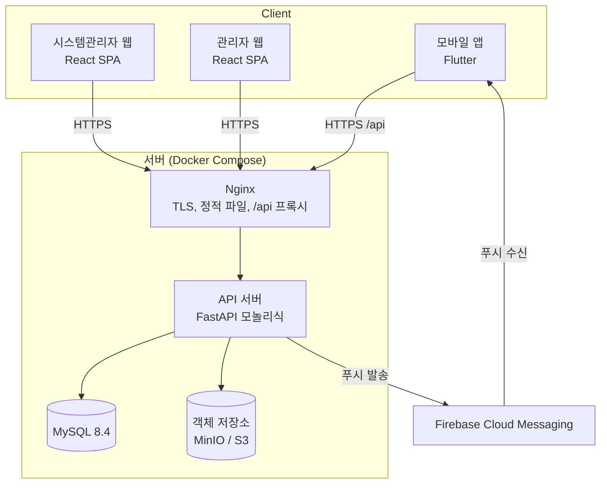

# my-vdream 기술스펙정의서

| 항목 | 내용 |
|---|---|
| 문서 버전 | v1.0 (초안, 2026-11-18 작성) |
| 작성일 | 2026-11-18 |
| 관련 문서 | [프로젝트 개요](01-project-overview.md) · [요구기능정의서](02-functional-requirements.md) · [DB 테이블 정의서](03-database-schema.md) · [개발 계획](05-development-plan.md) |

---

## 1. 기술 스택 요약

백엔드는 Python(FastAPI), 모바일 앱은 Dart(Flutter), 관리자 웹과 시스템관리자 웹은 TypeScript(React)로 작성한다. 아래 버전은 기준 버전이며, 프로젝트 세팅 시점의 최신 안정(LTS) 버전을 사용한다.

| 영역 | 기술 | 기준 버전 | 비고 |
|---|---|---|---|
| 백엔드 언어 | Python | 3.12 | 타입 힌트 필수, mypy strict |
| 백엔드 패키지 관리 | uv | 0.5.x | 잠금 파일 `uv.lock`, 가상환경 관리 |
| 백엔드 프레임워크 | FastAPI | 0.115.x | 모놀리식 REST API, OpenAPI 자동 생성 |
| ASGI 서버 | uvicorn (개발), gunicorn + uvicorn worker (운영) | - | |
| ORM | SQLAlchemy | 2.0.x | async 엔진, `Mapped[]` 선언형 모델 |
| DB 드라이버 | asyncmy | - | MySQL 비동기 드라이버 |
| 마이그레이션 | Alembic | 1.14.x | autogenerate 후 검토하여 커밋 |
| 데이터베이스 | MySQL | 8.4 LTS | InnoDB, utf8mb4 |
| 검증·설정 | Pydantic v2, pydantic-settings | 2.x | 요청·응답 스키마, 환경 변수 |
| 인증 | PyJWT, bcrypt | - | JWT 액세스 + 리프레시 |
| 스케줄러 | APScheduler (AsyncIOScheduler) | 3.x | 일 배치와 분 단위 배치 |
| 엑셀 | openpyxl | 3.1.x | write-only 모드로 대용량 처리 |
| 푸시 | firebase-admin | 6.x | FCM, iOS·Android 공통 |
| 파일 저장소 | S3 호환 객체 저장소 (로컬: MinIO, 운영: AWS S3 또는 동급) | - | boto3, 사전 서명 URL |
| 로깅 | structlog | 24.x | JSON 구조화 로그 |
| 백엔드 테스트 | pytest, pytest-asyncio, httpx | - | 서비스 단위 + API e2e |
| 백엔드 린트·포맷 | ruff, mypy | - | ruff가 린트와 포맷 담당 |
| 관리자 웹 / 시스템관리자 웹 | React + Vite | React 19, Vite 7 | SPA, TypeScript 5.x `strict: true` |
| 웹 UI 라이브러리 | MUI (Material UI) | 7.x | 라이트·다크·고대비 테마, 접근성 내장 |
| 웹 라우팅 | React Router | 7.x | |
| 웹 서버 상태 | TanStack Query | 5.x | |
| 웹 폼 | react-hook-form + zod | 7.x / 4.x | |
| 웹 HTTP 클라이언트 | axios | 1.x | 인터셉터로 토큰 갱신 |
| 웹 패키지 매니저 | pnpm + Turborepo | 10.x / 2.x | 웹 앱과 웹 공유 패키지만 워크스페이스로 관리 |
| 웹 테스트 | Vitest, Testing Library | - | |
| 모바일 앱 | Flutter | 3.27.x (Dart 3.6.x) | iOS 15+, Android 8+ (API 26) |
| 앱 상태 관리 | Riverpod (flutter_riverpod, riverpod_generator) | 2.x | 코드 생성 기반 provider |
| 앱 라우팅 | go_router | 14.x | 선언적 라우팅, 딥링크 |
| 앱 HTTP | dio | 5.x | 인터셉터로 토큰 갱신 |
| 앱 모델·직렬화 | freezed, json_serializable | - | 불변 모델 |
| 앱 API 클라이언트 | openapi-generator (dart-dio) | 7.x | 서버 OpenAPI에서 생성 |
| 앱 보안 저장소 | flutter_secure_storage | 9.x | 리프레시 토큰 보관 |
| 앱 생체인증 | local_auth | 2.x | Face ID, Touch ID, 지문 |
| 앱 푸시 | firebase_messaging, flutter_local_notifications | - | FCM 토큰, 포그라운드 표시 |
| 앱 위치 | geolocator | 13.x | 출퇴근 참고 위치 |
| 앱 파일 | file_picker, image_picker | - | 산출물 첨부, 증명사진 |
| 앱 로컬 설정 | shared_preferences | - | 테마, 생체인증 사용 여부 |
| 앱 코드 품질 | dart analyze (flutter_lints), dart format | - | |
| 앱 빌드·배포 | GitHub Actions + fastlane | - | TestFlight, Google Play 내부 테스트. 코드 푸시는 Shorebird 선택 적용 |
| 컨테이너 | Docker, Docker Compose | Compose v2 | 개발, 배포 동일 구성 |
| 리버스 프록시 | Nginx | 1.27 | 정적 웹 서빙, API 프록시, TLS 종료 |
| Git 훅 | pre-commit | - | 백엔드 ruff·mypy, 웹 lint-staged, 앱 dart format |
| CI | GitHub Actions | - | 린트, 타입체크, 테스트, 도커 빌드, 앱 빌드 |

---

## 2. 시스템 아키텍처



| 원칙 | 내용 |
|---|---|
| 단일 API | 세 클라이언트가 같은 REST API를 사용한다. 역할별 차이는 인가 규칙으로 처리한다 |
| 모놀리식 | API 서버는 하나의 FastAPI 애플리케이션이다. 도메인별 패키지 경계를 명확히 두어 추후 분리 가능하게 한다 |
| 무상태 서버 | 세션은 JWT로 처리하고 서버 인스턴스는 상태를 갖지 않는다. 파일은 객체 저장소에 둔다 |
| 배치 내장 | 별도 워커 없이 API 서버 내부 APScheduler가 배치를 실행한다. 다중 인스턴스 운영 시 `SCHEDULER_ENABLED` 환경 변수로 한 인스턴스만 켠다 |
| 스키마 원천 | 열거형과 DTO의 원천은 백엔드 Python 코드다. FastAPI가 생성한 OpenAPI JSON에서 웹(TypeScript)과 앱(Dart) 클라이언트 타입을 생성한다 |

---

## 3. 저장소 구조 (모노레포)

```
my-vdream/
├─ apps/
│  ├─ api/                 # FastAPI API 서버 (Python, uv)
│  │  ├─ app/
│  │  │  ├─ main.py        # 앱 생성, 라우터 등록, 미들웨어
│  │  │  ├─ core/          # 설정, 보안(JWT), 의존성, 예외, 로깅
│  │  │  ├─ db/            # 엔진, 세션, Base, 소프트 삭제 헬퍼
│  │  │  ├─ models/        # SQLAlchemy 모델 (도메인별 파일)
│  │  │  ├─ enums.py       # 모든 열거형 (DB 부록 A와 동일, 원천)
│  │  │  ├─ schemas/       # Pydantic 요청·응답 스키마
│  │  │  ├─ api/v1/        # 도메인별 라우터
│  │  │  ├─ services/      # 비즈니스 규칙, 트랜잭션, 알림 트리거
│  │  │  ├─ jobs/          # APScheduler 배치 작업
│  │  │  ├─ excel/         # openpyxl 내보내기
│  │  │  └─ seed.py        # 시드 스크립트
│  │  ├─ alembic/          # 마이그레이션
│  │  ├─ tests/
│  │  └─ pyproject.toml
│  ├─ admin-web/           # 관리자 웹 (기업 담당자, 브이드림 매니저)
│  ├─ system-web/          # 시스템관리자 웹
│  └─ mobile/              # Flutter 모바일 앱 (근로자)
│     ├─ lib/
│     │  ├─ main.dart
│     │  ├─ app/           # 라우터, 테마, 부트스트랩
│     │  ├─ core/          # dio 클라이언트, 보안 저장소, 접근성 유틸, 날짜 유틸
│     │  ├─ features/      # auth, home, attendance, tasks, work_log, leave, jobs, resume, more
│     │  └─ shared/        # 공용 위젯 (큰 버튼, 상태 뱃지, 접근 가능한 목록)
│     ├─ packages/
│     │  └─ api_client/    # OpenAPI에서 생성한 Dart 클라이언트 (dart-dio)
│     ├─ android/
│     ├─ ios/
│     └─ pubspec.yaml
├─ packages/                # 웹 전용 공유 패키지 (pnpm 워크스페이스)
│  ├─ shared/              # 웹 공용 상수, 날짜 유틸, 디자인 토큰, 상태 레이블
│  ├─ api-client/          # OpenAPI에서 생성한 TypeScript 타입과 axios 래퍼
│  ├─ ui-web/              # 관리자 웹과 시스템관리자 웹 공용 컴포넌트, MUI 테마
│  ├─ eslint-config/       # 공용 ESLint 설정
│  └─ tsconfig/            # 공용 tsconfig 베이스
├─ docker/
│  ├─ api.Dockerfile
│  ├─ web.Dockerfile       # admin-web, system-web 공용 (빌드 인자로 구분)
│  ├─ nginx/
│  │  ├─ nginx.conf
│  │  └─ conf.d/default.conf
│  └─ mysql/
│     └─ init/             # 초기 DB, 문자셋 설정 SQL
├─ scripts/
│  ├─ rename-project.mjs   # 프로젝트명 일괄 변경
│  ├─ export-openapi.py    # 서버를 띄우지 않고 OpenAPI JSON 내보내기
│  └─ generate-clients.sh  # 웹 타입과 Dart 클라이언트 생성
├─ docs/                   # 개발 문서 (본 문서 포함)
├─ docker-compose.yml      # 공통 서비스 정의
├─ docker-compose.dev.yml  # 개발용 오버라이드 (핫 리로드, 포트 노출)
├─ docker-compose.prod.yml # 운영용 오버라이드
├─ project.config.json     # 프로젝트명, 표시명, 패키지 스코프, 번들 ID
├─ .env.example
├─ .pre-commit-config.yaml
├─ turbo.json              # 웹 파이프라인
├─ pnpm-workspace.yaml     # apps/admin-web, apps/system-web, packages/*
└─ package.json
```

웹 패키지 스코프는 `@my-vdream/*`, Python 배포 이름은 `my-vdream-api`, Flutter 패키지명은 `my_vdream_app`이며 프로젝트명 변경 시 함께 바뀐다 (10장 참고).

---

## 4. 백엔드 (API 서버)

### 4.1 모듈 구성

`app/api/v1/`, `app/services/`, `app/schemas/`, `app/models/`가 같은 도메인 이름으로 나뉜다.

| 모듈 | 책임 | 관련 요구기능 |
|---|---|---|
| auth | 로그인, 토큰 발급과 갱신, 로그아웃, 비밀번호 변경, 로그인 실패 제한 | AUTH |
| users | 계정 CRUD(시스템관리자), 내 정보, 비밀번호 초기화 | AUTH, SYSM |
| companies | 기업 CRUD, 담당 매니저 지정, 근무 확인 설정 | SYSM, PRES-001 |
| system_settings | 설정 조회, 수정, 이력 | SYSM |
| announcements | 공지사항 CRUD, 공개 범위 필터 | ANNC |
| notifications | 알림 생성, 목록, 읽음, 푸시 발송, 기기 토큰, 담당 매니저 라우팅 | NOTI |
| files | 업로드 URL 발급, 다운로드 권한 검사, 메타데이터 | RESM, EMPL, TASK, WLOG |
| resumes | 프로필, 장애정보, 재택근무 환경, 희망 직무, 학력, 경력, 자격증 | RESM |
| job_seeking | 구직 등록, 해제, 구직자 목록 | REGI |
| job_postings | 공고 CRUD, 승인, 반려, 즉시 게시(브이드림 작성), 마감 | JOBP |
| applications | 지원, 재직 중 지원 검사, 심사, 면접, 합격, 출근일 확정, 메모 | APPL |
| employments | 재직 기록, 재직 이력, 직접 등록 | EMPL |
| contracts | 근로계약, 계약 파일, 유효 계약 조회 | EMPL |
| resignations | 퇴사 신청, 승인, 반려, 직접 처리 | RESG |
| attendance | 출퇴근, 휴게, 판정, 정정, 조회, 집계, 엑셀 | ATTD |
| leaves | 연차 부여, 휴가 신청, 승인, 취소, 잔여, 엑셀 | LEAV |
| holidays | 전국 공휴일(SA), 기업 휴무일(CM) 관리, 근무일 계산 서비스 | SYSM-011, ATTD-016 |
| tasks | 업무 배정, 상태 전이, 첨부, 댓글, 이력, 목록·상세 | TASK |
| work_logs | 업무일지 작성, 제출, 확인, 보완 요청, 산출물, 미제출, 통계, 엑셀 | WLOG |
| presence | 근무 확인 계획, 요청, 응답, 미응답, 조회 | PRES |
| surveys | 설문 양식, 문항, 버전 | CNSL |
| counseling | 상담보고서 작성, 조회, 엑셀 | CNSL |
| dashboard | 역할별 대시보드 집계 | DASH |
| jobs | APScheduler 배치 등록 | 4.9 |
| excel | openpyxl 공통 래퍼 | 4.10 |
| core | 설정, 보안, 의존성(현재 사용자, 역할 검사), 예외 핸들러, 응답 래퍼, 페이지네이션 | - |

### 4.2 레이어 규칙

| 레이어 | 역할 | 규칙 |
|---|---|---|
| Router (`api/v1`) | HTTP 요청 수신, 스키마 검증, 인가 의존성 | 비즈니스 로직 금지. 서비스 호출 후 응답 스키마로 변환 |
| Service | 비즈니스 규칙, 트랜잭션, 알림 트리거 | AsyncSession을 주입받아 SQLAlchemy를 직접 사용. 복잡한 쿼리는 Repository 함수로 분리 가능 |
| Repository (선택) | 재사용되는 복잡한 SQLAlchemy 쿼리 | 비즈니스 판단 금지 |
| Schema (Pydantic) | 요청, 응답 스키마 | `model_config = ConfigDict(extra="forbid")`로 화이트리스트 검증. 필드 설명(`Field(description=...)`) 필수 |
| 모델 변환 | SQLAlchemy 모델 → 응답 스키마 | `from_attributes=True`. 민감 컬럼(password_hash 등)은 응답 스키마에 절대 포함하지 않음 |

### 4.3 API 규약

| 항목 | 규칙 |
|---|---|
| 기본 경로 | `/api/v1` |
| 리소스 명명 | 복수 명사, kebab-case. 예: `/api/v1/job-postings/{id}/approve`, `/api/v1/work-logs/{id}/submit` |
| 메서드 | 조회 GET, 생성 POST, 전체 수정 PUT, 부분 수정 PATCH, 삭제 DELETE. 상태 전이는 POST + 동사 하위 경로 (`/approve`, `/reject`, `/close`, `/check-in`, `/submit`, `/confirm`, `/return`) |
| 성공 응답 | `{ "data": ..., "meta": { ... } }`. 목록은 `data` 배열 + `meta.page`, `meta.size`, `meta.total`. 제네릭 `Envelope[T]`, `PageEnvelope[T]` 스키마로 통일 |
| 오류 응답 | `{ "error": { "code": "JOB_POSTING_NOT_PUBLISHED", "message": "사용자용 한국어 메시지", "details": [...] } }`. 도메인 예외 클래스(`AppError(code, status, message)`)를 전역 예외 핸들러가 변환. Pydantic 검증 오류는 `VALIDATION_ERROR`로 통일 |
| 페이지네이션 | `?page=1&size=20` (최대 100). 정렬 `?sort=created_at,desc` |
| 날짜·시간 | 요청과 응답 모두 ISO 8601. 일시는 UTC(`Z`), 날짜만은 `YYYY-MM-DD`. 클라이언트가 Asia/Seoul로 표시 |
| 열거형 | DB 테이블 정의서 부록 A의 코드 문자열 그대로 사용. `app/enums.py`의 `str` 기반 Enum이 OpenAPI 스키마에 그대로 노출 |
| 필드 명명 | JSON 필드는 camelCase. Pydantic `alias_generator=to_camel`, `populate_by_name=True`로 서버 내부 snake_case와 변환 |
| ID | 숫자(number)로 응답. BIGINT는 2^53 이내 |
| 버전 관리 | 하위 호환이 깨지는 변경은 `/api/v2`로 분리 |
| 문서 | Swagger UI `/api/docs`, OpenAPI JSON `/api/openapi.json` (개발, 스테이징만 노출). `scripts/export-openapi.py`가 서버 없이 JSON을 내보내 클라이언트 생성에 사용 |

### 4.4 인증

| 항목 | 규칙 |
|---|---|
| 방식 | JWT (PyJWT, HS256). 액세스 토큰 30분, 리프레시 토큰 14일 |
| 리프레시 토큰 | 발급 시 SHA-256 해시를 `refresh_tokens`에 저장. 갱신 시 기존 토큰 무효화 후 새 토큰 발급(회전). 재사용 감지 시 해당 사용자의 모든 토큰 무효화 |
| 비밀번호 | bcrypt, cost 12. 정책: 최소 8자, 영문과 숫자 포함 |
| 로그인 플랫폼 검사 | 요청 헤더 `X-Client-Platform` 값은 ios, android, web-admin, web-system 중 하나. WK는 ios, android만, CM과 VM은 web-admin만, SA는 web-system만 허용 |
| 최초 로그인 | `must_change_password = 1`이면 비밀번호 변경 API 외 모든 API가 403 `PASSWORD_CHANGE_REQUIRED` |
| 로그인 잠금 | 연속 5회 실패 시 `locked_until = now + 10분` |
| 생체인증 | 서버는 관여하지 않는다. 앱이 리프레시 토큰을 보안 저장소에 두고 생체인증 성공 시 꺼내 갱신 요청 |
| 웹 토큰 저장 | 액세스 토큰은 메모리, 리프레시 토큰은 `HttpOnly; Secure; SameSite=Strict` 쿠키 |
| 구현 | `Depends(get_current_user)`가 액세스 토큰을 검증해 `CurrentUser(id, role, company_id)`를 주입한다 |

### 4.5 인가 (역할과 범위)

| 계층 | 규칙 |
|---|---|
| 역할 의존성 | `Depends(require_roles(UserRole.COMPANY_MANAGER, ...))`로 엔드포인트별 허용 역할 지정 |
| 범위 검사 | 역할만으로 부족한 소속 범위를 서비스 계층에서 검사한다. CM은 `current_user.company_id`와 자원의 `company_id`가 같아야 한다. VM은 브이드림 전체 범위이므로 별도 소속 검사가 없고, 목록 API의 `managerId=me` 필터로 담당 기업만 좁힌다. WK는 본인 자원만 |
| 이력서 범위 | CM은 자기 공고 지원자(브이드림 승인 대기 제외)와 자기 기업 재직(이력 포함) WK, VM은 모든 WK의 이력서를 읽을 수 있다 |
| 조회 동등성 | CM과 VM의 근태, 휴가, 업무, 업무일지, 근무 확인 조회 API는 같은 엔드포인트를 쓰고, CM에게만 범위 조건을 적용한다 |
| 편집 권한 | 근태 정정, 휴가 승인, 업무 배정, 업무일지 확인·보완 요청, 근무 확인 설정은 CM만. 공고 승인, 재직 중 지원 승인, 퇴사 승인, 재직 직접 등록, 상담보고서는 VM만 |
| 업무 댓글 | 해당 업무의 기업 CM과 담당 WK만 작성. VM은 조회만 |
| 상담보고서 | VM 전용. WK와 CM은 403 |

### 4.6 유효성 검증

- 모든 요청 스키마는 Pydantic v2 모델이며 `extra="forbid"`로 허용하지 않은 필드를 거부한다.
- 날짜 범위, 상태 전이 가능 여부, 중복 검사 등 비즈니스 검증은 서비스 계층에서 도메인 오류 코드로 반환한다.
- 상태 전이는 모듈별 상태 머신 딕셔너리(`ALLOWED_TRANSITIONS: dict[Status, set[Status]]`)로 정의하고 전이 전에 반드시 검사한다. 업무와 업무일지 전이는 요구기능정의서 부록 A.6, A.7을 그대로 코드화한다.

### 4.7 파일 업로드와 다운로드

| 항목 | 규칙 |
|---|---|
| 저장소 | S3 호환. 로컬 개발은 MinIO 컨테이너, 운영은 AWS S3 또는 동급 서비스. 버킷은 비공개 |
| 업로드 | 클라이언트가 `POST /files/upload-url`로 사전 서명 URL을 받아 저장소에 직접 PUT한 뒤 `POST /files/complete`로 메타데이터를 확정한다 |
| 키 규칙 | `{purpose}/{yyyy}/{mm}/{uuid}.{ext}` |
| 제한 | 증명사진 JPG, PNG 10MB. 계약서 PDF, JPG, PNG 20MB. 업무 첨부와 업무일지 산출물은 PDF, JPG, PNG, DOCX, XLSX, PPTX, HWP, ZIP 20MB. MIME 타입과 확장자를 서버에서 검증 |
| 다운로드 | `GET /files/{id}/download-url`에서 권한 검사 후 5분짜리 사전 서명 URL 반환. 증명사진은 WK 본인, 이력서 열람 범위에 해당하는 CM과 VM. 계약서는 해당 재직의 WK, CM, VM. 업무 첨부는 해당 업무의 WK, 기업 CM, VM. 업무일지 산출물은 해당 일지의 WK, 기업 CM, VM |
| 삭제 | 소프트 삭제 후 일 배치가 저장소 객체 제거 |

### 4.8 푸시 알림

| 항목 | 규칙 |
|---|---|
| 발송 | 서비스에서 도메인 이벤트 발생 시 `NotificationService.notify(user_ids, event, payload)` 호출. 알림 행 생성 후 WK 수신자에게만 FCM 발송 |
| 담당 매니저 라우팅 | `NotificationService.notify_company_managers(company_id, event, payload)`가 담당 매니저가 있으면 그 사람에게, 없으면 모든 활성 VM에게 보낸다 (NOTI-006) |
| 이벤트 정의 | 요구기능정의서 부록 B의 번호를 `type` 코드로 사용 (`TASK_ASSIGNED`, `WORK_LOG_SUBMITTED` 등 의미 있는 상수명) |
| 페이로드 | 제목, 본문, `refType`, `refId`. 앱은 `refType`에 따라 화면 이동 |
| 토큰 관리 | 발송 실패 코드가 `registration-token-not-registered`이면 해당 기기 토큰 삭제 |
| 비동기 | 발송은 요청 트랜잭션 커밋 후 `BackgroundTasks`로 수행하고 실패는 로그만 남긴다 (업무 처리에 영향 없음). firebase-admin의 동기 호출은 스레드풀(`run_in_threadpool`)에서 실행 |

### 4.9 배치 작업

모두 APScheduler Cron 또는 Interval 트리거로 등록하며 시간대는 Asia/Seoul 기준이다.

| 작업 | 시각 | 내용 | 관련 요구기능 |
|---|---|---|---|
| 재직 상태 전환 | 매일 00:10 | `start_date <= 오늘`인 PENDING 재직을 ACTIVE로 전환하고 구직 등록을 해제. `end_date < 오늘`인 ACTIVE 재직을 RESIGNED로 전환하고 미완료 업무를 CANCELLED로 변경 | RESG-006, REGI-004, TASK-015 |
| 결근 생성 | 매일 00:30 | 전날이 근무일(계약 근무 요일이면서 공휴일, 기업 휴무일이 아닌 날)인 ACTIVE 재직 중 출근 기록과 승인 휴가가 없는 건에 ABSENT 생성 | ATTD-005 |
| 공고 자동 마감 | 매일 00:40 | `deadline_date < 오늘`인 PUBLISHED 공고를 CLOSED로 전환 | JOBP-009 |
| 계약 만료 알림 | 매일 09:00 | `end_date = 오늘 + 30일`인 현재 계약에 대해 알림 | EMPL-007 |
| 업무 기한 알림 | 매일 09:10 | `due_date = 내일`인 미완료 업무의 WK에게 리마인더. `due_date < 오늘`이고 미완료이며 `overdue_notified_date != 오늘`인 업무의 WK와 CM에게 알림 후 날짜 기록 | TASK-013 |
| 업무일지 미제출 리마인더 | 매 10분 | 오늘 출근 기록이 있고, 유효 계약의 `work_end_time + 지연 분`이 지났으며, 업무일지가 SUBMITTED 또는 CONFIRMED가 아니고 `reminder_sent_at`이 오늘이 아닌 재직에 푸시 | WLOG-011 |
| 근무 확인 요청 발송 | 매 1분 | `status = PLANNED`이고 `scheduled_at <= now`인 건을 처리. 진행 중 휴게가 있으면 `scheduled_at += 15분`, 퇴근했거나 휴가면 SKIPPED, 아니면 REQUESTED로 바꾸고 `deadline_at` 설정 후 푸시 | PRES-003 |
| 근무 확인 미응답 처리 | 매 1분 | `status = REQUESTED`이고 `deadline_at < now`인 건을 MISSED로 바꾸고 CM에게 알림 | PRES-005 |
| 삭제 파일 정리 | 매일 03:00 | `deleted_at`이 7일 지난 파일의 저장소 객체 삭제 | 4.7 |
| 만료 토큰 정리 | 매일 03:10 | 만료 또는 무효화된 리프레시 토큰 삭제 | 4.4 |

배치는 멱등하게 작성하고, 실행 결과(처리 건수, 실패)를 로그로 남긴다. 분 단위 배치는 `max_instances=1`로 중복 실행을 막는다.

### 4.10 엑셀 내보내기

| 항목 | 규칙 |
|---|---|
| 라이브러리 | openpyxl, `write_only=True` 워크북으로 스트리밍 생성 |
| 대상 | 근태(일별 + 월 집계 시트), 휴가(신청 내역 + 연차 현황 시트), 업무일지(항목별 + 월 통계 시트), 근무 확인(일별 결과 시트), 상담보고서(응답 시트) |
| 파일명 | `{문서종류}_{기업명 또는 브이드림}_{YYYYMMDD}-{YYYYMMDD}.xlsx` |
| 헤더 | 한국어 컬럼명. 업무일지는 근로자명, 근무일, 업무명, 연결 업무 여부, 수행 내용, 소요 시간(분), 일지 상태, 제출 시각, 확인자, 확인 시각 순 |
| 시간 표기 | Asia/Seoul 기준 `YYYY-MM-DD HH:mm` |
| 응답 | `StreamingResponse`, `Content-Disposition: attachment`, 파일명은 RFC 5987 인코딩 |

### 4.11 로깅, 모니터링, 헬스체크

| 항목 | 규칙 |
|---|---|
| 로그 | structlog JSON 로그. 요청 ID, 사용자 ID, 경로, 상태 코드, 처리 시간 포함. 요청 본문은 로깅하지 않음 (개인정보) |
| 헬스체크 | `GET /api/health` (DB 연결 포함), `GET /api/health/live` (프로세스만). Docker healthcheck에 사용 |
| 오류 추적 | 5xx는 스택 포함 로그. 운영에서는 Sentry 연동 가능하도록 훅 자리 마련 (1차 범위 외) |

---

## 5. 데이터베이스

### 5.1 MySQL 설정

| 항목 | 값 |
|---|---|
| 버전 | 8.4 LTS |
| 문자셋 | `utf8mb4`, 콜레이션 `utf8mb4_0900_ai_ci` |
| 시간대 | 서버 `UTC`. 애플리케이션이 Asia/Seoul 변환 |
| 엔진 | InnoDB |
| 연결 | SQLAlchemy async 엔진 풀. `pool_size`, `max_overflow`는 환경 변수로 조정 |

### 5.2 SQLAlchemy 규칙

- 모델은 `app/models/` 아래 도메인별 파일에 두고 `DeclarativeBase` 하나(`Base`)를 공유한다.
- 모델명은 PascalCase 단수, `__tablename__`은 snake_case 복수. 컬럼은 `Mapped[타입] = mapped_column(...)` 선언형으로 작성한다.
- 공통 컬럼(`id`, `created_at`, `updated_at`)은 믹스인(`PKMixin`, `TimestampMixin`)으로 제공하고, 예외 테이블은 믹스인을 빼거나 재정의한다.
- 열거형은 `app/enums.py`의 `class XxxStatus(str, enum.Enum)`으로 정의하고 `sqlalchemy.Enum(XxxStatus, native_enum=True, values_callable=lambda e: [m.value for m in e])`로 MySQL ENUM에 저장한다. 값 추가는 마이그레이션으로 처리한다.
- 모든 FK에 `ForeignKey(..., ondelete=...)`와 `relationship`을 명시하고 삭제 규칙을 DB 테이블 정의서대로 지정한다.
- 소프트 삭제 테이블은 `SoftDeleteMixin`을 쓰고, 세션 이벤트 `do_orm_execute`에서 `with_loader_criteria`로 기본 `deleted_at IS NULL` 조건을 적용한다. 삭제된 행까지 보려면 `execution_options(include_deleted=True)`.
- 세션은 요청당 하나(`Depends(get_session)`)이며 서비스가 `async with session.begin()`으로 트랜잭션 경계를 잡는다.

### 5.3 마이그레이션과 시드

| 환경 | 명령 | 설명 |
|---|---|---|
| 개발 | `uv run alembic revision --autogenerate -m "..."` 후 `uv run alembic upgrade head` | 마이그레이션 생성과 적용. autogenerate 결과는 반드시 검토 |
| 운영 | `uv run alembic upgrade head` | 컨테이너 시작 전 적용 (entrypoint) |
| 시드 | `uv run python -m app.seed` | 시스템관리자 계정 1개, `system_settings` 초기값. 시드 계정 아이디와 비밀번호는 환경 변수 `SEED_ADMIN_LOGIN_ID`, `SEED_ADMIN_PASSWORD`에서 읽는다 |

마이그레이션 파일은 반드시 커밋하며, 운영 DB에 autogenerate를 실행하지 않는다.

### 5.4 시간대 처리 규칙

| 상황 | 규칙 |
|---|---|
| 저장 | 모든 일시는 UTC. Python에서는 tz-aware `datetime`(UTC)만 다루고 DB에 넣을 때 naive UTC로 변환 |
| 업무 날짜 | `work_date`, `start_date` 같은 DATE는 Asia/Seoul 날짜. 서버가 UTC 시각을 Asia/Seoul로 변환해 계산 |
| 근태 판정 | 계약의 `work_start_time`(TIME)과 `work_date`를 Asia/Seoul로 결합해 `expected_start_at`(UTC)을 만든다. `expected_end_at`도 `work_end_time`으로 같은 방식 |
| 유효 계약 | 날짜별 판정에는 해당 날짜에 유효한 계약(start_date 이하, end_date 이상 또는 end_date NULL)을 조회해 사용하고, 없으면 `is_current` 계약을 사용한다. 공통 서비스 `ContractResolver.for_date(employment_id, date)`로 일원화 |
| 근무일 판정 | 공통 서비스 `WorkdayService.is_workday(employment_id, date)`가 계약 근무 요일, 전국 공휴일, 기업 휴무일을 함께 검사한다 |
| 클라이언트 | 표시 시 Asia/Seoul 고정 (기기 시간대 무시) |
| 라이브러리 | 백엔드 `zoneinfo`(표준 라이브러리). 웹 `date-fns` + `date-fns-tz`를 `@my-vdream/shared`에서 래핑. 앱 `timezone` 패키지로 Asia/Seoul 고정 |

---

## 6. 관리자 웹, 시스템관리자 웹

### 6.1 구성

| 항목 | 내용 |
|---|---|
| 앱 분리 | `admin-web`(CM, VM)과 `system-web`(SA)은 별도 Vite 앱, 별도 도메인 또는 경로로 배포. 공용 컴포넌트와 테마는 `@my-vdream/ui-web` |
| 렌더링 | SPA. Nginx가 정적 파일 서빙, `/api`는 API 서버로 프록시 |
| 역할별 메뉴 | `admin-web`은 로그인 사용자의 역할(CM 또는 VM)에 따라 메뉴와 편집 버튼을 다르게 노출. 조회 화면은 공유. VM 목록 화면은 "내 담당 기업" 필터가 기본 |
| 라우팅 | React Router. 인증 필요 라우트는 가드 컴포넌트로 보호, 역할 불일치 시 403 페이지 |
| 서버 상태 | TanStack Query. 쿼리 키 규칙 `[도메인, 식별자, 필터]` |
| 폼 | react-hook-form + zod. zod 스키마는 `@my-vdream/api-client`가 생성한 타입을 기준으로 작성 |
| HTTP | axios 인스턴스. 401 시 리프레시 1회 후 재시도, 실패 시 로그아웃 |
| 표 | MUI DataGrid (Community). 서버 사이드 페이지네이션 |
| 날짜 입력 | MUI X Date Pickers, Asia/Seoul 고정 |

### 6.2 디자인과 접근성

| 항목 | 규칙 |
|---|---|
| 테마 | OS의 `prefers-color-scheme`을 기본으로 따르고 설정에서 라이트, 다크, 고대비로 고정. 선택은 `localStorage`. 고대비는 MUI 테마 팔레트를 별도 정의 |
| 글자 크기 | 본문 16px, 표 본문 15px, 제목 24px 이상. MUI 타이포그래피 스케일을 이 기준으로 재정의 |
| 대비 | 텍스트 대비 WCAG AA(4.5:1) 이상. 주요 버튼은 7:1 목표. 고대비 테마는 전 요소 7:1 이상 |
| 포커스 | 모든 상호작용 요소에 2px 이상 가시 포커스 링 |
| 키보드 | 모달, 드롭다운, 표 모두 키보드 조작 가능 (MUI 기본 동작 유지) |
| 상태 색상 | 색상만으로 상태를 구분하지 않고 텍스트 레이블을 함께 표시 |
| 반응형 | 최소 1280px 데스크톱 기준. 태블릿(1024px)까지 표 가로 스크롤로 대응 |

### 6.3 화면 구성 (admin-web)

| 메뉴 | CM | VM |
|---|---|---|
| 대시보드 | 기업 대시보드 | 브이드림 대시보드 (담당 기업 / 전체 전환) |
| 기업 | - | 기업 목록, 기업 상세 |
| 근로자 | 재직 근로자 목록, 상세 | 구직자 목록, 재직 근로자 목록, 재직 직접 등록, 상세(이력서 대리 작성 포함) |
| 채용 | 공고 관리, 지원자 관리 | 공고 작성(즉시 게시), 공고 승인, 지원 승인(재직 중 지원), 지원자 관리 |
| 근로계약 | 계약 등록, 조회 | 계약 등록, 조회 |
| 퇴사 | 퇴사 통보 조회 | 퇴사 신청 처리, 직접 처리 |
| 근태 | 근태 조회, 정정, 기업 휴무일 관리, 근무 확인 설정·결과, 엑셀 | 근태 조회, 기업 휴무일 조회, 근무 확인 결과, 엑셀 |
| 휴가 | 연차 설정, 승인, 조회, 엑셀 | 조회, 엑셀 |
| 업무 | 업무 배정, 수정, 보류·취소, 댓글, 목록, 상세 | 목록, 상세 (조회) |
| 업무일지 | 확인, 보완 요청, 미제출 현황, 통계, 엑셀 | 조회, 미제출 현황, 통계, 엑셀 |
| 상담 | - | 설문 양식 관리, 상담보고서 작성, 조회, 엑셀 |
| 공지사항 | 조회 | 조회 |
| 알림 | 목록 | 목록 |
| 내 정보 | 조회, 수정, 비밀번호 변경 | 동일 |

### 6.4 화면 구성 (system-web)

| 메뉴 | 내용 |
|---|---|
| 대시보드 | 기업 수, 계정 수, 구직중·재직 근로자 수, 게시 중 공고 수, 오늘 출근 근로자 수 |
| 기업 관리 | 목록, 등록, 수정, 비활성화, 담당 매니저 지정 |
| 계정 관리 | 역할별 목록, 생성, 수정, 비활성화, 삭제, 비밀번호 초기화 |
| 공지사항 | 작성, 수정, 삭제, 공개 범위 |
| 시스템 설정 | 설정 값 수정, 변경 이력 |
| 공휴일 관리 | 연도별 전국 공휴일 등록, 수정, 삭제 |
| 내 정보 | 비밀번호 변경 |

---

## 7. 모바일 앱 (근로자)

### 7.1 구성

| 항목 | 내용 |
|---|---|
| 프레임워크 | Flutter 안정 채널. 네이티브 연동: firebase_messaging, local_auth, flutter_secure_storage, geolocator, file_picker, image_picker |
| 라우팅 | go_router. 하단 탭 5개: 홈, 업무, 일지, 근태, 더보기. 푸시의 `refType`을 딥링크 경로로 변환 |
| 더보기 하위 | 이력서, 구직 등록, 채용 공고, 지원 현황, 휴가, 근로계약, 근무 확인 기록, 퇴사 신청, 공지사항, 알림, 설정(테마, 글자 크기 안내, 생체인증), 내 정보 |
| 상태 관리 | Riverpod. 서버 데이터는 `AsyncNotifier`로 캐시하고 오프라인 시 마지막 조회 결과를 표시, 쓰기 동작은 네트워크 필요 |
| HTTP | dio + 생성된 `api_client`. 401 시 리프레시 1회 후 재시도, 실패 시 로그아웃 |
| 모델 | freezed + json_serializable. 서버 OpenAPI에서 생성한 모델을 우선 사용하고 화면 전용 모델만 직접 작성 |
| 저장 | 리프레시 토큰은 flutter_secure_storage. 테마, 생체인증 사용 여부는 shared_preferences |
| 폼 | 기본 `Form` + 검증 함수. 복잡한 폼(이력서, 업무일지)은 단계별 화면으로 분할 |

### 7.2 주요 화면과 동작

| 화면 | 핵심 동작 |
|---|---|
| 홈 | 상단에 출근 또는 퇴근 큰 버튼 1개(상태에 따라 전환), 휴게 시작·종료 버튼. 대기 중 근무 확인 요청 카드(남은 시간 텍스트, 확인 버튼). 오늘 업무 요약과 다음 할 업무 카드, 업무일지 상태와 바로가기, 미읽음 알림 수, 최신 공지 1건 |
| 업무 | 오늘 할 일, 전체, 완료 탭. 각 건에서 시작, 완료 큰 버튼. 상세에서 내용, 첨부 내려받기, 댓글, 이력, 업무일지에 추가 바로가기 |
| 일지 | 오늘 업무일지 작성 화면(항목 추가, 업무 선택 또는 직접 입력, 수행 내용, 소요 시간, 산출물 첨부, 요약, 특이사항), 제출 버튼. 월별 달력에서 날짜별 상태와 과거 일지 조회, 보완 요청 사유 표시 |
| 근태 | 월별 달력 또는 목록. 일별 상태, 출퇴근 시각, 휴게·실근무 시간. 지각, 조퇴 사유 입력. 잔여 연차와 휴가 신청 바로가기 |
| 더보기 | 위 7.1 하위 메뉴 |

### 7.3 접근성 구현 규칙

| 항목 | 규칙 |
|---|---|
| 테마 | `ThemeMode.system` 기본. 설정에서 light, dark, 고대비(별도 `ThemeData`) 고정. `MediaQuery.highContrast`가 켜져 있으면 고대비 테마 자동 적용 |
| 글자 크기 | 본문 18pt, 제목 24pt 이상. `MediaQuery.textScaler`를 그대로 따르고 상한을 두지 않는다. 고정 높이 위젯 금지, 긴 텍스트는 줄바꿈 허용 |
| 대비 | 텍스트 4.5:1 이상, 주요 버튼 7:1 목표 |
| 터치 영역 | 주요 동작 버튼 높이 64 이상, 그 외 48 이상 (`minimumSize`). 버튼 간 간격 12 이상 |
| 레이블 | 모든 버튼, 입력, 아이콘, 이미지에 `Semantics(label:, hint:, button:, ...)` 또는 위젯의 `semanticLabel`. 장식용 이미지는 `excludeFromSemantics` |
| 화면 진입 | 화면 제목에 `Semantics(header: true)`, 진입 시 제목으로 포커스 이동(`SemanticsService.announce`와 `FocusNode` 조합) |
| 동적 안내 | 출근 완료, 업무 완료, 제출 완료 등 상태 변경 시 `SemanticsService.announce`로 음성 안내, `HapticFeedback`으로 진동, 화면 내 텍스트로 결과 표시 (세 가지 동시) |
| 목록 순서 | 업무 목록은 기한·우선순위 순, 각 항목은 "n번째 업무, 제목, 우선순위 높음, 기한 내일, 진행중" 형태의 통합 `Semantics` 레이블 |
| 폼 오류 | 오류 메시지를 입력 필드 `Semantics`에 포함하고 제출 실패 시 첫 오류 필드로 포커스 이동 |
| 제스처 | 스와이프 전용 동작 금지. 모든 동작은 버튼으로도 가능 |
| 시간 제한 | 자동 닫힘 스낵바 사용 금지. 결과는 화면 내 텍스트와 음성 안내로 전달. 근무 확인 남은 시간은 텍스트로 갱신 |
| 움직임 | `MediaQuery.disableAnimations`가 켜져 있으면 페이지 전환과 자동 애니메이션 비활성화 |
| 문장 | 안내 문구는 한 문장 한 동작. 용어 사전(`lib/core/terms.dart`)에서 동작별 단어를 고정해 재사용 |
| 테스트 | 출시 전 VoiceOver(iOS), TalkBack(Android)으로 핵심 흐름(로그인, 출퇴근, 휴게, 업무 완료, 업무일지 제출, 근무 확인 응답, 휴가 신청, 지원) 전수 점검 체크리스트 운영. Flutter `SemanticsTester` 기반 위젯 테스트로 레이블 누락 검사 |

### 7.4 인증과 생체인증

1. 아이디, 비밀번호 로그인 성공 시 리프레시 토큰을 flutter_secure_storage에 저장한다.
2. 설정에서 생체인증 사용을 켜면 앱 재진입 시 `local_auth`로 인증 후 저장된 토큰으로 갱신한다.
3. 생체인증 5회 실패 또는 미지원 기기는 비밀번호 로그인으로 대체한다.
4. 로그아웃 시 보안 저장소의 토큰을 삭제하고 서버에 무효화를 요청한다.

### 7.5 푸시와 위치

| 항목 | 규칙 |
|---|---|
| 푸시 | 로그인 후 FCM 토큰을 `POST /device-tokens`로 등록. 알림 수신 시 `refType`에 따라 go_router 경로로 이동. 포그라운드 수신은 flutter_local_notifications로 표시하고 화면 내 배너 + 음성 안내. 근무 확인 요청은 알림 채널을 분리해 중요도를 높인다 |
| 위치 | 출퇴근 버튼 시 `geolocator`로 현재 위치 1회 조회(권한 거부 시 생략). 위치는 참고용이며 출퇴근을 막지 않는다. 백그라운드 위치 추적은 하지 않는다 |

### 7.6 빌드와 배포

| 항목 | 규칙 |
|---|---|
| 플레이버 | `dev`, `staging`, `prod`. `--dart-define-from-file`로 API 주소와 표시명 주입 |
| 빌드 | GitHub Actions에서 `flutter build ipa`, `flutter build appbundle`. 서명 키는 CI secret |
| 배포 | fastlane으로 TestFlight와 Google Play 내부 테스트에 업로드. 스토어 출시는 수동 승인 |
| 코드 푸시 | Dart 코드만 바뀐 긴급 수정은 Shorebird로 OTA 배포 가능 (선택, 1차 필수 아님) |
| 식별자 | iOS 번들 ID, Android 패키지명은 `project.config.json`의 `bundleId`에서 생성 (기본 `com.myvdream.app`) |

---

## 8. 공유 패키지와 클라이언트 생성

| 패키지 | 내용 | 사용처 |
|---|---|---|
| @my-vdream/shared | 웹 공용 상수(상태 레이블, 휴가 종류 레이블, 알림 타입), 날짜 유틸(Asia/Seoul), 디자인 토큰(색상, 글자 크기) | admin-web, system-web |
| @my-vdream/api-client | API 서버의 OpenAPI JSON에서 `openapi-typescript`로 생성한 타입과 axios 래퍼. 열거형도 여기서 가져온다 | admin-web, system-web |
| @my-vdream/ui-web | MUI 테마(라이트, 다크, 고대비), 공용 레이아웃, 표, 폼 컴포넌트, 상태 뱃지 | admin-web, system-web |
| @my-vdream/eslint-config | ESLint flat config (typescript-eslint, react, import 정렬) | 웹 전체 |
| @my-vdream/tsconfig | `base.json`, `react.json` | 웹 전체 |
| apps/mobile/packages/api_client | OpenAPI JSON에서 openapi-generator(dart-dio)로 생성한 Dart 모델과 API 클래스. 열거형도 여기서 가져온다 | mobile |

생성 절차: `scripts/generate-clients.sh`가 `scripts/export-openapi.py`로 OpenAPI JSON을 내보낸 뒤 웹 타입과 Dart 클라이언트를 함께 생성한다. 생성물은 커밋하며, CI가 재생성 결과와 커밋된 파일의 차이가 없는지 검사해 서버와 클라이언트의 열거형·DTO 불일치를 막는다.

---

## 9. 개발 환경과 Docker

### 9.1 Docker Compose 서비스

| 서비스 | 이미지 또는 빌드 | 포트(개발) | 역할 |
|---|---|---|---|
| mysql | mysql:8.4 | 3306 | DB. 볼륨 `mysql_data`. `docker/mysql/init`의 SQL로 문자셋과 DB 생성 |
| minio | minio/minio | 9000 (API), 9001 (콘솔) | 로컬 객체 저장소. 볼륨 `minio_data` |
| minio-init | minio/mc | - | 버킷 생성 후 종료 |
| api | docker/api.Dockerfile | 8000 | FastAPI. 개발 모드에서는 소스 볼륨 마운트 + `uvicorn --reload` |
| admin-web | docker/web.Dockerfile (APP=admin-web) | 5173 | 개발: Vite dev server. 운영: Nginx 정적 서빙 |
| system-web | docker/web.Dockerfile (APP=system-web) | 5174 | 동일 |
| nginx | nginx:1.27 | 80, 443 | 운영 전용. 정적 파일과 `/api` 프록시, TLS |

모바일 앱은 컨테이너로 실행하지 않고 개발자 PC에서 Flutter로 실행하며, API는 `http://<PC IP>:8000`으로 접속한다.

### 9.2 Dockerfile 규칙

| 항목 | 규칙 |
|---|---|
| API 베이스 | `python:3.12-slim`. uv를 설치해 `uv sync --frozen --no-dev`로 의존성 설치 |
| API 멀티 스테이지 | `builder`(uv sync) → `runner`(가상환경만 복사). 최종 이미지에 빌드 도구 미포함 |
| API 엔트리포인트 | `alembic upgrade head` 실행 후 `gunicorn app.main:app -k uvicorn.workers.UvicornWorker` |
| 웹 베이스 | `node:22-alpine`에서 pnpm으로 빌드 후 산출물을 `nginx:1.27-alpine`에 복사. 환경별 API 주소는 빌드 시 `VITE_API_BASE_URL`로 주입 |
| 헬스체크 | api는 `/api/health/live`, mysql은 `mysqladmin ping` |
| 사용자 | 컨테이너는 비root 사용자로 실행 |

### 9.3 환경 변수

`.env.example`을 복사해 `.env`를 만든다. 비밀 값은 커밋하지 않는다. 백엔드는 pydantic-settings로 읽는다.

| 변수 | 예시 | 설명 |
|---|---|---|
| COMPOSE_PROJECT_NAME | my-vdream | 컨테이너, 네트워크, 볼륨 접두어 |
| APP_NAME | my-vdream | 내부 식별자 (로그, 메트릭) |
| APP_DISPLAY_NAME | my-vdream | 화면 표시명 (앱, 웹 타이틀, 알림) |
| APP_ENV | development | development, staging, production |
| TZ | UTC | 컨테이너 시간대 |
| API_PORT | 8000 | |
| API_BASE_URL | http://localhost:8000 | 사전 서명 URL 등 절대 경로 생성용 |
| DATABASE_URL | mysql+asyncmy://myvdream:pw@mysql:3306/myvdream | SQLAlchemy 접속 문자열 |
| DB_POOL_SIZE, DB_MAX_OVERFLOW | 10, 20 | 커넥션 풀 |
| MYSQL_ROOT_PASSWORD, MYSQL_DATABASE, MYSQL_USER, MYSQL_PASSWORD | | mysql 컨테이너 초기화 |
| JWT_ACCESS_SECRET, JWT_REFRESH_SECRET | | 32자 이상 임의 문자열 |
| JWT_ACCESS_TTL_MINUTES, JWT_REFRESH_TTL_DAYS | 30, 14 | |
| S3_ENDPOINT | http://minio:9000 | 운영은 S3 엔드포인트 |
| S3_REGION, S3_BUCKET, S3_ACCESS_KEY, S3_SECRET_KEY | | |
| S3_FORCE_PATH_STYLE | true | MinIO는 true |
| FCM_SERVICE_ACCOUNT_JSON | (base64) | Firebase 서비스 계정 키 |
| SCHEDULER_ENABLED | true | 배치 실행 여부 |
| SEED_ADMIN_LOGIN_ID, SEED_ADMIN_PASSWORD | | 초기 시스템관리자 |
| CORS_ORIGINS | http://localhost:5173,http://localhost:5174 | 허용 오리진 |
| SWAGGER_ENABLED | true | 운영은 false |
| LOG_LEVEL | info | |
| VITE_API_BASE_URL | http://localhost:8000 | 웹 빌드 시 |
| API_BASE_URL (dart-define) | http://192.168.0.10:8000 | 앱 개발 시 `--dart-define-from-file=env/dev.json` |

### 9.4 로컬 시작 절차

```bash
cp .env.example .env
```

```bash
docker compose -f docker-compose.yml -f docker-compose.dev.yml up -d mysql minio minio-init
```

```bash
cd apps/api && uv sync && uv run alembic upgrade head && uv run python -m app.seed
```

```bash
cd apps/api && uv run uvicorn app.main:app --reload --port 8000
```

```bash
pnpm install && pnpm --filter admin-web dev
```

```bash
cd apps/mobile && flutter pub get && flutter run --dart-define-from-file=env/dev.json
```

- API: http://localhost:8000, Swagger: http://localhost:8000/api/docs
- 관리자 웹: http://localhost:5173, 시스템관리자 웹: http://localhost:5174
- MinIO 콘솔: http://localhost:9001

API와 웹을 모두 컨테이너로 띄우려면 `docker compose -f docker-compose.yml -f docker-compose.dev.yml up -d`를 사용한다.

---

## 10. 프로젝트명 변경 가이드

프로젝트명 `my-vdream`은 가칭이다. 이름이 쓰이는 곳을 한 설정 파일로 모으고 스크립트로 일괄 변경한다.

### 10.1 설정 파일 `project.config.json`

```json
{
  "name": "my-vdream",
  "displayName": "my-vdream",
  "packageScope": "@my-vdream",
  "pythonDistName": "my-vdream-api",
  "dartPackageName": "my_vdream_app",
  "bundleId": "com.myvdream.app",
  "dbName": "myvdream"
}
```

### 10.2 이름이 쓰이는 위치

| 위치 | 항목 | 변경 방식 |
|---|---|---|
| 루트 `package.json`, 각 웹 앱과 패키지의 `package.json` | `name` (`@my-vdream/api-client` 등) | 스크립트 치환 |
| 웹 소스 코드의 import 경로 | `@my-vdream/shared` 등 | 스크립트 치환 |
| `apps/api/pyproject.toml` | `[project] name` | 스크립트 치환 (Python 패키지 디렉터리 `app`은 이름과 무관) |
| `apps/mobile/pubspec.yaml`, Dart import | `name`, `package:my_vdream_app/...` | 스크립트 치환 |
| `apps/mobile/android/app/build.gradle`, `ios/Runner.xcodeproj/project.pbxproj` | applicationId, PRODUCT_BUNDLE_IDENTIFIER | 스크립트 치환 |
| `.env`, `.env.example` | COMPOSE_PROJECT_NAME, APP_NAME, APP_DISPLAY_NAME, DATABASE_URL의 DB명 | 스크립트 치환 |
| `docker/mysql/init/*.sql` | DB명, 사용자명 | 스크립트 치환 |
| 웹 `index.html` 타이틀, 앱 화면 표시명 | 표시명 | 런타임에 `APP_DISPLAY_NAME`(웹은 `VITE_APP_DISPLAY_NAME`, 앱은 dart-define `APP_DISPLAY_NAME`) 사용 (하드코딩 금지) |
| 푸시 알림 제목, 엑셀 파일명 | 표시명 | 서버가 `APP_DISPLAY_NAME` 사용 |

### 10.3 변경 절차

```bash
node scripts/rename-project.mjs --name newname --display-name "새이름" --scope @newname --dart-package newname_app --bundle-id com.newname.app
```

1. 스크립트가 `project.config.json`을 갱신하고 위 표의 "스크립트 치환" 항목을 모두 바꾼다.
2. `pnpm install`, `uv sync`, `flutter pub get`으로 각 워크스페이스를 재생성한다.
3. 기존 Docker 볼륨은 이전 이름으로 남으므로 `docker compose down -v` 후 재시작하거나 볼륨명을 수동 변경한다.
4. 이미 스토어에 출시된 앱의 번들 ID는 변경할 수 없으므로, 출시 전에 최종 이름을 확정한다.

---

## 11. 코드 품질과 협업 규칙

| 항목 | 규칙 |
|---|---|
| 백엔드 린트, 포맷 | ruff (린트 + 포맷), mypy `strict = true`. `Any` 금지 (불가피하면 주석으로 사유) |
| 웹 린트, 포맷 | ESLint 9 + Prettier 3. `strict: true`, `noUncheckedIndexedAccess: true` |
| 앱 린트, 포맷 | flutter_lints 기반 `analysis_options.yaml`, `dart format`. 경고 0 유지 |
| 커밋 전 검사 | pre-commit 훅이 변경된 파일에 대해 ruff·mypy, lint-staged, dart format을 실행 |
| 커밋 메시지 | Conventional Commits (`feat:`, `fix:`, `docs:`, `chore:`, `refactor:`, `test:`). 범위에 앱명 (`feat(api): ...`, `feat(mobile): ...`) |
| 브랜치 | `main`(배포), `develop`(통합), `feature/*`, `fix/*`. PR 필수, 리뷰 1명 이상 |
| 테스트 | API: 서비스 단위 테스트(비즈니스 규칙, 상태 전이, 근태 판정, 업무일지 집계) + 핵심 흐름 e2e(로그인, 지원, 출퇴근, 업무일지 제출·확인, 상담보고서 접근 제한). 웹: 핵심 컴포넌트와 폼 검증. 앱: 유틸·provider 단위 테스트와 접근성 레이블 위젯 테스트 |
| 커버리지 목표 | API 서비스 계층 80% 이상 |
| CI | PR마다 백엔드(ruff, mypy, pytest), 웹(lint, typecheck, vitest), 앱(analyze, test), 클라이언트 생성물 일치 검사, Docker 빌드. `main` 머지 시 이미지 빌드와 태그, 앱은 수동 트리거로 스토어 업로드 |
| 문서 | API 변경 시 Pydantic 스키마 설명 갱신과 클라이언트 재생성. DB 변경 시 마이그레이션과 DB 테이블 정의서 동시 갱신 |
| 비밀 | `.env`, 서비스 계정 키, 앱 서명 키는 커밋 금지. `.gitignore`와 CI secret 사용 |

---

## 12. 보안

| 영역 | 규칙 |
|---|---|
| 전송 | 운영은 HTTPS만. Nginx에서 TLS 종료, HSTS |
| 인증 토큰 | 4.4 참고. 웹 리프레시 토큰은 HttpOnly 쿠키, 앱은 보안 저장소 |
| 비밀번호 | bcrypt cost 12. 평문 로그 금지. 초기 비밀번호는 다음 로그인 시 변경 강제 |
| 입력 | Pydantic `extra="forbid"` 검증. SQLAlchemy 파라미터 바인딩으로 SQL 인젝션 방지 |
| 헤더 | 보안 헤더 미들웨어(`X-Content-Type-Options`, `X-Frame-Options`, `Referrer-Policy`). CORS는 `CORS_ORIGINS` 화이트리스트 |
| 속도 제한 | slowapi. 로그인 API는 IP당 분당 10회 |
| 개인정보 | 이력서(장애정보 포함), 상담보고서는 최소 권한 원칙. 응답에 불필요한 개인정보 포함 금지. 로그에 요청 본문 미기록. 출퇴근 위치와 IP는 근태 화면에서만 표시하고 엑셀에는 포함하지 않는다 |
| 파일 | 비공개 버킷 + 사전 서명 URL. 다운로드 시 권한 검사. 업로드 파일은 확장자와 MIME 검증 |
| 감사 | 근태 정정, 휴가 승인, 공고 승인, 퇴사 승인, 업무 상태 변경, 업무일지 확인, 계정 변경은 처리자와 시각을 테이블에 기록 |
| 의존성 | `uv pip audit`(또는 pip-audit), `pnpm audit`, `flutter pub outdated`를 CI에 포함. 주요 취약점은 머지 차단 |

---

## 13. 배포와 운영

| 항목 | 1차 구성 |
|---|---|
| 인프라 | 단일 리눅스 서버(VM)에 Docker Compose로 nginx, api, admin-web, system-web, mysql 배포. 객체 저장소는 외부 S3 사용 권장 (서버 장애 시 파일 보존) |
| 배포 절차 | CI가 빌드한 이미지를 레지스트리에 푸시 → 서버에서 `docker compose -f docker-compose.yml -f docker-compose.prod.yml pull && up -d` |
| 마이그레이션 | api 컨테이너 시작 시 `alembic upgrade head` 자동 실행 |
| 백업 | 매일 `mysqldump` 압축 후 객체 저장소에 업로드, 30일 보관. 복구 절차 문서화 |
| 로그 | 컨테이너 표준 출력 → Docker json-file 드라이버(용량 제한) → 필요 시 외부 수집기 |
| 모니터링 | 헬스체크 실패 시 재시작 (`restart: unless-stopped`). 외부 업타임 모니터로 `/api/health` 감시 |
| 확장 | 트래픽 증가 시 api 컨테이너 수평 확장 가능 (무상태). 이때 `SCHEDULER_ENABLED`는 한 인스턴스만 true |
| 앱 배포 | TestFlight, Google Play 내부 테스트로 검증 후 스토어 출시. 접근성 체크리스트 통과가 출시 조건 |
| 환경 | 개발(로컬 Docker), 스테이징(선택), 운영 세 단계. 스테이징은 운영과 같은 compose 파일 사용 |

---

## 14. 비기능 요구사항

| 항목 | 목표 |
|---|---|
| 응답 시간 | 일반 조회 API p95 500ms 이내, 엑셀 생성 1만 행 기준 10초 이내 |
| 동시 사용자 | 1차 기준 동시 접속 500명 |
| 가용성 | 업무 시간(평일 07:00~20:00) 99.5% |
| 브라우저 | 최신 Chrome, Edge, Safari, Firefox. 데스크톱 1280px 이상 기준 |
| 모바일 OS | iOS 15 이상, Android 8.0(API 26) 이상 |
| 접근성 | 모바일 앱 WCAG 2.1 AA 준수, VoiceOver와 TalkBack 핵심 흐름 전수 통과, 글자 크기 최대 배율에서 레이아웃 유지 |
| 데이터 보존 | 근태, 업무, 업무일지, 채용 기록은 영구 보존(소프트 삭제). 업로드 파일은 소프트 삭제 후 7일 뒤 저장소에서 제거 |
| 언어 | 한국어 단일 |
