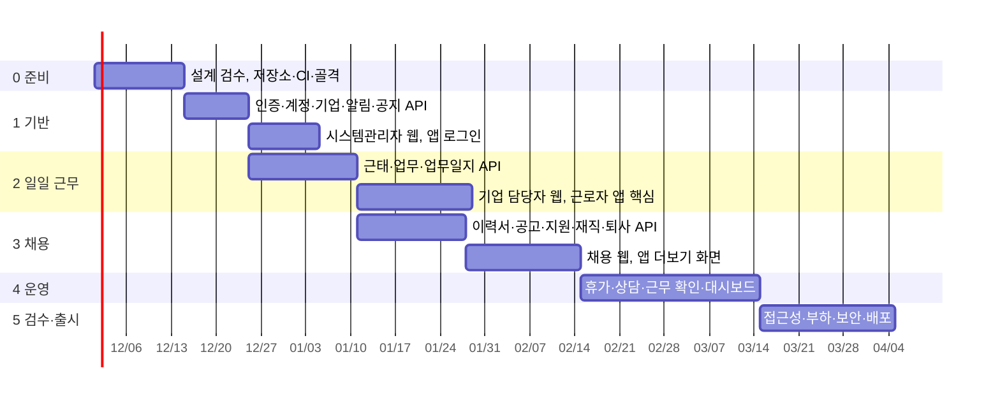

# my-vdream 개발 계획

| 항목 | 내용 |
|---|---|
| 문서 버전 | v1.0 (초안, 2026-11-18 작성) |
| 작성일 | 2026-11-18 |
| 문서 성격 | 1차 출시까지의 개발 단계, 단계별 범위와 완료 기준, 작업 순서, 리스크를 정의하는 문서 |
| 관련 문서 | [프로젝트 개요](01-project-overview.md) · [요구기능정의서](02-functional-requirements.md) · [DB 테이블 정의서](03-database-schema.md) · [기술스펙정의서](04-tech-spec.md) |

---

## 1. 개발 원칙

1. **API 우선.** 각 단계는 백엔드 API와 테스트를 먼저 완성하고 OpenAPI를 내보낸 뒤, 생성된 클라이언트로 웹과 앱을 병렬 개발한다.
2. **세로 슬라이스.** 한 단계 안에서 백엔드, 웹, 앱을 같은 도메인 단위로 묶어 끝까지 동작하는 흐름을 만든다. 화면만 먼저 만들거나 API만 먼저 쌓지 않는다.
3. **핵심 흐름 먼저.** 재택근무의 하루(출근 → 업무 → 업무일지 → 퇴근 → 확인)를 가장 먼저 동작시키고, 채용 흐름과 운영 기능을 그 위에 얹는다.
4. **접근성은 단계마다.** 앱 화면을 만들 때마다 스크린리더 레이블, 글자 크기, 터치 영역을 함께 검사한다. 마지막에 몰아서 고치지 않는다.
5. **문서 동기화.** DB 변경은 마이그레이션과 DB 테이블 정의서를 같은 PR에서 바꾼다. API 변경은 클라이언트 재생성을 같은 PR에 포함한다.

---

## 2. 단계 개요

| 단계 | 이름 | 목표 | 주요 산출물 | 예상 기간 |
|---|---|---|---|---|
| 0 | 준비 | 저장소, 개발 환경, CI, 설계 확정 | 모노레포 골격, Docker Compose, CI 파이프라인, 검수된 설계 문서 | 2주 |
| 1 | 기반 | 인증, 계정, 기업, 알림, 공지, 파일의 공통 기반 | 로그인 가능한 세 클라이언트, 시스템관리자 웹 완성 | 3주 |
| 2 | 일일 근무 | 근태, 휴게, 업무 배정, 업무일지 | 근로자 앱의 하루 흐름 완성, 기업 담당자 업무·일지 화면 | 5주 |
| 3 | 채용 | 이력서, 구직 등록, 공고, 지원, 재직, 계약, 퇴사 | 채용부터 입사까지 전체 흐름, 재직 중 지원 규칙 | 5주 |
| 4 | 운영 | 휴가, 상담보고서, 근무 확인, 대시보드, 엑셀, 배치 마무리 | 매니저 운영 화면, 통계와 내보내기 | 4주 |
| 5 | 검수와 출시 | 접근성 전수 점검, 부하 테스트, 스토어 배포 | 출시 체크리스트 통과, 운영 환경 배포 | 3주 |

총 약 22주. 단계는 순서대로 진행하되 2단계와 3단계의 백엔드는 팀 규모에 따라 일부 병렬로 진행할 수 있다.

---

## 3. 단계별 상세

### 3.1 0단계: 준비

| 작업 | 내용 | 완료 기준 |
|---|---|---|
| 설계 검수 | 개요 11장의 결정 사항과 요구기능정의서 전체를 검토하고 확정 | 검수 의견 반영한 v1.1 문서 |
| 저장소 골격 | 기술스펙 3장의 구조로 모노레포 생성. `project.config.json`, 이름 변경 스크립트 | `rename-project` 실행 후 전 구성요소 빌드 성공 |
| 백엔드 골격 | FastAPI 앱, 설정, DB 세션, Base 모델, 응답 래퍼, 예외 핸들러, 헬스체크, Alembic 초기화 | `/api/health` 응답, 빈 마이그레이션 적용 |
| 웹 골격 | admin-web, system-web Vite 앱, ui-web 테마(라이트, 다크, 고대비), 라우터 가드 자리 | 로그인 페이지 껍데기 표시 |
| 앱 골격 | Flutter 프로젝트, go_router, Riverpod, dio, 테마 3종, 하단 탭 5개 껍데기, 접근성 공용 위젯(큰 버튼, 통합 레이블 목록) | TalkBack으로 탭 이동 가능 |
| 클라이언트 생성 | `export-openapi.py`, `generate-clients.sh`, CI 일치 검사 | 더미 엔드포인트로 웹·앱 타입 생성 확인 |
| Docker, CI | Compose dev 구성, Dockerfile, GitHub Actions(린트, 타입체크, 테스트, 빌드) | PR에서 CI 통과 |

### 3.2 1단계: 기반

| 영역 | 포함 기능 | 비고 |
|---|---|---|
| 인증 | AUTH-001 ~ AUTH-009 | 플랫폼 헤더 검사, 토큰 회전, 잠금 |
| 계정·기업 | SYSM-001 ~ SYSM-008, SYSM-012 | 시스템관리자 웹 계정·기업 화면 완성. WK 생성 시 빈 프로필 생성 |
| 설정·공휴일 | SYSM-009, SYSM-011 | 설정 초기값 시드 |
| 알림 | NOTI-001 ~ NOTI-006 | FCM 연동, 담당 매니저 라우팅 |
| 공지사항 | ANNC-001 ~ ANNC-005 | |
| 파일 | 기술스펙 4.7 | 사전 서명 업로드·다운로드 |
| 앱 | 로그인, 생체인증 재로그인, 알림 목록, 공지, 설정(테마, 생체인증), 내 정보 | 접근성 체크리스트 1차 적용 |

완료 기준: 시스템관리자가 기업과 계정을 만들고, 세 플랫폼에서 각 역할이 로그인해 공지와 알림을 보는 흐름이 동작한다. 근로자 앱에서 푸시 수신 후 알림 화면으로 이동한다.

### 3.3 2단계: 일일 근무

| 영역 | 포함 기능 | 비고 |
|---|---|---|
| 재직 최소 구현 | EMPL-008(직접 등록), EMPL-003, EMPL-006, 유효 계약 조회 | 채용 흐름 없이도 근무 기능을 테스트하기 위해 직접 등록을 먼저 구현 |
| 근태 | ATTD-001 ~ ATTD-016 | 휴게(ATTD-009, 010)는 권장이지만 이 단계에 포함 |
| 업무 | TASK-001 ~ TASK-015 | 댓글(TASK-012)은 후순위 가능 |
| 업무일지 | WLOG-001 ~ WLOG-014 | 산출물 첨부, 확인·보완 요청, 통계 |
| 배치 | 결근 생성, 업무 기한 알림, 업무일지 리마인더 | 멱등성 테스트 |
| 웹 | 기업 담당자: 재직 근로자 목록·상세, 근태 조회·정정, 기업 휴무일, 업무 배정·관리, 업무일지 확인, 미제출 현황. 매니저: 동일 화면 조회 | |
| 앱 | 홈(출퇴근, 휴게, 오늘 업무, 일지 상태), 업무 탭, 일지 탭, 근태 탭 | 핵심 흐름 스크린리더 점검 |

완료 기준: 매니저가 직접 등록한 재직 근로자가 앱에서 출근 → 업무 시작·완료 → 업무일지 작성·제출 → 퇴근까지 수행하고, 기업 담당자가 웹에서 업무일지를 확인하거나 보완 요청하며, 결근과 리마인더 배치가 동작한다.

### 3.4 3단계: 채용

| 영역 | 포함 기능 | 비고 |
|---|---|---|
| 이력서 | RESM-001 ~ RESM-013 | 장애유형, 재택근무 환경, 자격증 포함 |
| 구직 등록 | REGI-001 ~ REGI-006 | 입사 시 자동 해제 |
| 공고 | JOBP-001 ~ JOBP-014 | 기업 작성 승인 흐름, 브이드림 작성 즉시 게시 |
| 지원 | APPL-001 ~ APPL-015 | 재직 중 지원 검사와 조건부 승인이 가장 복잡한 규칙. 서비스 단위 테스트 집중 |
| 재직·계약 | EMPL-001, EMPL-002, EMPL-004, EMPL-005, EMPL-007 | 초기 계약 자동 생성, 갱신 |
| 퇴사 | RESG-001 ~ RESG-008 | 재직 전환 배치, 업무 자동 취소 |
| 웹 | 기업 담당자: 공고 관리, 지원자 관리, 계약, 퇴사 통보. 매니저: 구직자 목록, 공고 승인, 지원 승인, 퇴사 처리, 이력서 대리 작성 | |
| 앱 | 더보기: 이력서, 구직 등록, 채용 공고, 지원 현황, 근로계약, 퇴사 신청 | |

완료 기준: 공고 작성 → 승인 → 지원 → 서류심사 → 면접 → 합격 → 출근일 확정 → 입사 예정 → 재직중 전환 흐름이 동작하고, 재직 중 조기 이직 지원의 조건부 승인과 자동 철회가 테스트로 검증된다.

### 3.5 4단계: 운영

| 영역 | 포함 기능 | 비고 |
|---|---|---|
| 휴가 | LEAV-001 ~ LEAV-008 | 근태 반영, 연차 차감·복원 |
| 상담 | CNSL-001 ~ CNSL-009 | 양식 버전 관리, 매니저 전용 접근 |
| 근무 확인 | PRES-001 ~ PRES-007 | 분 단위 배치, 푸시 채널 분리 |
| 대시보드 | DASH-001 ~ DASH-005 | 집계 쿼리 성능 확인 |
| 엑셀 | ATTD-014, LEAV-008, WLOG-013, CNSL-009, 근무 확인 결과 | 1만 행 10초 기준 |
| 배치 | 계약 만료 알림, 공고 자동 마감, 파일·토큰 정리 | |
| 앱 | 휴가 신청·조회, 근무 확인 응답 카드, 근무 확인 기록 | |

완료 기준: 매니저 대시보드에서 승인 대기 항목을 처리하고, 기업 담당자가 휴가를 승인하며, 근무 확인을 켠 기업에서 요청과 응답, 미응답 기록이 동작하고, 모든 엑셀이 내려받아진다.

### 3.6 5단계: 검수와 출시

| 작업 | 내용 | 완료 기준 |
|---|---|---|
| 접근성 전수 점검 | VoiceOver, TalkBack으로 기술스펙 7.3의 핵심 흐름 전수 점검. 글자 크기 최대 배율, 고대비 테마, 애니메이션 줄이기 확인 | 체크리스트 전 항목 통과 |
| 장애 유형별 사용성 테스트 | 시각, 청각, 지체, 발달 장애 사용자 각 1명 이상과 핵심 흐름 테스트 | 치명 이슈 0건 |
| 부하 테스트 | 동시 접속 500명 시나리오, 조회 API p95 500ms | 기준 충족 |
| 보안 점검 | 권한 우회 테스트(상담보고서, 타인 업무일지, 타 기업 자원), 의존성 취약점 | 발견 이슈 조치 |
| 운영 환경 | 운영 서버 Compose 배포, S3, 백업, 모니터링 | 스테이징에서 운영 절차 리허설 |
| 스토어 배포 | TestFlight, Google Play 내부 테스트 → 심사 제출 | 심사 통과 |
| 운영 문서 | 배포 절차, 복구 절차, 시스템관리자 매뉴얼 | 문서 완료 |

---

## 4. 작업 순서와 병렬화

- 백엔드 담당은 1단계 API가 끝나면 바로 2단계 API로 넘어가고, 웹·앱 담당은 생성된 클라이언트로 1단계 화면을 만든다. 이렇게 한 단계씩 어긋난 파이프라인으로 진행한다.
- 2단계와 3단계 API는 서로 의존이 적으므로(3단계는 재직 생성을 채용 흐름으로 바꾸는 것뿐) 인원이 있으면 병렬로 진행할 수 있다.
- 앱은 2단계 화면(홈, 업무, 일지, 근태)이 가장 중요하므로 앱 담당이 한 명이면 2단계에 집중하고 3단계 더보기 화면은 단순 폼 위주로 빠르게 만든다.

---

## 5. 우선순위 조정 규칙

일정이 밀리면 다음 순서로 후순위 조정한다. 모두 요구기능정의서에서 "권장"으로 표시된 항목이다.

| 순위 | 항목 | 영향 |
|---|---|---|
| 1 | 근무 확인 전체 (PRES) | 기업별 선택 기능이므로 2차로 미뤄도 핵심 흐름에 영향 없음 |
| 2 | 업무 댓글 (TASK-012), 댓글 알림 | 알림과 업무 내용 수정으로 대체 가능 |
| 3 | 상담 이력 추이, 상담 엑셀 (CNSL-008, 009) | 목록 조회로 대체 |
| 4 | 기업 상세 (DASH-005), 시스템 대시보드 (SYSM-010) | 목록 화면으로 대체 |
| 5 | 새 공고 알림, 공지 알림, 기한 알림 (JOBP-014, ANNC-005, TASK-013) | 화면에서 직접 확인 |
| 6 | 휴게 기록, 실근무 시간 (ATTD-009, 010) | 계약 휴게 시간으로 집계 대체 |

채용 흐름(3단계)과 업무일지(2단계)는 어떤 경우에도 1차에서 빼지 않는다.

---

## 6. 리스크와 대응

| 리스크 | 영향 | 대응 |
|---|---|---|
| 세 언어(Python, TypeScript, Dart) 간 열거형·DTO 불일치 | 런타임 오류, 상태 표시 오류 | OpenAPI 생성 클라이언트를 커밋하고 CI에서 재생성 일치 검사. 열거형은 백엔드 한 곳에서만 정의 |
| Flutter 접근성 구현 경험 부족 | 출시 지연, 사용자 불만 | 0단계에서 접근성 공용 위젯을 먼저 만들고 모든 화면이 이를 사용. 단계마다 TalkBack·VoiceOver 점검 |
| 재직 중 지원·조건부 승인 규칙의 복잡성 | 버그, 데이터 불일치 | 상태 머신을 코드로 고정하고 서비스 단위 테스트를 시나리오별로 작성. healkee 설계를 그대로 유지해 검증된 규칙 재사용 |
| 근무 확인이 감시로 받아들여질 가능성 | 근로자 반발, 기업 오용 | 기업별 선택 기능, 미응답 기록만 남기고 근태에 영향 없음을 문서와 화면에 명시. 화면 캡처 등 감시형 기능 영구 제외 |
| 업무일지 작성 부담 (모바일에서 긴 입력) | 미제출 증가 | 항목 추가 시 배정 업무 선택으로 제목 자동 입력, 소요 시간 빠른 선택(15분 단위), 음성 입력 안내. 2차에서 Flutter Web 검토 |
| 분 단위 배치와 다중 인스턴스 | 중복 푸시 | `SCHEDULER_ENABLED` 한 인스턴스 원칙, `max_instances=1`, 상태 전이 조건으로 멱등 보장 |
| 외부 서비스 의존 (FCM, S3) | 로컬 개발 차질 | MinIO로 S3 대체, FCM은 개발 환경에서 로그 발송기로 대체하는 어댑터 제공 |
| 프로젝트명 변경 | 번들 ID 변경 불가 | 스토어 제출 전 이름 확정. 이름 변경 스크립트를 0단계에서 검증 |

---

## 7. 완료 정의 (1차 출시)

1. 요구기능정의서의 "필수" 기능이 모두 구현되고 테스트를 통과한다.
2. 핵심 흐름 e2e 테스트(로그인, 채용 전체, 출퇴근, 업무 완료, 업무일지 제출·확인, 휴가, 퇴사)가 CI에서 통과한다.
3. 근로자 앱이 VoiceOver와 TalkBack 체크리스트를 전수 통과하고 장애 유형별 사용성 테스트에서 치명 이슈가 없다.
4. API 서비스 계층 테스트 커버리지 80% 이상.
5. 운영 환경에 배포되고 백업·모니터링이 동작한다.
6. 앱이 App Store와 Google Play 심사를 통과한다.
